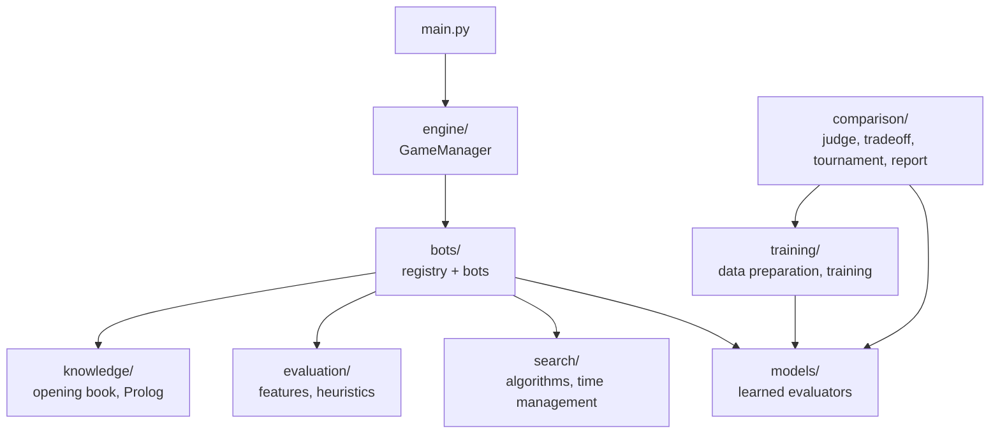
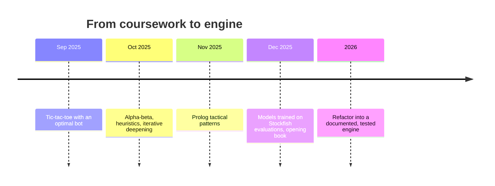

# Chess AI Engine

A chess engine in Python built around adversarial search: minimax, alpha-beta pruning and an advanced
iterative-deepening search, with hand-crafted, machine-learned and Prolog-assisted evaluation, plus a
game manager, tournaments and an extension framework for new bots and evaluation models.

[](../../actions/workflows/ci.yml)


## Table of contents

- [Overview](#overview)
- [Features](#features)
- [Architecture](#architecture)
- [Installation](#installation)
- [Usage](#usage)
- [Search algorithms](#search-algorithms)
- [Evaluation models](#evaluation-models)
- [Extending the engine](#extending-the-engine)
- [Testing](#testing)
- [Project history](#project-history)
- [Roadmap](#roadmap)
- [Authors](#authors)
- [Acknowledgements](#acknowledgements)
- [License](#license)

## Overview

The project combines three ways of deciding which position is better, on top of the same search:

* **Search**: alpha-beta with a transposition table, killer moves, MVV-LVA ordering and a clock-aware
  iterative deepening.
* **Evaluation**: weighted hand-crafted features, or models trained to imitate Stockfish (scikit-learn,
  Keras).
* **Knowledge**: an opening book and a Prolog knowledge base that recognizes pins, forks and skewers to
  order moves.

Everything plugs together through small interfaces, so a new bot is one file and a new evaluation model is
one class.

## Features

| Bot | Search | Evaluation | Needs |
|---|---|---|---|
| `IterativeHeuristicBot` | iterative deepening, transposition table, killers | weighted features (`h1`–`h4`) | – |
| `IterativeModelBookBot` | opening book, then iterative deepening | learned model | `.[ml]` |
| `HumanPlayer` | – | you, at the console | – |

## Architecture



See [docs/ARCHITECTURE.md](docs/ARCHITECTURE.md) for class diagrams and the life of a move.

```
.github/workflows/  continuous integration (ruff, pytest)
data/               opening book (versioned) and downloaded datasets (ignored by git)
docs/               guides, diagrams and the training records (docs/training/)
scripts/
  data/             Lichess download and conversion, sidecars, Stockfish labelling
  bench/            search benchmark, depth profile, tournament, representation bake-off
  docs/             pattern diagrams
  run_all.sh        the whole training and comparison flow
src/chess_engine/   the package: bots, comparison, config, engine, evaluation, knowledge,
                    models, search, training
tests/              pytest suite
main.py             command-line interface
pyproject.toml      packaging, dependencies and tool configuration
```

## Installation

Python 3.11 or newer.

```bash
git clone https://github.com/JoaquinDeVA/chess-ai-engine.git
cd chess-ai-engine
python -m venv .venv && source .venv/bin/activate
pip install -e ".[dev]"              # core engine and tests
pip install -e ".[ml,prolog,data]"   # optional: learned models, Prolog patterns, dataset tools
```

Optional system packages: SWI-Prolog for the tactical-pattern detector (`apt install swi-prolog`) and Stockfish for
`scripts/data/label_with_stockfish.py` (`apt install stockfish`).

## Usage

```bash
python main.py --list-bots

# you (White) against a bot, moves typed in UCI notation such as e2e4
python main.py --player1 human --player2 IterativeHeuristicBot

# bot against bot, choosing the model of the ML bot and the search depth
python main.py --player1 IterativeModelBookBot --model cnn_resnet --player2 IterativeHeuristicBot --depth 3

# from a given position (full FEN) and exporting the game
python main.py --player1 IterativeHeuristicBot --player2 IterativeHeuristicBot \
  --position "6k1/5ppp/8/8/8/8/8/R3K3 w - - 0 1" --export game.pgn

# round-robin tournament between all bots (results and PGN files are written)
python main.py --mode tournament
```

`--model` and `--depth` are only applied to the bots that accept them. Time controls are set in
`src/chess_engine/config/settings.py`.

## Search algorithms

| Algorithm | Idea |
|---|---|
| Minimax / alpha-beta | textbook algorithms, kept for reference and testing |
| Heuristic alpha-beta | stops at a depth and evaluates with a heuristic |
| Advanced alpha-beta | transposition table with bound flags, killer moves, move ordering, faster wins preferred |
| Iterative deepening | deepens while the time budget allows and keeps the last *completed* iteration |

Details, flowcharts and the conventions used by the cut-off test are in
[docs/SEARCH_ALGORITHMS.md](docs/SEARCH_ALGORITHMS.md); the Prolog pattern detector is described in
[docs/TACTICAL_PATTERNS.md](docs/TACTICAL_PATTERNS.md).

## Evaluation models

Models estimate the evaluation of a position (expected score for White, as Stockfish would see it)
and the search uses it as its evaluation function. Three linear models are trained from the raw
Lichess evaluations at an effort level 0-100: `material_linear` (material counts), `pst_tapered`
(piece-square tables) and `pst_terms` (piece-square tables plus classical terms). Four older models
(`ridge_features`, `mlp_features`, `cnn_light`, `cnn_resnet`) are only measured for accuracy.

The comparison has three parts: [MODELS_HISTORY.md](docs/training/MODELS_HISTORY.md) (accuracy and
cost against Stockfish), `TRADEOFF.md` (search depth against search accuracy at a fixed time per
move) and `TOURNAMENT.md` (round-robin at equal time per move, the verdict).

```bash
python scripts/data/fetch_lichess_raw.py --input data/lichess/lichess_db_eval.jsonl.zst  # raw shards
python scripts/data/prepare_dataset.py                                                    # sidecars
python -m chess_engine.training.train    --model pst_tapered --effort 40
python -m chess_engine.comparison.evaluate --model pst_tapered
python scripts/bench/profile_tradeoff.py --players pst_tapered,h2,h3 --seconds 1,3,10
python scripts/bench/run_tournament.py --players material_linear,pst_tapered,pst_terms,h2,h3 --hours 10
```

`EFFORT=40 bash scripts/run_all.sh` runs the whole flow; [TRAINING_TASKS.md](docs/training/TRAINING_TASKS.md)
is the checklist and [ADDING_A_MODEL.md](docs/ADDING_A_MODEL.md) explains how to add a model.

## Extending the engine

* **A bot**: one file in `src/chess_engine/bots/` implementing `evaluate()` →
  [docs/ADDING_A_BOT.md](docs/ADDING_A_BOT.md).
* **An evaluation model**: a registered `EvaluationModel` →
  [docs/ADDING_A_MODEL.md](docs/ADDING_A_MODEL.md).
* **Another game**: implement `GameState` and `GameProblem`; the algorithms do not know about chess.

## Testing

```bash
pytest                       # whole suite (tests needing SWI-Prolog or Stockfish skip if absent)
pytest -m "not slow"         # skips the tests marked slow (tournament pools, bake-off fixture, linear fit)
ruff check . && ruff format --check .
```

The suite covers the search algorithms (with hand-made game trees), every bot, the registry and CLI,
the model layer, the training and comparison pipelines, the dataset scripts and the links and
commands quoted in the documentation (`tests/test_docs.py`).

## Project history



## Roadmap

See [ROADMAP.md](docs/ROADMAP.md): quiescence search, a redesign of the evaluation models (conversion of
evaluations, larger datasets, speed), endgame tablebases and a UCI front end.

## Authors

* Joaquín De Vicente Abad

## Acknowledgements

* The base framework (game manager, bot interface, registry, abstract game classes) and the initial test
  suite come from the *Inteligencia Artificial e Ingeniería del Conocimiento* course (CEU San Pablo
  University); the abstract game classes derive from the [AIMA](https://github.com/aimacode/aima-python)
  code (MIT). The search algorithms, bots, models and tooling in this repository are original work.
* [python-chess](https://python-chess.readthedocs.io), [Stockfish](https://stockfishchess.org),
  [SWI-Prolog](https://www.swi-prolog.org) with [PySwip](https://github.com/yuce/pyswip), and the public
  [Lichess evaluation database](https://database.lichess.org) (CC0).
* Alpha-beta image by Jez9999 on Wikimedia Commons (CC BY-SA 3.0).

## License

[MIT](LICENSE)
