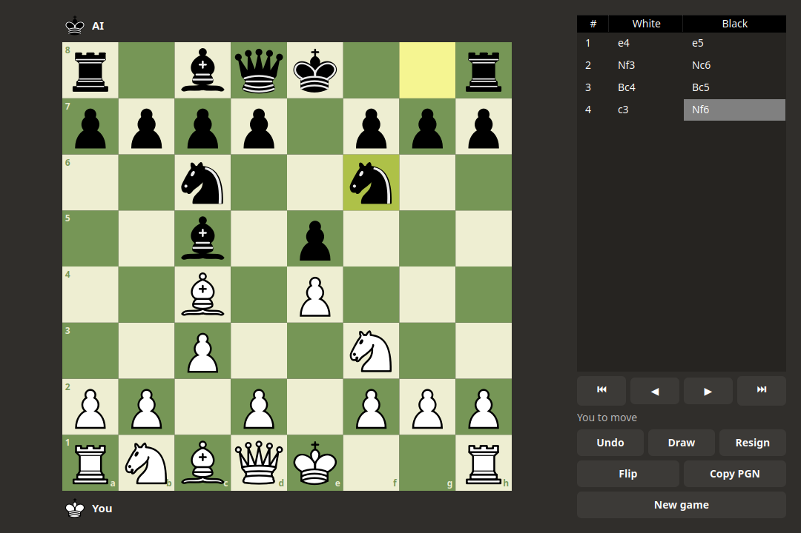
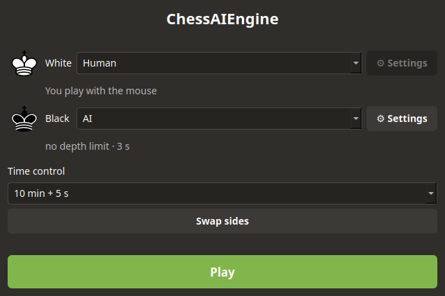
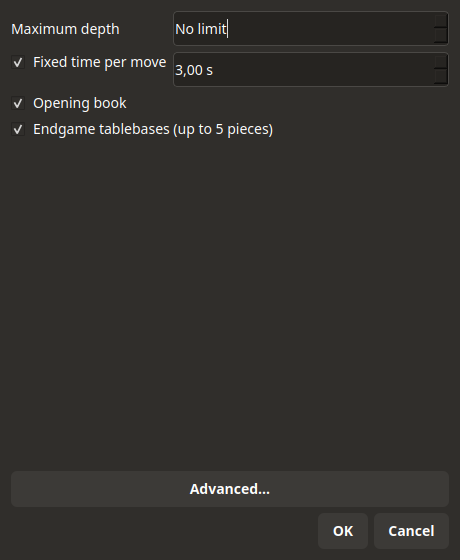
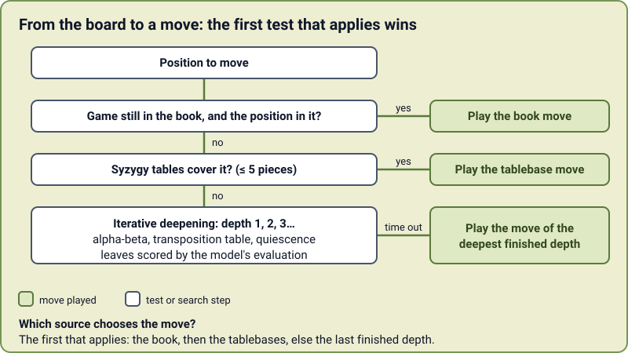

<h1 align="center">Chess AI Engine</h1>

<p align="center">A Rust alpha-beta chess engine with a small neural network (NNUE) that learned to imitate Stockfish.<br>
Play it in a window, plug it into any UCI interface, or rerun every measurement.</p>

<p align="center">
  <a href="https://github.com/JoaquinDeVA/chess-ai-engine/actions/workflows/ci.yml"></a>
  
  
  
</p>

<p align="center"></p>

The engine asks an evaluation function how good each position is. That function is a network of 768 inputs, one
hidden layer and one output, trained on the [Lichess evaluation database](https://database.lichess.org)
(Stockfish evaluations, CC0). A Python window plays against it, and a Python laboratory holds the rest of the
experiment: the data pipeline, the training and the matches that decide what stays.

## What it found

Every figure has its command or file in [Results](docs/RESULTS.md).

| Finding | Figure | Source |
|---|---|---|
| Moving the search to Rust made it faster | 2.58x in `uci bench` on one build (304 k to 784 k nodes per second; later speed-ups are in the changelog) | [Changelog](CHANGELOG.md) |
| Four techniques each won an SPRT against the search without them | null move +97, static exchange evaluation +64, table move first +57, incremental accumulator +35 Elo | [Round robin](docs/RESULTS.md#round-robin-rust-engine-fastchess) |
| The network beat the logistic model that played before it | +165.1 ± 32.9 Elo, 504 games | [Results](docs/RESULTS.md#measured-and-estimated) |
| More accurate is not stronger | Networks with the classical chess terms as inputs have a higher Spearman but lose by 105.5 ± 25.5 Elo | [Results](docs/RESULTS.md#measured-and-estimated) |
| Five search techniques reached no verdict and were retired | `pvs`, `aspiration`, `history`, `history_malus`, `qs_tt` | [Results](docs/RESULTS.md#the-short-answer) |

The engine that plays is the Rust UCI binary with the **Piece-square network, width 64** (`net_pst_w64`) and seven
search techniques on by default. The one measurement still open is that `net_pst_w64` has no match against its
predecessor: see [Results](docs/RESULTS.md#the-short-answer).

## Quick start

Python 3.11 or newer and a Rust toolchain ([`rustup`](https://rustup.rs)); `pip` compiles the Rust core
(a minute or two the first time).

```bash
git clone https://github.com/JoaquinDeVA/chess-ai-engine.git
cd chess-ai-engine
python -m venv .venv && source .venv/bin/activate
pip install -e ".[dev,gui]"
cargo build --release --manifest-path rust/Cargo.toml --bin uci
```

Check the engine answers UCI:

```bash
printf 'uci\nisready\nposition startpos\ngo movetime 1000\n' | rust/target/release/uci
```

It lists its options and plays a move; the depth, nodes and move depend on the machine:

```text
id name chess_core
option name Hash type spin default 64 min 1 max 65536
option name Threads type spin default 1 min 1 max 64
option name Book type string default
option name Tablebase type string default
option name Model type string default net_pst_w64
option name Techniques type string default incremental,tt_move,null_move,see,lmr,rfp,iir
uciok
readyok
info depth 8 nodes 1070725 time 1000
bestmove d2d4
```

Any UCI interface (fastchess, Cute Chess) can play the binary. `pip install -e ".[ml,data]"` adds Keras and the
data tools for training.

## Play a game

```bash
python main.py
```

<table>
  <tr>
    <td width="50%"></td>
    <td width="50%"></td>
  </tr>
  <tr>
    <td>Choose who plays each colour (human or AI) and the time control.</td>
    <td>The <b>Settings</b> button of every AI sets its depth, time per move, opening book and endgame tablebases.</td>
  </tr>
</table>

The window plays the opening book and the endgame tablebases itself and asks the UCI binary for every other move.
The captures come from `python -m chess_lab.screenshots`, which draws the window offscreen.

## The path of one move

<picture>
  <source media="(prefers-color-scheme: dark)" srcset="docs/img/path-of-a-move-dark.svg">
  
</picture>

The book answers while the game follows it; with five pieces or fewer the tablebases answer; otherwise the search
deepens one ply at a time (alpha-beta with a transposition table, quiescence and the network) and plays the move
of the deepest depth that finished when the time runs out.

## Where the data comes from

- **Positions and labels.** The Lichess evaluation database, one line per position with Stockfish's evaluation.
  The project reads its first 126,000,000 lines, drops the illegal positions and keeps 124,923,027 rows
  (`src/chess_lab/datasets/build_raw_shards.py`, Parquet shards under `data/`, ignored by git).
- **Opening book.** Built from the same database by `src/chess_lab/datasets/build_opening_book.py`.
- **Endgame tablebases.** Syzygy tables up to five pieces, read by `shakmaty-syzygy`.
- **Measurements.** Engine matches with [fastchess](https://github.com/Disservin/fastchess) and the SPRT test,
  described in [How a change is measured](docs/MEASUREMENT.md).

## Glossary

<details>
<summary>Terms used in this page and in the results</summary>

- **UCI**: the text protocol chess GUIs use to talk to an engine.
- **NNUE**: a small network whose first layer is updated incrementally as pieces move, so it is cheap to evaluate.
- **Alpha-beta**: minimax search that skips lines that cannot change the result.
- **Quiescence**: a short search of captures at the end of the main one, so the evaluation is not taken mid-exchange.
- **Transposition table**: a cache of positions already searched, shared by every move order that reaches them.
- **SPRT**: a match that stops as soon as the score proves a change better or not worse, instead of at a fixed number of games.
- **Elo / LLR**: the strength difference measured, and the log-likelihood ratio that tells the SPRT when to stop.
- **Spearman**: how well the order a model gives to positions matches Stockfish's order.

</details>

## Commands

| To | Run |
|---|---|
| Play | `python main.py` |
| Use the engine from a GUI | `rust/target/release/uci` |
| See every step of the pipeline without running it | `DRY_RUN=1 bash src/chess_lab/pipeline.sh` |
| Rebuild the model table of the results | `python -m chess_lab.measure.report` |
| Refresh the window captures | `QT_QPA_PLATFORM=offscreen python -m chess_lab.screenshots` |
| Test | `pytest -m "not slow"` |
| Lint | `ruff check . && ruff format --check .` |
| Test the Rust core | `cargo test --manifest-path rust/Cargo.toml` |

The history of changes is the [changelog](CHANGELOG.md).

## Repository map

```text
rust/           the core: rules, search, evaluations, opening book and endgame tables (Rust)
src/chess_engine/
  uci.py        the UCI client the window plays through
  gui/          the window: board, game page, player selection and AI settings
src/chess_lab/  the laboratory (not needed to play)
  models/       the learned evaluators, their cards and the export to the binary
  datasets/     the Lichess shards, their sidecars, the split and the opening book
  training/     fitting the networks and the training command
  measure/      judge, model evaluation, the results table and the round robin of SPRTs
  pipeline.sh   every stage, from training to the results table
docs/           RESULTS.md, MEASUREMENT.md and the images
tests/          the test suite
```

## Credits

Joaquín De Vicente Abad. The base framework (game loop, bot interface) and the first test suite come from the
course *Inteligencia Artificial e Ingeniería del Conocimiento* (Universidad CEU San Pablo). The search, the UCI
engine, the models and the tools are original work. The project uses
[python-chess](https://python-chess.readthedocs.io), [shakmaty](https://github.com/niklasf/shakmaty) and
[shakmaty-syzygy](https://github.com/niklasf/shakmaty-syzygy) (Rust), [PyO3](https://pyo3.rs),
[Stockfish](https://stockfishchess.org), the [Lichess evaluation database](https://database.lichess.org) (CC0) and
[fastchess](https://github.com/Disservin/fastchess). The pieces of the window are the cburnett set.

## License

[MIT](LICENSE)
