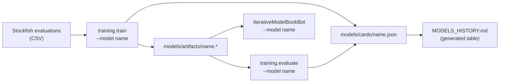

# Adding an evaluation model

> **Status:** the *interface* described here is stable. The internals behind it (how centipawns are
> turned into search values, the training targets, the architectures, the benchmark protocol) are
> deliberately provisional and will be redesigned in their own pass; see [ROADMAP.md](../ROADMAP.md).

An evaluation model answers one question: *how good is this position for White, in centipawns,
as Stockfish would see it?* The search then uses that number as its evaluation function.



## The contract

| Piece | Where | What it is |
|---|---|---|
| Feature extractor | `models/features.py` | turns a `chess.Board` into the arrays the model consumes |
| Model class | `models/*.py` | `EvaluationModel`: `predict_cp(board)`, batch prediction, `fit`, `save`, `load` |
| Registration | `@register_model("name")` | makes it available to the CLIs and the bots by name |
| Config | `training/configs/<name>.toml` | hyper-parameters for training |
| Card | `models/cards/<name>.json` | everything known about the model; written by the commands |

`models/sklearn_model.py` and `models/keras_model.py` already implement the plumbing for scikit-learn
estimators and Keras networks; a new model is usually a small subclass that chooses the extractor
and builds the estimator or network. `models/linear_baseline.py` is the smallest complete example.

## Workflow

```bash
python -m training.train    --model <name> --data data/evaluations.csv
python -m training.evaluate --model <name> --data data/evaluations.csv --strength
python scripts/plot_models.py
python main.py --player1 IterativeModelBookBot --model <name> --player2 IterativeHeuristicBot --depth 2
```

Both commands work on **one** model at a time; `scripts/run_all.sh` loops over all of them.
Retraining a model overwrites its card: there is one entry per approach, not one per run.

## What the benchmark reports

Error against Stockfish in centipawns, how often model and Stockfish agree on who is better, the
time needed per evaluation, and (optionally) results of a short match against reference bots. The exact
definitions live in `training/metrics.py` and are part of what the redesign will revisit.
