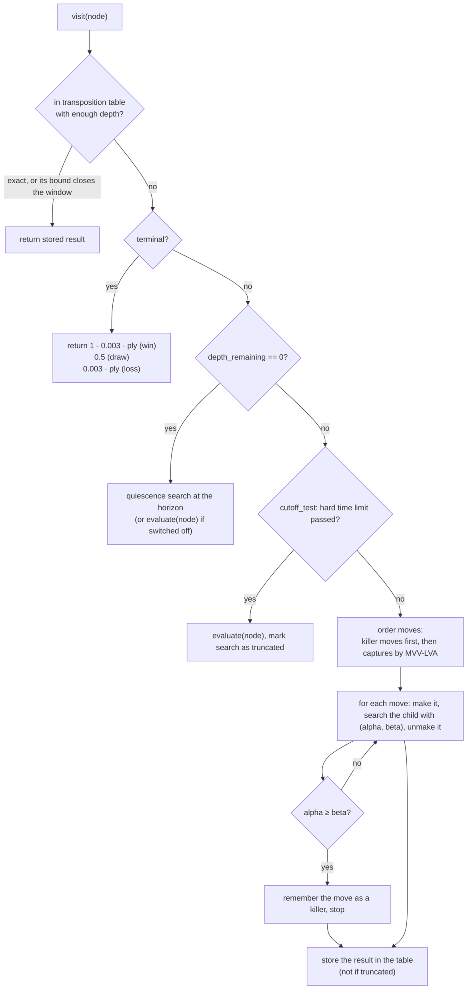
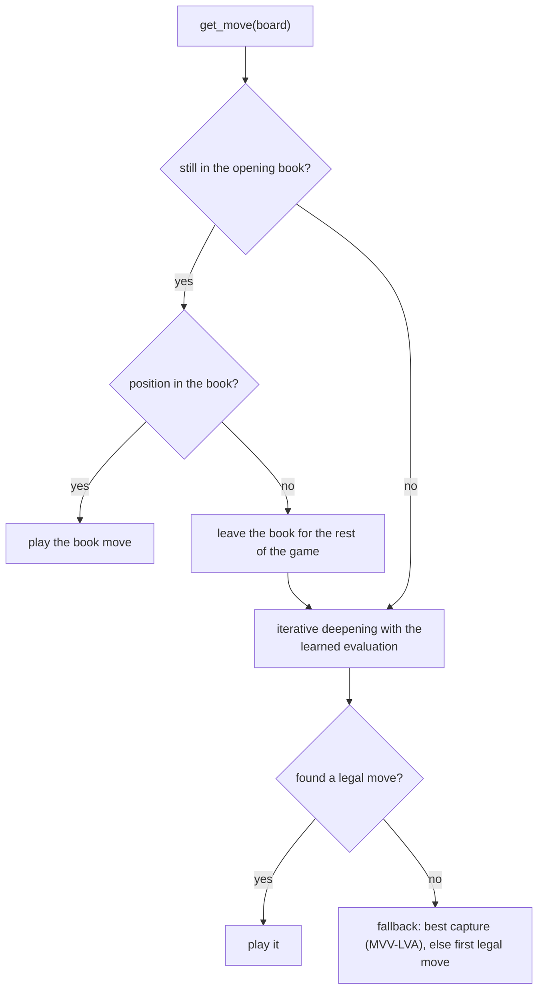

# Search algorithms

> **What it is:** How the engine chooses a move: one main algorithm (alpha-beta search) and, one section each, the nine modifications made on it.
>
> **Read it when:** You want to know why the engine thinks the way it does, what each technique costs or saves, or where it lives in the code.
>
> **Next:** [Data and training](DATA_AND_TRAINING.md)

A chess engine tries moves, imagines the replies, and picks the move leading to the best position it
can force. With about 30 moves per position the lines explode, so everything below is about looking at
fewer or better positions within the clock. After the main algorithm, each modification gets a section
with five parts. Code: `src/chess_engine/search/`, `src/chess_engine/bots/`; evaluations: [MODELS.md](MODELS.md).

## The main algorithm: alpha-beta search

**Minimax.** The engine's side (MAX) picks the child with the highest value, the opponent (MIN) the
lowest; leaf scores bubble up to the root.

**Alpha-beta pruning.** While exploring, the search keeps a window `(alpha, beta)`: `alpha` is the
best value MAX is already sure to get elsewhere, `beta` the best value MIN is already sure to
concede. When `alpha >= beta` the rest of a node's children cannot change the decision, so they are
skipped (a cut-off). The result is exactly the minimax result with fewer nodes.

*Alpha-beta pruning: branches that cannot change the decision are cut. Image by Jez9999, CC BY-SA 3.0,
via Wikimedia Commons.*

**Heuristic evaluation and a depth cut-off.** Games are too deep to search to the end, so the search
stops at a fixed depth and asks an evaluation function for a number. This is
`heuristic_alphabeta_search` in `src/chess_engine/search/game_algorithms.py` (`max_value` / `min_value`,
`cutoff_test`, `eval_fn`; it returns `(best_move, SearchStatistics)`). The engine plays with its
extended sibling, `advanced_heuristic_alphabeta_search`, to which every modification below was added.

**Values.** Every value is the expected score for the player the search runs for: `1` win, `0.5` draw,
`0` loss. Evaluations (heuristics and learned models) are clipped to `0.01 .. 0.99`, so an estimate never
outranks a real result; terminal positions use exact `1`, `0.5`, `0`.

How the advanced search visits one node (`visit`, `max_value`, `min_value`):

The measured tables below come from `python scripts/bench/compare_search_features.py`: a fixed sample
of test positions searched with each technique switched off, one at a time, with `linear_material`
as evaluation. Its report files are local (not versioned), so the numbers are copied here.

## 1. Preference for faster wins

**Problem.** A forced mate in 2 and a forced mate in 9 are both worth `1`, so the engine can see a
win and keep postponing it. The same happens in reverse for losses.

**What it does.** A terminal value is nudged by `0.003` per ply from the root: a quicker win is worth
slightly more than a slower one, a slower loss more than a quicker one. Draws are untouched.

**How it is implemented.** `DEPTH_PREFERENCE_EPSILON = 0.003` and `_terminal_utility` in
`src/chess_engine/search/game_algorithms.py`: `utility - ply * epsilon` for a win, `utility + ply *
epsilon` for a loss, with `ply` computed from `depth_remaining`. The quiescence search uses it too.

**Measured effect.** Not measured in this repository.

**Status.** Kept; since the first commit (2026-10-16, imported from the coursework version).

## 2. Iterative deepening with a clock

**Problem.** A game is played against a clock, not against a depth. A fixed depth wastes time in easy
positions and flags in sharp ones, and a search interrupted at a random moment has no answer.

**What it does.** The engine searches depth 1, 2, 3... and keeps the move of the deepest *finished*
iteration. The cheap shallow iterations also fill the transposition table and killer moves that
speed up the deeper ones (sections 3 and 4). The clock logic:

* **Soft budget** (`TimeManager.turn_budget`): 15 % of the time left, between 1.5 s and 40 s and never
  more than half the clock (10 minutes left: the 40 s cap).
* **Time estimate.** From the fourth iteration on, a rule predicts the duration of the next
  iteration from the finished ones (`src/chess_engine/search/time_estimators.py`; the default is
  `geometric_growth`: the last duration times the geometric mean of the growth between iterations,
  kept between 2 and 8). If the prediction is more than 15 % over the remaining budget, the next
  depth is not started.
* **Hard limit** (`TimeManager.hard_limit`): `1.5 × budget − 0.3 s` (59.7 s for a 40 s budget). The
  running iteration is then interrupted, flagged as truncated and *discarded*, unless it is the very
  first (some move is always needed).
* **Minimum depth 3** (`min_depth`, `DEFAULT_MIN_DEPTH`): iterations 1 to 3 are always completed.
  Only the hard limit can interrupt them. This is the fix described next.

**The defect and its cause.** In the per-move logs of a 10 min + 5 s tournament (partial, 1,051
moves of three models), 126 moves (12.0 %) finished below depth 3, every one of them in under 2 s
although the budget was 35-40 s. The original rule predicted the next iteration as
`last² / previous`, the square of the last duration over the one before. With a transposition table
warmed by the previous moves the depth-1 iteration can last microseconds, so the ratio of the second
iteration to the first reaches thousands (42,166 at most in the recorded games) and its square
predicts hours: the search stopped at depth 2. Replaying recorded iteration times (below), the
original rule ends 15 of 85 moves under depth 3 with a 40 s budget (19 with 10 s), and every bounded
rule ends none. An earlier replay with a cold table, or with a table warmed by a deeper search of the
same position, did not reproduce it; the recorded series, taken from consecutive moves of a game, did.

**The estimators compared.** `python scripts/bench/record_iteration_times.py` replays the
positions of finished games with the stopping rules disabled and records the duration of every
iteration (85 moves of three games, two of `linear_material` and one of `net4_pst`);
`python scripts/bench/compare_time_estimators.py` replays the loop on those series with each rule.
With a 40 s budget (the cap used with 10 minutes on the clock):

| rule | mean depth | budget used | stopped though the next iteration fitted | iteration cut by the hard limit | move over budget +15 % |
|---|---|---|---|---|---|
| `ratio_squared` (original) | 4.55 | 61 % | 21 % | 9 % | 11 % |
| `geometric_growth` (default) | 4.72 | 68 % | 8 % | 8 % | 13 % |
| `clamped_growth` | 4.72 | 79 % | 9 % | 16 % | 14 % |
| `node_growth` | 4.73 | 76 % | 7 % | 14 % | 13 % |
| `fixed_factor` (×4) | 4.80 | 85 % | 1 % | 16 % | 14 % |

With a 10 s budget the original rule reaches 3.96 and `geometric_growth` 4.00, with 14 % against 8 %
of premature stops. All the bounded rules are about 0.2 plies deeper than the original at 20 and 40 s;
the differences among them are within the noise of 85 moves. `geometric_growth` was chosen because
it uses the whole history, has the lowest overrun at 10 s (2 %) and the fewest wasted
iterations at 40 s. The replay assumes each iteration lasts what it lasted in the recording; the
change was not tested in games, where a difference of 0.2 plies (a few Elo) is far below what a
hundred games can resolve.

**How it is implemented.** `heuristic_alphabeta_iterative_deepening_search` in
`src/chess_engine/search/game_algorithms.py` (loop, `overshoot_factor = 1.15`, discard of truncated
iterations; `completed_depth` in `SearchStatistics`). `TimeManager` in
`src/chess_engine/search/time_management.py` holds the numbers; `IterativeDeepeningBot.search` and
`cutoff_test` in `src/chess_engine/bots/_search_bots.py` connect them. `elapsed` runs from the start
of the move, not of each iteration.

**Measured effect.** Before the fix, 12.0 % of the moves of the partial tournament above finished
below depth 3 (126 of 1,051). With the floor of three iterations, 0 of the 2,900 moves of the first 34
games at 10 min + 5 s did; at 1 min + 1 s, 0 to 0.1 % for the learned models and 5.7 % for `h1`, the
slowest evaluation, whose depth-3 iteration is sometimes cut by the hard limit when the clock is low
(`python scripts/bench/depth_in_game_logs.py data/tournament/reference`). The tournaments in this repository were played with the original
estimator and the floor; the estimator above was chosen afterwards and was not replayed in games. The logs are local files.

**Status.** Iterative deepening and `TimeManager`: kept, since the first commit (2026-10-16).
Minimum depth 3: kept as a guard, since 2026-10-21 (commit `0cdf404`). Estimator `geometric_growth`: default since 2026-10-21 (commit `d3e848c`); the original rule stays available as `ratio_squared`.

## 3. Transposition table

**Problem.** The same position can be reached through different move orders, and iterative deepening
repeats the positions of the previous iteration. A plain search analyses them again every time.

**What it does.** Each searched position is stored with its value, best move, depth and a flag
(`EXACT`, `LOWERBOUND`, `UPPERBOUND`) computed against the `(alpha, beta)` window the node was entered
with, since a cut-off value is only a bound. If the position returns with no more depth remaining than
stored, an exact entry is returned at once and a bound tightens the window (returning if it closes it).

**How it is implemented.** `TTEntry`, `probe_transposition_table` and `store_transposition_entry`
in `src/chess_engine/search/search_utils.py`, called from `visit` and `finish` in
`advanced_heuristic_alphabeta_search`. A `dict` keyed by `ChessGameState.key()`, capped at 500,000
entries (`DEFAULT_MAX_TT_ENTRIES`), oldest dropped first; nothing is stored once the clock has
truncated a search. It is shared by the iterations of a move and by the moves of a game, and cleared in
`on_game_start` (values are from the point of view of the colour played). Quiescence does not use it.

**Measured effect.** `python scripts/bench/compare_search_features.py --player linear_material
--positions 60 --depth 4` (60 positions; the table is empty at the start of every position):

| variant | nodes/move | s/move | same as baseline | Stockfish |
|---|---|---|---|---|
| baseline | 15,988 | 1.365 | 1.000 | 0.317 |
| no transposition table | 17,184 | 1.474 | 1.000 | 0.317 |

At depth 4 the table saves 7.0 % of the nodes (17,184 → 15,988) and 7.4 % of the time, and changes
no move. At depth 6 the sample says the opposite (`--positions 20 --depth 6 --variants
"no transposition table,no killer moves"`):

| variant | nodes/move | s/move | same as baseline | Stockfish |
|---|---|---|---|---|
| baseline | 224,896 | 16.562 | 1.000 | 0.450 |
| no transposition table | 185,089 | 14.619 | 0.950 | 0.400 |

On those 20 positions the baseline visited *more* nodes (+21.5 %) and took more time (+13.3 %)
than the search without the table. The sample is small and the repository does not explain this
result; do not read it as a general rule.

**Status.** Kept; since the first commit (2026-10-16); size cap and no-store-after-truncation since `1ee37d6`.

## 4. Killer moves

**Problem.** Alpha-beta prunes best when the best move is tried first, and a good move in one branch
is often good in a sibling branch.

**What it does.** A move that causes a cut-off is remembered as a "killer" for its depth and tried
before the other moves in later nodes at that depth.

**How it is implemented.** `record_killer_move` and `reorder_by_killer_moves` in
`src/chess_engine/search/search_utils.py`, called from `ordered_actions` and from `max_value` /
`min_value` in `advanced_heuristic_alphabeta_search`. Up to three killers are kept per depth
(`MAX_KILLERS_PER_DEPTH`), shared across iterations and moves, cleared at the start of each game.

**Measured effect.** Depth 4, 60 positions: without killers 18,303 nodes per move against 15,988
(killers save 12.6 % of the nodes and 7.9 % of the time, 1.482 s against 1.365 s; `same as
baseline` 0.983). At depth 6 on 20 positions the baseline visited 224,896 nodes per move and the
search without killers 175,520 (baseline +28.1 % nodes; 16.562 s against 13.408 s): killers did *not*
reduce the nodes there. Same caveat as in section 3: small sample, no explanation here.

**Status.** Kept; since the first commit (2026-10-16).

## 5. Move ordering by MVV-LVA

**Problem.** The order in which moves are tried decides how much alpha-beta can skip, and python-chess
lists them in arbitrary order.

**What it does.** Captures go first, best Most Valuable Victim / Least Valuable Attacker first (a pawn
taking a queen before a queen taking a pawn; en passant counts as a pawn capture). Quiet moves keep
their order, so killers stay in front of them.

**How it is implemented.** `mvv_lva_score` and `order_by_mvv_lva` in
`src/chess_engine/search/search_utils.py` (score `10 × victim − attacker`), passed to the search as
`order_moves_callback` by `IterativeDeepeningBot.order_moves` in `src/chess_engine/bots/_search_bots.py`.
The same function picks the fallback move when a search returns nothing.

**Measured effect.** Depth 4, 60 positions: without ordering 64,003 nodes per move instead of 15,988
(ordering saves 75.0 % of the nodes) and 5.408 s instead of 1.365 s (74.8 % less time); 11.7 % of the
moves differ (`same as baseline` 0.883) and Stockfish agreement drops from 0.317 to 0.283. By far the
most effective technique measured. With table, killers, ordering and quiescence all off: 47,445 nodes
(fewer than without ordering alone, because switching quiescence off removes many nodes itself).

**Status.** Kept; since the first commit (2026-10-16).

## 6. Quiescence search

**Problem.** A fixed-depth search ends in the middle of an exchange: it sees "queen takes pawn", misses
the recapture and scores a free pawn (the horizon effect).

**What it does.** At depth 0 the position is not scored directly. The side to move may keep the static
evaluation ("stand-pat": nobody is forced to capture) or follow a *noisy* move (capture or promotion)
for a few more plies, with alpha-beta pruning, and the best option is returned.

**How it is implemented.** The inner function `quiescence` of `advanced_heuristic_alphabeta_search`
in `src/chess_engine/search/game_algorithms.py`, called from `visit` at `depth_remaining <= 0`, and
`chess_noisy_moves` in `src/chess_engine/search/chess_problem.py` (legal captures and promotions). It
uses neither the table nor killers; its nodes count in `nodes_visited`. The bots
(`IterativeDeepeningBot`) use `DEFAULT_QUIESCENCE_PLIES = 4`; `quiescence_plies=0` switches it off, which
is also the default of the search function itself.

**Measured effect.**

TODO-QUIESCENCE-NUMBERS

Cost, from the depth 4 table (60 positions): with quiescence the search visits 15,988 nodes per
move, without it 6,224. Removing it therefore cuts the nodes by about 61 % (and the time per move
from 1.365 s to 0.407 s), but it changes 33 % of the moves (`same as baseline` 0.667), and the
agreement with Stockfish goes from 0.317 to 0.283.

**Status.** Kept and on by default in the search bots; added on 2026-10-17 (commit `40571a4`).

## 7. Make/unmake on one state, with fast transposition keys

**Problem.** The first version copied the whole game state at every node and built the position key
from a FEN string, which costs time at every node.

**What it does.** The search plays a move in place on one `ChessGameState`, searches the child and
takes the move back; the state keeps an undo stack (history, cached outcome). The transposition key
is a tuple (python-chess board key, halfmove clock, fullmove number) that identifies the same
positions as the FEN without building the string.

**How it is implemented.** `ChessGameState.apply_move`, `undo_move` and `key` in
`src/chess_engine/search/chess_game_state.py`; the `node.apply_move(action)` / `try ... finally:
node.undo_move()` pairs in `max_value`, `min_value` and `quiescence` of
`advanced_heuristic_alphabeta_search`. `make_move` and `copy` remain for code that wants a new or
independent state.

**Measured effect.** Commit `ea86b20` reports, on the fixed benchmark at depth 3, identical moves and
node counts and a total time from 10.8 s to 3.7 s (2.9 times faster), *together with* the change of
section 8. Reproduce with `python scripts/bench/bench_search_speed.py` (times depend on the machine).

**Status.** Kept; since 2026-10-16 (commit `ea86b20`).

## 8. Fast terminal detection with the same draw rules

**Problem.** "Is the game over here?" is asked at every node, and python-chess's
`board.outcome(claim_draw=True)` replays the game to claim a threefold repetition.

**What it does.** Same answer as `board.outcome(claim_draw=True)`, but the repetition is read from the
keys of the positions since the last irreversible move, which the state extends in constant time per
move; the result is cached per state.

**How it is implemented.** `ChessGameState.is_over`, `_compute_outcome`,
`_can_claim_threefold_repetition` and `_build_history` in
`src/chess_engine/search/chess_game_state.py`. Tests: `tests/test_terminal_detection.py`.

**Measured effect.** Commit `ba3d5cb` reports, at depth 3 on the fixed benchmark, the same moves and
nodes as the baseline and a search 1.89 times faster (same command as in section 7; the 10.8 s to
3.7 s there is the combined effect of both changes).

**Status.** Kept; since 2026-10-16 (commit `ba3d5cb`).

## 9. Endgame tablebases

**Problem.** A search with a static evaluation plays simple endgames badly. King and queen against
king is a win that takes about ten moves of method; at a depth of four or five plies the horizon
is nowhere near the mate, so the evaluation wanders and the 50-move rule can arrive first.
With five pieces or fewer the exact answer for every position is known and can be stored.

**What it does.** When the position has at most five pieces (kings included) and no castling
rights, the bot does not search: it plays the move given by Syzygy tablebases. The tables say, for
every position, whether the side to move wins, draws or loses and how many moves are left before the
next capture or pawn move (the distance to zeroing, DTZ). The bot keeps the best result and then
mates at once if it can; among winning moves it takes the one with the smallest DTZ, and when it is
losing it takes the one with the largest, to resist longest.

**How it is implemented.** `EndgameTablebase` in `src/chess_engine/knowledge/endgame_tablebase.py`
(`covers`, `best_move` and the move ranking), on top of `chess.syzygy` from python-chess. The 3-4-5
piece tables (290 files, 939 MB) live in `data/knowledge/endgame`; they are not versioned.
`IterativeDeepeningBot` takes a `tablebase` argument and consults it at the root of `get_move`,
recording `stop_reason = "tablebase"` in the search statistics; `python main.py --endgame-db`
turns it on. It is off by default, so that tournaments compare evaluations and search, not tables.

**Measured effect.** TODO-ENDGAME-NUMBERS

**Status.** Kept as an option; since 2026-10-21 (commit `2fc0f86`). It is used only at the root:
the search never probes the tables inside the tree, and positions with six or more pieces are
searched as usual.

## Tried and removed: tactical move ordering with Prolog

The repository once had a `TacticalAlphaBetaBot` that asked a Prolog knowledge base which legal moves
create a tactical pattern (forks, pins, skewers) and searched those first, hoping for earlier
cut-offs. Commit `62c2904` measured about 2 ms per node (every node loaded its position into Prolog),
several seconds per move at depth 3 against about one second without it, and sometimes more nodes.
Commit `ca35218` (2026-10-18) removed it because no bot or script used it. In one sentence: the idea
was never shown to pay for its cost, and it was dropped rather than disproved.

## Around the search

**The opening book.** `IterativeModelBookBot` (`src/chess_engine/bots/iterative_model_book_bot.py`) plays
book moves while the game follows the book, then searches with the learned model. The book
(`OpeningBook`, `src/chess_engine/knowledge/opening_book.py`) is keyed by the first four FEN fields, so
transpositions hit the same entry. Once the game leaves the book it is never consulted again;
`on_game_start` re-enables it and clears the table, killers and statistics.

See also [RESULTS.md](RESULTS.md) and [ARCHITECTURE.md](ARCHITECTURE.md).
