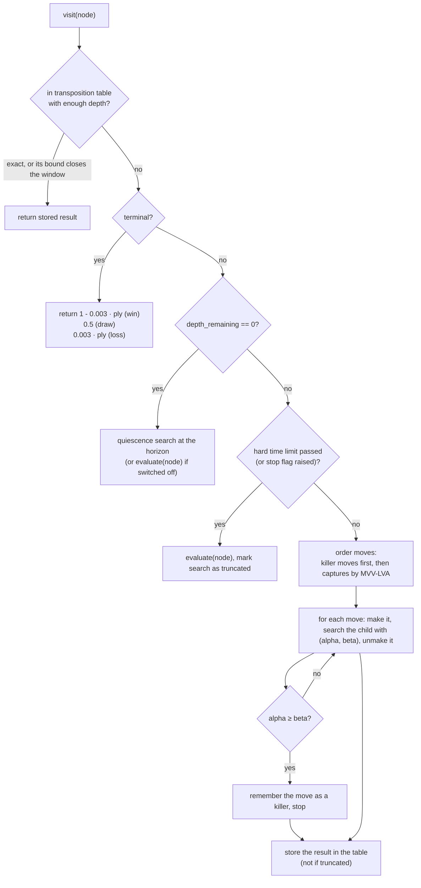

# Search algorithms

> **What it is:** How the engine chooses a move: one main algorithm (alpha-beta search) and the techniques added on it, one section each in the pages linked below.
>
> **Read it when:** You want to know why the engine thinks the way it does, what each technique costs or saves, or where it lives in the code.
>
> **Next:** [Data and training](DATA_AND_TRAINING.md)

A chess engine tries moves, imagines the replies, and picks the move leading to the best position it
can force. With about 30 moves per position the lines explode, so everything below is about looking at
fewer or better positions within the clock. After the main algorithm, each technique gets a section
with five parts (problem, what it does, how it is implemented, measured effect, status). Code: `rust/src/search/`, `rust/src/board.rs`, `src/chess_engine/bots/`; evaluations: [MODELS.md](MODELS.md).

The search was first written in Python and moved to Rust ([Rust and threads](algorithms/rust-and-threads.md)). The node counts, the pruning
counts and the moves quoted in these pages were measured with the Python engine; the Rust core
reproduces them exactly (the golden files in `tests/golden/` check it on every run), so they hold
for both. Only the time per node changed, and that page gives the speed.

## The main algorithm: alpha-beta search

**Minimax.** The engine's side (MAX) picks the child with the highest value, the opponent (MIN) the
lowest; leaf scores bubble up to the root.

**Alpha-beta pruning.** While exploring, the search keeps a window `(alpha, beta)`: `alpha` is the
best value MAX is already sure to get elsewhere, `beta` the best value MIN is already sure to
concede. When `alpha >= beta` the rest of a node's children cannot change the decision, so they are
skipped (a cut-off). The result is exactly the minimax result with fewer nodes.

*Alpha-beta pruning: branches that cannot change the decision are cut. Image by Jez9999, CC BY-SA 3.0,
via Wikimedia Commons.*

**Heuristic evaluation and a depth cut-off.** Games are too deep to search to the end, so the search
stops at a fixed depth and asks an evaluation function for a number. This is `Search::node` in
`rust/src/search/mod.rs` (one function for MAX and MIN nodes; `alpha_beta` runs it for a depth and
returns the value, the best move and the counters). Every modification below was added to it.

**Values.** Every value is the expected score for the player the search runs for: `1` win, `0.5` draw,
`0` loss. Evaluations (heuristics and learned models) are clipped to `0.01 .. 0.99`, so an estimate never
outranks a real result; terminal positions use exact `1`, `0.5`, `0`.

How the search visits one node (`Search::node`):

The measured tables below come from `python scripts/bench/compare_search_features.py`: a fixed sample
of test positions searched with each technique switched off, one at a time, with `linear_material`
as evaluation. Its report files are local (not versioned), so the numbers are copied here.

## The techniques

Node counts are per move at depth 6 over 100 positions (reference: 672,800); the measurements are in the pages linked.

| Technique | Status and effect | Page |
|---|---|---|
| Preference for faster wins | reference | [search basics](algorithms/search-basics.md#preference-for-faster-wins) |
| Iterative deepening with a clock | reference, on | [search basics](algorithms/search-basics.md#iterative-deepening-with-a-clock) |
| Transposition table | reference, on | [search basics](algorithms/search-basics.md#transposition-table) |
| Killer moves | reference, on | [search basics](algorithms/search-basics.md#killer-moves) |
| MVV-LVA move ordering | reference, on | [search basics](algorithms/search-basics.md#move-ordering-by-mvv-lva) |
| Quiescence search | on (4 plies) | [search basics](algorithms/search-basics.md#quiescence-search) |
| Make/unmake, terminal detection | reference, on | [search basics](algorithms/search-basics.md#makeunmake-on-one-state-with-fast-transposition-keys) |
| Endgame tablebases, opening book | on | [search basics](algorithms/search-basics.md#endgame-tablebases) |
| Search in Rust | since 2026-10-25; 8 to 35 times faster | [Rust and threads](algorithms/rust-and-threads.md#the-search-in-rust) |
| Several threads (Lazy SMP) | option, off (`--threads`) | [Rust and threads](algorithms/rust-and-threads.md#several-threads-lazy-smp) |
| Incremental network accumulator (`incremental`) | on; +15 % nodes/s for `net4_pst` | [selective techniques](algorithms/selective-techniques.md#incremental-network-accumulator) |
| Table move first (`tt_move`) | on; nodes 672,800 to 256,693 | [selective techniques](algorithms/selective-techniques.md#table-move-first-tt_move) |
| History heuristic (`history`) | on; nodes to 391,130 | [selective techniques](algorithms/selective-techniques.md#history-heuristic-history) |
| Principal variation search (`pvs`) | on; nodes to 487,244 | [selective techniques](algorithms/selective-techniques.md#principal-variation-search-pvs) |
| Aspiration windows (`aspiration`) | on; nodes to 440,213 | [selective techniques](algorithms/selective-techniques.md#aspiration-windows-aspiration) |
| Null move (`null_move`) | on; nodes to 446,129; +205 Elo with the set | [selective techniques](algorithms/selective-techniques.md#null-move-null_move) |
| Late move reductions (`lmr`) | implemented, off: lost games | [not adopted](algorithms/not-adopted.md#late-move-reductions-lmr---tried-not-adopted) |
| Tactical ordering with Prolog | removed | [not adopted](algorithms/not-adopted.md#tried-and-removed-tactical-move-ordering-with-prolog) |

See also [RESULTS.md](RESULTS.md) and [ARCHITECTURE.md](ARCHITECTURE.md).
