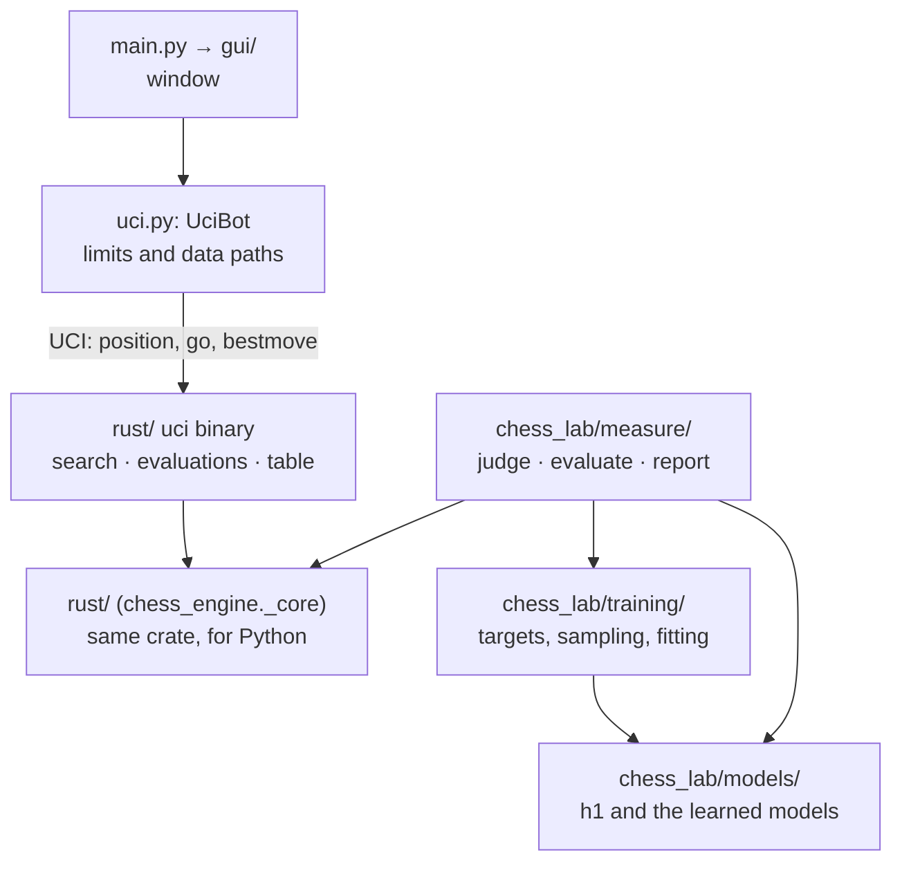
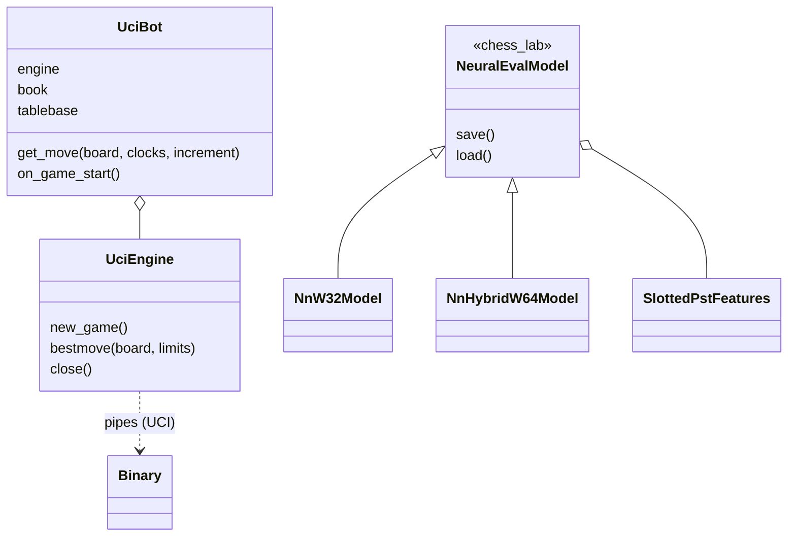
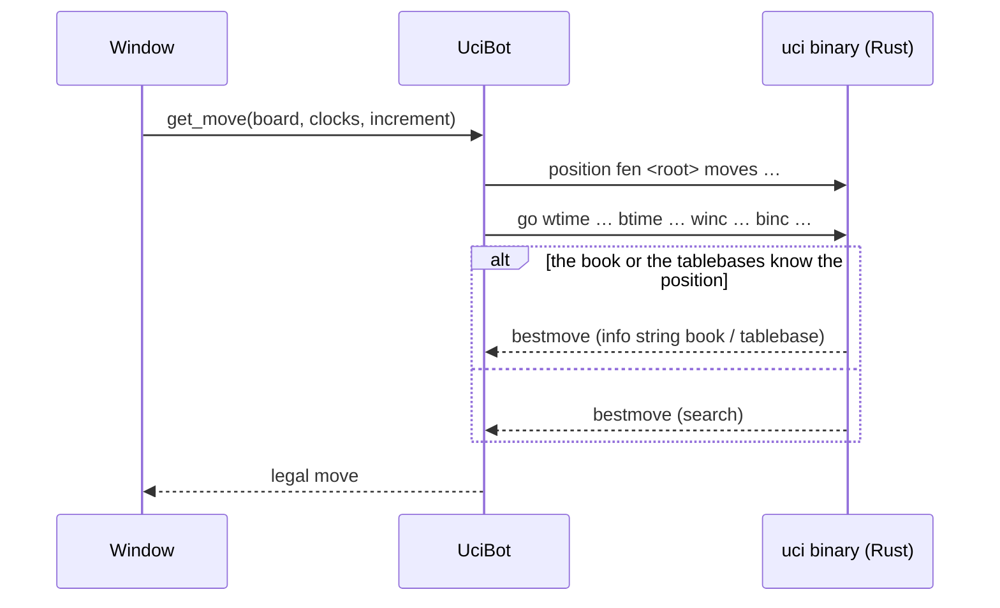

# Architecture

> **What it is:** The packages of the engine, what depends on what, and the path of one move through them.
>
> **Read it when:** You are about to change the code or add a bot or a model.
>
> **Next:** [How the engine chooses a move](SEARCH.md)

The engine has two parts. The part that must be fast, the search, the evaluations it calls and the
opening book and endgame tables, is written in Rust (`rust/`). It is built as two products: the
extension module `chess_engine._core` (for the Python code and the tests) and the UCI binary
`rust/target/release/uci`, which the window plays through. Everything else is Python in two
packages: `src/chess_engine/` is the application (window, UCI client, opening book and tables), and `src/chess_lab/` is the
laboratory that produces and measures it (the models, training and measurements). The laboratory imports the application;
the application never imports the laboratory. The window talks to the UCI binary once per move.

Dependencies, as the imports stand:

- `rust/` imports nothing from Python except the weights it is given (`chess_lab/models/` builds the evaluators).
- `chess_lab/models/` holds everything about a model: its classes, the saved files, the feature extractors, the target representation and fitting. `chess_lab/training/` imports it.
- `chess_engine/uci.py` talks to the UCI binary through pipes and imports nothing from the Rust core.
- `gui/` imports `uci.py`; Qt only in its widgets. Nothing else imports it.
- `chess_lab/measure/` is the top layer: it imports `chess_lab/models/`, `chess_lab/training/` and the Rust core. Nothing else imports it.

## Packages

| Package (`src/chess_engine/` unless noted) | Responsibility |
|---|---|
| `rust/src/board.rs` | The rules for the search: a position with the keys needed for repetitions, the terminal test of `board.outcome(claim_draw=True)`, legal moves in the order python-chess generates them, a key for the transposition table |
| `rust/src/eval/` | The evaluations the search runs without Python: `classic_heuristic.rs` (the heuristic), `sparse_features.rs` (sparse board features), `sparse_net.rs` (the sparse networks and their incremental accumulator) |
| `rust/src/search/` | `node.rs`: alpha-beta and quiescence. `deepening.rs`: iterative deepening, the helper threads and their vote. `options.rs`: `Options`, the `Techniques` switches and the defaults. `memory.rs`: `Memory` (what a game keeps), `Control` (clock and stop switches). `stats.rs`: the counters and the stop reason. `mod.rs` re-exports them. `tt.rs`: transposition table. `ordering.rs`: killer moves, MVV-LVA ordering, static exchange evaluation (SEE). `shared_tt.rs`: the lock-free table of several threads. `iteration_time.rs`: the rules that predict the next iteration |
| `rust/src/knowledge/` | `book.rs`: the opening book. `tablebase.rs`: the Syzygy endgame tables |
| `rust/src/python.rs` | The Python module: `Evaluator` and the search defaults `DEFAULT_TECHNIQUES`, `MAX_DEPTH` the window reads |
| `uci.py` | `UciEngine` (one process of the UCI binary: `position fen … moves …`, `go`, `bestmove`), `UciBot` (the AI player of the window: the opening book and the tablebases first, then the engine; the clock or the fixed time become the `go` limits) |
| `chess_lab/models/` | Everything about a model. `definitions.py`: `NeuralEvalModel` and its subclasses, the table `MODELS` and `load_evaluator`, which turns a saved model (`artifacts/<name>.npz`, or `<name>@<tag>`) into the Rust `Evaluator`. `store/`: what a model leaves on disk: `loader.py` (paths and tagged specs of the saved models in `store/artifacts/`, and `h1` with `h1_weights.json`) and `cards.py` (model cards in `store/cards/`). `features.py`: the sparse feature sets in Python (`FEATURE_SETS`). `target.py`: target scale and point of view. `defaults.py`: the defaults shared by the training and the measurements (sample seed, share of mates kept). `fitting/epochs.py`: encoding of the frames, their cache and the epoch loop with early stopping; `fitting/neural.py`: `new_network_model` and `fit_stream` for the networks (Keras). |
| `chess_lab/training/` | `data/raw_shards.py`: the Lichess evaluation dump as raw Parquet shards, and the detection of its perspective. `data/sidecar.py`: split, quiet flag and seeded samplers over the shards. `data/split.py`: the train, validation and test split. `cache.py`: directory of the encoded batches. `effort.py`: training size per effort level. `train.py`: the training command |
| `chess_lab/measure/` | `judge.py` (accuracy and best-move agreement against Stockfish, with the core's `Evaluator`), `evaluate.py` (judge plus cost of one model in the core), `report.py` (model cards into the models table of `RESULTS.md`) |
| `gui/` | The window (PySide6, optional): `game_model.py` (position, clocks, result; no Qt), `settings.py` (AI settings; no Qt), `board_widget.py`, `game_window.py`, `setup_dialog.py`, `settings_dialog.py`, `app.py`, `theme.py`, `pieces.py` and the piece images in `assets/` |

Data scripts live in `src/chess_lab/scripts/data/` (`build_raw_shards.py`, `build_sidecars.py`,
`build_opening_book.py`, `check_opening_book.py`, `check_split_leakage.py`, `build_openings.py`), and `src/chess_lab/scripts/run_full_pipeline.sh`
runs the data, training and measurement flow. Games between engines are played by fastchess against the UCI binary, not by
Python code in this repository. See [Training data](DATA.md) for the data and
[MODELS.md](MODELS.md) for the models themselves.

## Main classes

`UciBot` decides the move source; `UciEngine` only speaks UCI. The binary has one network, `net_pst_w32`,
compiled in (`rust/models/`; other networks load with `setoption name Model value <file>.json`), and its search options (threads, techniques) are set with `setoption`.

The core identifies a position by `(zobrist hash, halfmove clock, fullmove number)`: it names the
same positions as the FEN without building the string, and it is what the transposition table is
indexed by. The repetition history is rebuilt on every call from the root FEN and the moves played
(`board.root()` and `board.move_stack`).

## One move

How much time a move gets (clock, `depth N`, `movetime`, the increment) is described in one page,
[Iterative deepening with a clock](techniques/iterative-deepening.md). Without a clock or a fixed time the window sends
`movetime 3000`. The search is iterative deepening with a hard limit inside the tree: an interrupted
iteration is discarded unless it is the first one, so there is always a move. The algorithms themselves
are in [How the engine chooses a move](SEARCH.md) and the [catalogue of techniques](techniques/README.md).

The binary takes its options by `setoption`: `Threads`, `Hash`, `Techniques` (a list of names, as in
`_core.TECHNIQUES`), `Model`, `Book` (JSON file of the opening book) and `Tablebase` (folder of the Syzygy tables); the last two are off until they name a path, so the matches and tournaments play without them. `ucinewgame` clears the table between games and makes the engine follow the book again. The clock rules, including
the ignored increment, are in [Iterative deepening with a clock](techniques/iterative-deepening.md).

## Building and testing

The Rust crate is built by `maturin`, which `pip install -e ".[dev]"` runs (it needs a Rust
toolchain, `rustup`). After a change in `rust/` run the same command again, or `maturin develop`,
and then the tests. `cargo test --manifest-path rust/Cargo.toml` runs the Rust tests;
`cargo clippy --all-targets -- -D warnings` and `cargo fmt --check` are checked by CI as well.

The rules of the Rust core are checked by perft and end-of-game tests (`rust/tests/rules.rs`), the book and the
tables by `rust/tests/knowledge.rs`, the techniques by `rust/tests/techniques.rs` and the features against the
Python extractors by `tests/core/test_feature_parity.py`.

## Extension points

| To add... | Implement | Guide |
|---|---|---|
| an evaluation model | a feature set (a `SlottedPstFeatures` subclass in `chess_lab/models/features.py`, plus its Rust version) and a model class in `chess_lab/models/definitions.py` (added to `MODELS`); train and measure it with the commands of [Training](TRAINING.md) and [Results](RESULTS.md) | [Models](MODELS.md) |
| a search technique | a change in `rust/src/search/`, measured and documented like the others | [Search techniques](techniques/README.md#how-to-add-a-technique) |

### Running a model in Rust

The search runs in Rust, so a model plays at full speed only if its features are computed there too.
`chess_lab/models/definitions.py` hands the saved weights of a model to the core by the
**name** of its feature set; the core knows `pst_slotted`, `pst_hybrid`,
`pst_hybrid_k4` and `pst_hybrid_k8`. A model with another feature set is rejected by the core. To give a feature set its Rust version:

1. add a variant to `FeatureSet` in `rust/src/eval/sparse_features.rs`, with its name in `FeatureSet::NAMES`,
   its size in `size` and its `active` function, which must give the same indices and values, in the
   same order, as the Python `active` (the training encodes with the Python one, so a difference
   means training on one thing and playing with another);
2. run `tests/core/test_feature_parity.py`, which compares the two on 300 positions for every registered
   feature family;
3. rebuild with `pip install -e .` and run `cargo test --manifest-path rust/Cargo.toml`.

The search is written for chess (it uses `shakmaty` for the rules); another game would need
its own core.
