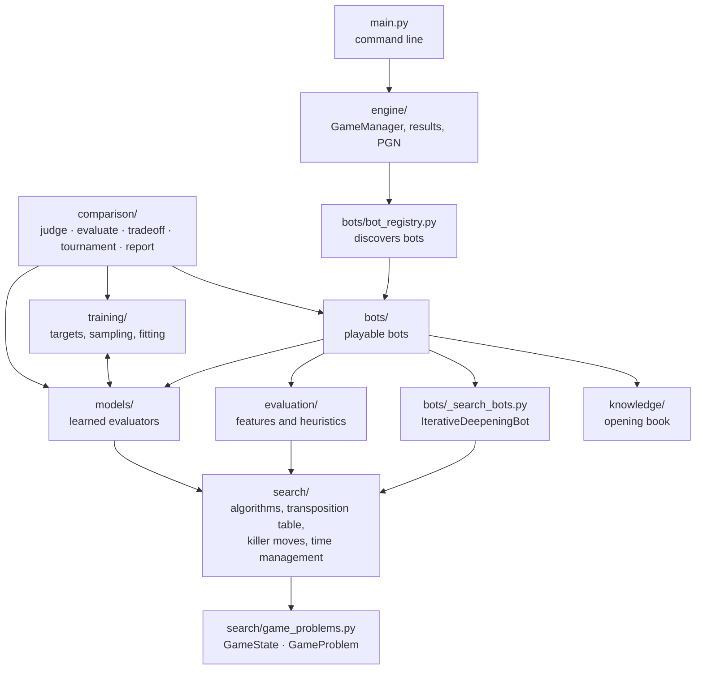
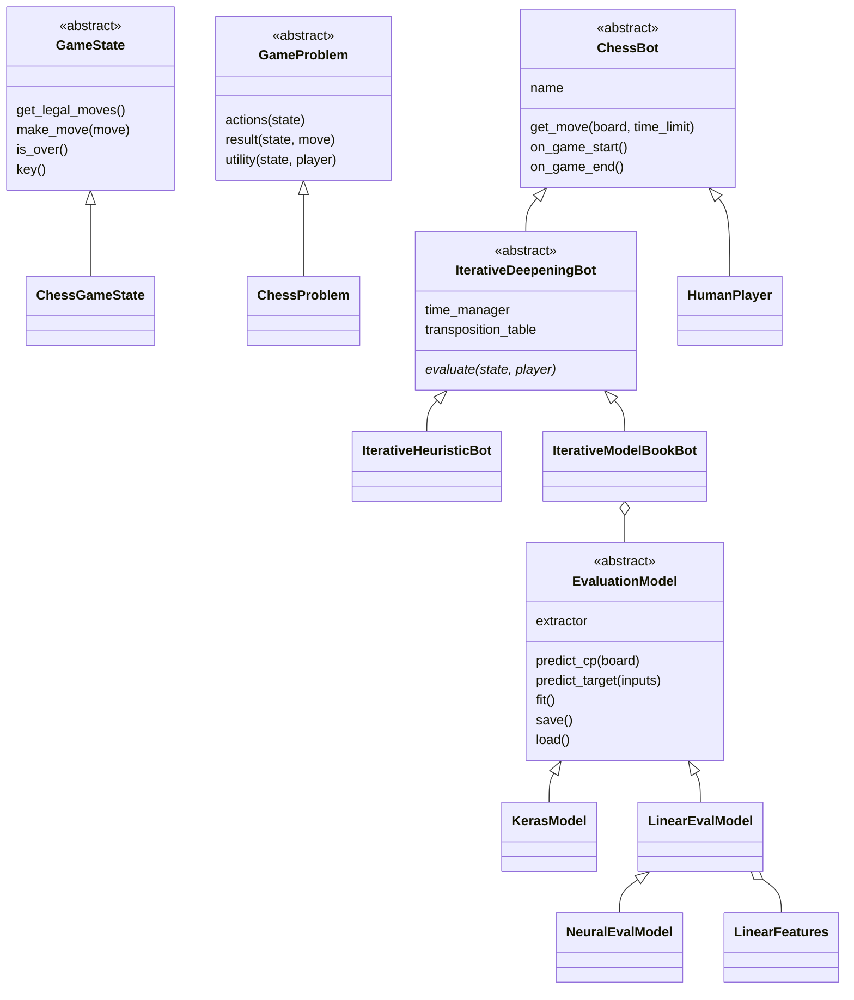
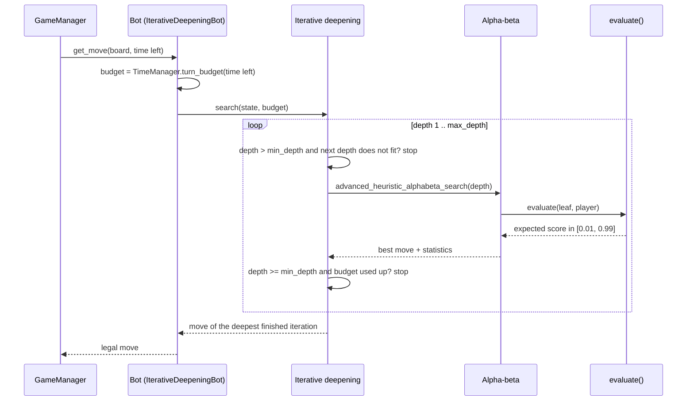

# Architecture

> **What it is:** The packages of the engine, what depends on what, and the path of one move through them.
>
> **Read it when:** You are about to change the code or add a bot or a model.
>
> **Next:** [Algorithms](ALGORITHMS.md)

All packages live in `src/chess_engine/`. The search is written against two small abstract
interfaces and knows nothing about chess; bots plug an evaluation function into it; models and
the comparison tools sit beside the bots.



Dependencies, as the imports stand:

- `search/` imports nothing else from the package.
- `evaluation/` imports `search/` (heuristics receive a `ChessGameState`).
- `models/` imports `search/` (only `evaluator.py`) and, for the target representation, `training/`.
- `training/` imports `models/` (the base class, the registry, the cards and the model classes it fits). So `models/` and `training/` depend on each other; the only edge from `models/` to `training/` is `training/representation.py`.
- `bots/` imports `search/`, `evaluation/`, `models/` and `knowledge/`.
- `engine/` imports `bots/` and `config/`; `config/` imports the data classes of `engine/`.
- `comparison/` is the top layer: it imports `bots/`, `search/`, `models/`, `training/`, `evaluation/`, `knowledge/` and `engine/`. Nothing else imports it.

## Packages

| Package | Responsibility |
|---|---|
| `search/` | `game_problems.py`: the abstract `GameState` and `GameProblem`. `chess_game_state.py` and `chess_problem.py`: chess on top of python-chess. `game_algorithms.py`: plain heuristic alpha-beta, advanced alpha-beta and iterative deepening. `search_utils.py`: transposition table, killer moves, MVV-LVA ordering. `time_management.py`: per-move time budget |
| `bots/` | `chess_bot.py` (base class), `bot_registry.py` (finds the bots), `_search_bots.py` (`IterativeDeepeningBot`), `iterative_heuristic_bot.py`, `iterative_model_book_bot.py`, `human_player.py` |
| `evaluation/` | `features.py`: hand-crafted features (material, mobility, king safety...). `heuristics.py`: the heuristic `h1` and its fitted weights |
| `models/` | Learned position evaluators behind one interface, `EvaluationModel` (`base.py`), found by name in `registry.py` (which also lists `ACCURACY_RECORDS`, the models that are only measured). Linear family: `linear_features.py` (sparse feature sets) and `linear_eval.py` (`LinearEvalModel` and the registered `linear_*` models). Neural: `neural_eval.py` (`net4_pst`). Course models: `architectures.py` and `keras_model.py` (`mlp_features`, `cnn_resnet`) with the encodings of `features.py`. `evaluator.py` adapts a model to a search; `cards.py` reads and writes the model cards in `models/cards/` |
| `training/` | `lichess.py` and `lichess_raw.py`: the Lichess evaluation dump as raw Parquet shards. `sidecar.py`: split, quiet flag and seeded samplers over the shards. `dataset.py`, `targets.py` and `representation.py`: split, target scale and point of view. `spec.py`: defaults shared everywhere (sample seed, share of mates kept). `effort.py`: training size per effort level. `train.py`: the training command |
| `comparison/` | `judge.py` (accuracy and best-move agreement against Stockfish), `evaluate.py` (judge plus cost of one model), `tradeoff.py` (depth against accuracy at a fixed time per move), `tournament.py` (round-robin at equal time, Elo), `report.py` (model cards into the models table of `RESULTS.md`) |
| `knowledge/` | `opening_book.py`: the opening book |
| `engine/`, `config/` | Game loop with clocks, tournaments, results and PGN export; tournament presets |

Outside the package, `scripts/data/` builds the data (`build_raw_shards.py`, `build_sidecars.py`,
`fit_h1_weights.py`), `scripts/bench/` holds the experiments (`profile_depth_vs_accuracy.py`,
`play_tournament.py`, `compare_quiescence.py`, `compare_search_features.py`,
`compare_target_representations.py`, `bench_search_speed.py`) and `scripts/run_full_pipeline.sh`
runs the whole flow. See [DATA_AND_TRAINING.md](DATA_AND_TRAINING.md) for the data and
[MODELS.md](MODELS.md) for the models themselves.

## Main classes



`ChessGameState` wraps a `chess.Board`. Its `key()` is a hashable tuple, `(transposition key,
halfmove clock, fullmove number)`: it identifies the same positions as the FEN without building the
string, and it is what the transposition table is indexed by. A bot's whole job is to implement
`evaluate()` (and optionally `order_moves()`); the base classes provide the search, the time
budget and the bookkeeping.

## One move



The clock only decides how deep to go after the first `min_depth` iterations: depths 1 to
`min_depth` (default 3, `DEFAULT_MIN_DEPTH` in `search/game_algorithms.py`) are always completed,
whatever the time estimate says. Beyond that, the search stops when the time the next iteration
would take (estimated from the two previous ones) does not fit in the budget. Only the hard limit
(`TimeManager.hard_limit`, checked inside the tree by `cutoff_test`) interrupts an iteration, and
an interrupted iteration is discarded unless it is the first one. If the search returns no legal
move, the bot falls back to the best capture or the first legal move. The algorithms themselves
are in [Algorithms](ALGORITHMS.md).

`IterativeDeepeningBot` takes these options (`bots/_search_bots.py`):

| Option | Default | Meaning |
|---|---|---|
| `max_depth` | 3 | deepest iteration |
| `min_depth` | 3 | iterations always completed |
| `quiescence_plies` | 4 | plies of capture and promotion search at the horizon; 0 turns it off |
| `max_tt_entries` | 500,000 | size cap of the transposition table |
| `time_manager` | `TimeManager()` | per-move time budgeting policy |

The shipped subclasses take their own arguments (`IterativeHeuristicBot`: `eval_function`; `IterativeModelBookBot`:
`model` and `opening_book`) plus `max_depth`, `time_manager` and any other option of
`IterativeDeepeningBot` (`quiescence_plies`, `min_depth`, `estimator`, `max_tt_entries`, `tablebase`,
`opening_book`), which they pass on.

## Adding a bot

A bot is one file in `src/chess_engine/bots/`: subclass `IterativeDeepeningBot` (from
`bots/_search_bots.py`) and implement `evaluate(state, player)`, the expected score of `player` in
`state`, strictly between 0 and 1. `BotRegistry` imports every public module in `bots/` and registers
each `ChessBot` subclass under its class name; modules starting with `_` hold shared code and are
skipped. `get_bot(name, **options)` forwards constructor arguments, which is how `--model` and
`--depth` reach the bots, so the new bot appears in `python main.py --list-bots` and in tournaments.

```python
# src/chess_engine/bots/material_bot.py
import chess

from chess_engine.bots._search_bots import IterativeDeepeningBot
from chess_engine.evaluation.features import extract_material_features


class MaterialBot(IterativeDeepeningBot):
    """Iterative-deepening alpha-beta that only counts material."""

    def __init__(self, max_depth: int = 2):
        super().__init__("MaterialBot", max_depth=max_depth)

    def evaluate(self, state, player):
        white_score = extract_material_features(state.get_board())["material_diff_normalized"]
        score = white_score if player == chess.WHITE else 1.0 - white_score
        return min(0.99, max(0.01, score))
```

Rules: the constructor must work without arguments; override `order_moves(board, moves)` for a
better move order, `on_game_start` to reset per-game state and `get_info()` to describe the bot. Use
`ChessBot` directly only if you do not want a tree search (just `get_move(board, time_limit)`).
Test it like `tests/test_bots.py`: legal moves from several positions, mate in one
(`tests.conftest.MATE_IN_ONE`) and the board left untouched.

## Extension points

| To add... | Implement | Guide |
|---|---|---|
| a bot | `evaluate()` in a subclass of `IterativeDeepeningBot` | the section above |
| an evaluation model | a `LinearFeatures` and a `LinearEvalModel`, or any `EvaluationModel`; register it by name | [ADDING_A_MODEL.md](ADDING_A_MODEL.md) |
| another game | `GameState` and `GameProblem`; the algorithms are game-agnostic | [Algorithms](ALGORITHMS.md) |
