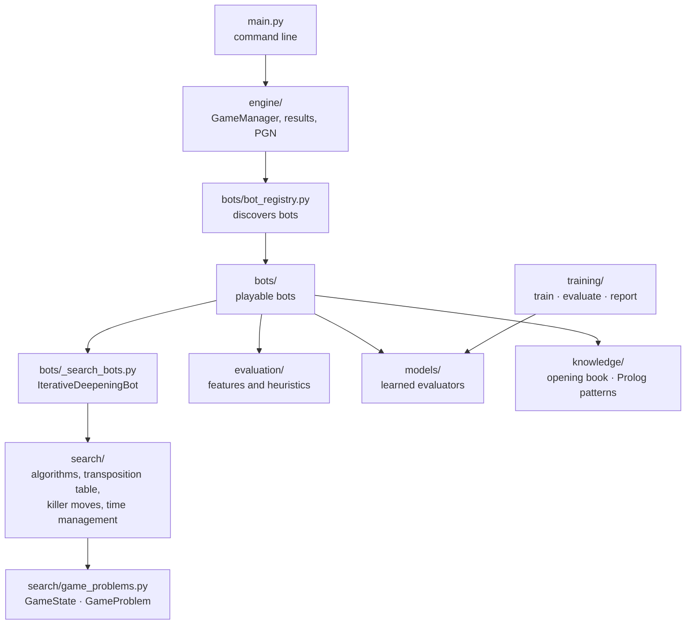
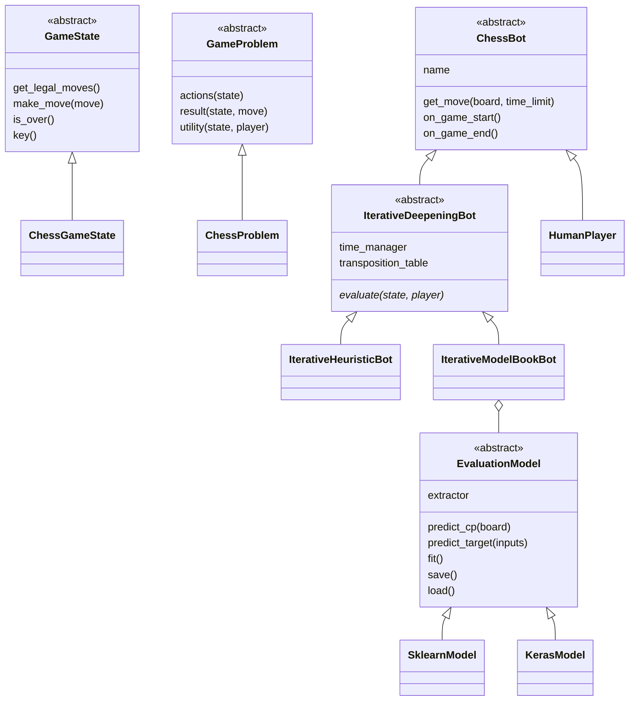
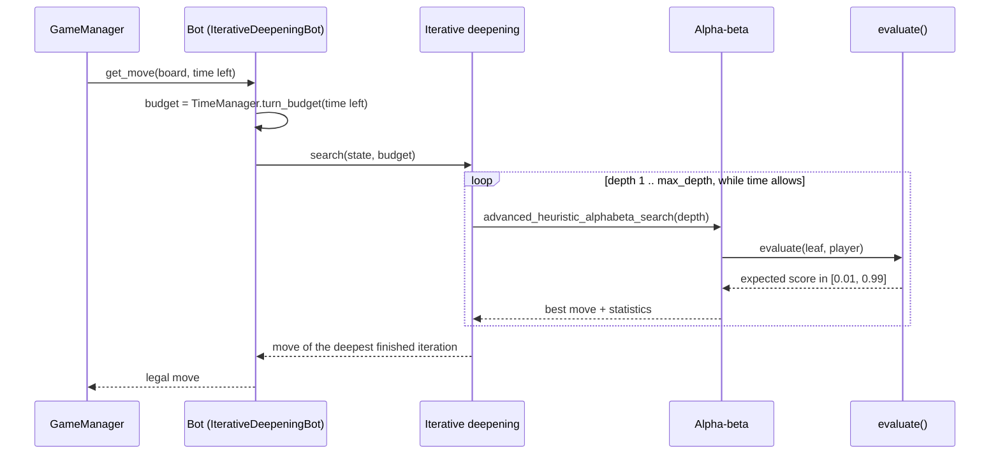

# Architecture

The engine is split in layers; each one only depends on the ones below it. All packages live in
`src/chess_engine/`.

| Package | Responsibility |
|---|---|
| `search/` | Game abstractions (`GameState`, `GameProblem`), the chess implementation on top of python-chess, minimax / alpha-beta / advanced alpha-beta / iterative deepening, search helpers, time management |
| `bots/` | The playable bots and the registry that finds them |
| `evaluation/` | Hand-crafted features (material, mobility, king safety...) and the heuristics `h1`..`h4` |
| `models/` | Learned position evaluators behind one interface (`EvaluationModel`) and a registry |
| `training/` | Commands that train one model and benchmark it against Stockfish |
| `knowledge/` | Opening book (Python) and tactical-pattern knowledge base (Prolog) |
| `engine/` | Game loop with clocks, tournaments, results and PGN export |

## Main classes

`ChessGameState` wraps a `chess.Board` and its `key()` is the FEN, which is what the transposition
table uses. A bot's whole job is to implement `evaluate()` (and optionally `order_moves()`); the
base classes provide the search, the time budget and the bookkeeping.

## One move

## Bot discovery

`BotRegistry` imports every public module in `bots/` and registers each `ChessBot` subclass defined
there under its class name. Modules starting with `_` hold shared base classes and are skipped, so
adding a bot is adding one file (see [ADDING_A_BOT.md](ADDING_A_BOT.md)). `get_bot(name, **options)`
forwards constructor arguments, which is how `--model` and `--depth` reach the bots.

## Extension points

| To add... | Implement | Guide |
|---|---|---|
| a bot | `evaluate()` in a subclass of `IterativeDeepeningBot` | [ADDING_A_BOT.md](ADDING_A_BOT.md) |
| an evaluation model | an `EvaluationModel` and register it | [ADDING_A_MODEL.md](ADDING_A_MODEL.md) |
| another game | `GameState` and `GameProblem`; the algorithms are game-agnostic | [SEARCH_ALGORITHMS.md](SEARCH_ALGORITHMS.md) |
