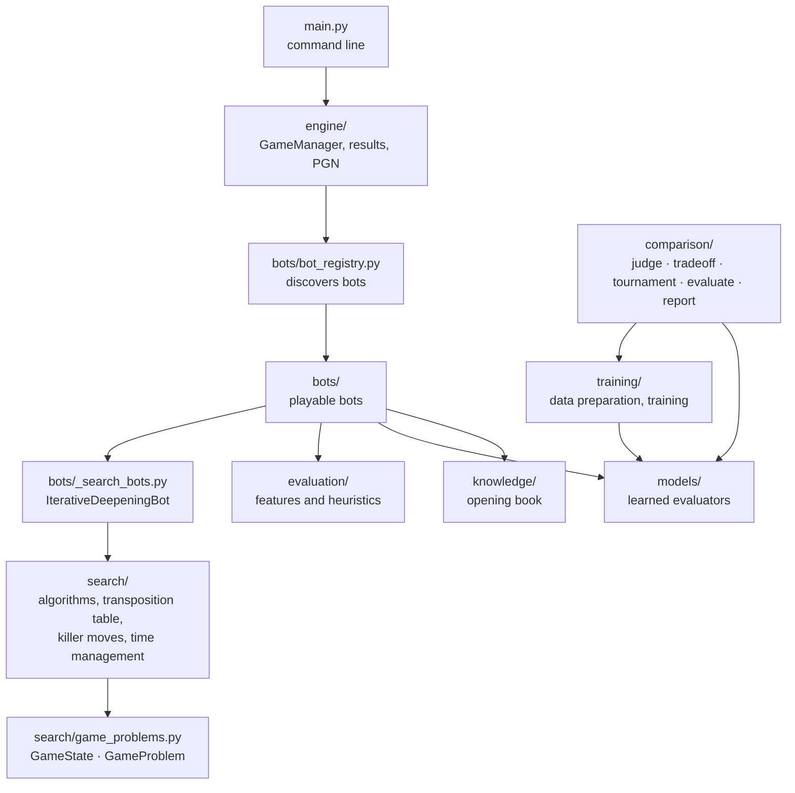
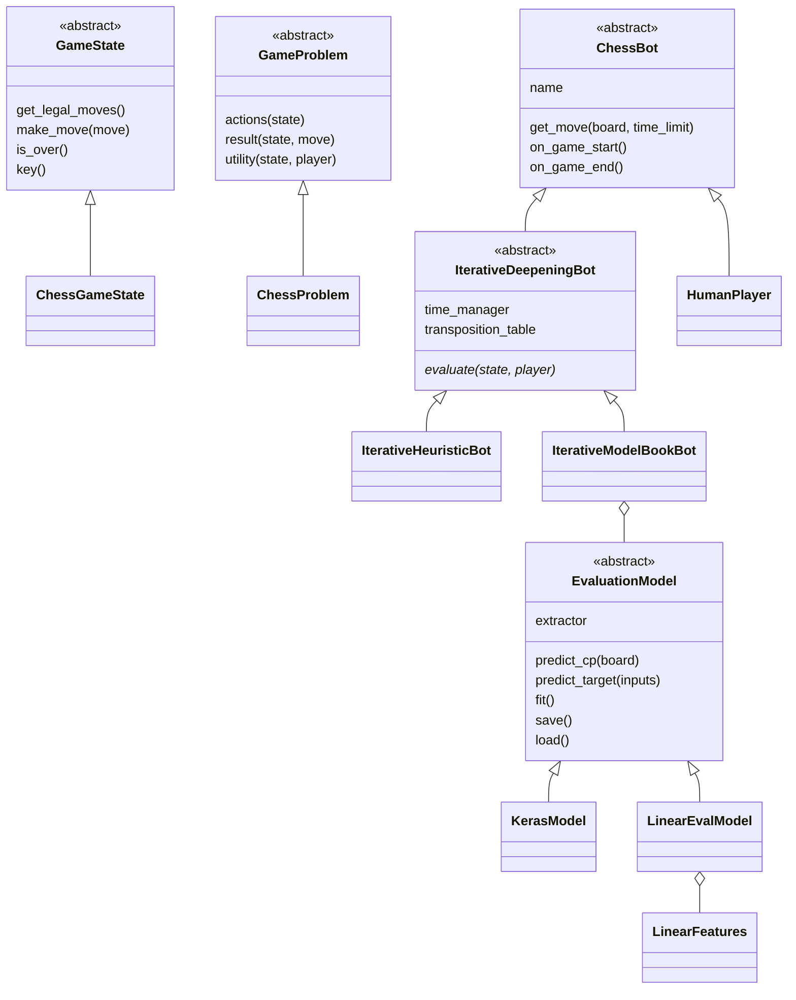
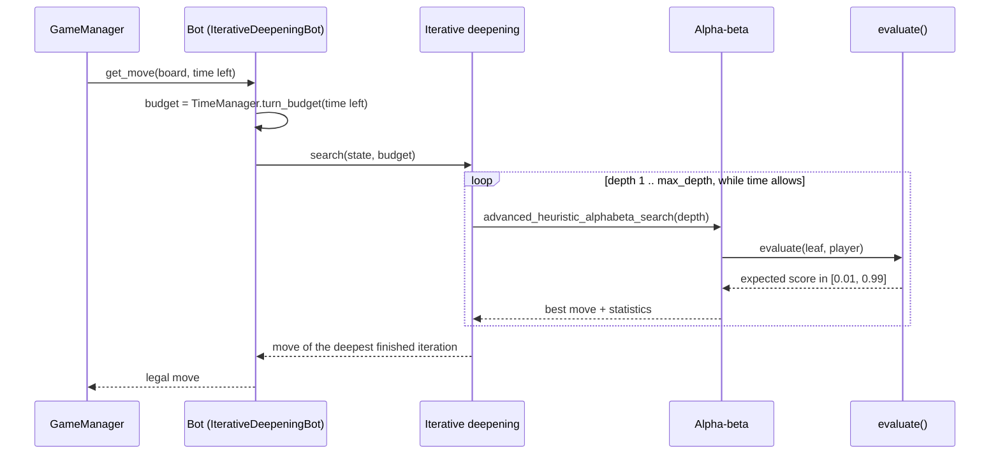

# Architecture

> **Qué es:** Los paquetes del motor, sus dependencias y el recorrido de una jugada.
>
> **Cuándo leerla:** Antes de tocar el código o de añadir un bot o un modelo.
>
> **Siguiente paso:** [Search algorithms](SEARCH_ALGORITHMS.md)

The engine is split in layers; each one only depends on the ones below it. All packages live in
`src/chess_engine/`.



`comparison` may import `training` and `models`; `training` and `models` never import `comparison`.

| Package | Responsibility |
|---|---|
| `search/` | Game abstractions (`GameState`, `GameProblem`), the chess implementation on top of python-chess, minimax / alpha-beta / advanced alpha-beta / iterative deepening, search helpers, time management |
| `bots/` | The playable bots and the registry that finds them |
| `evaluation/` | Hand-crafted features (material, mobility, king safety...) and the heuristic `h1` (pesos ajustados a Stockfish) |
| `models/` | Learned position evaluators behind one interface (`EvaluationModel`) and a registry. `linear_features` (sparse features: `PstFeatures`, `MaterialCountFeatures`, `PstTermsFeatures`) and `linear_eval` (`LinearEvalModel` and the `linear_pst`, `linear_pst_terms`, `linear_king_bucket` and `linear_material` models) hold the linear family; `keras_model` and `architectures` the older one. `cards` reads and writes the model cards in `models/cards/` |
| `training/` | Data preparation and training: `lichess` and `lichess_raw` (conversion of the Lichess dump into raw Parquet shards), `sidecar` (split, quiet flag and seeded sampler over the shards), `dataset` (the split), `targets` and `representation` (target scale and point of view), `effort` (training size per effort level), `stockfish` (labelling), `train` (the training command), `configs/` (TOML configurations of the older models) |
| `comparison/` | Comparison of the trained models: `judge` (accuracy and best-move agreement against Stockfish), `metrics` (centipawn metrics of the CSV era), `evaluate` (judge and cost of a model), `tradeoff` (depth against accuracy at a fixed time per move), `tournament` (round-robin at equal time, Elo), `report` (model cards to the models table in `RESULTS.md`) |
| `knowledge/` | Opening book |
| `engine/` | Game loop with clocks, tournaments, results and PGN export |

## Main classes



`ChessGameState` wraps a `chess.Board` and its `key()` is the FEN, which is what the transposition
table uses. A bot's whole job is to implement `evaluate()` (and optionally `order_moves()`); the
base classes provide the search, the time budget and the bookkeeping.

## One move



## Adding a bot

A bot is one file in `src/chess_engine/bots/`: subclass `IterativeDeepeningBot` (from
`bots/_search_bots.py`) and implement `evaluate(state, player)`, the expected score of `player` in
`state`, strictly between 0 and 1. `BotRegistry` imports every public module in `bots/` and registers
each `ChessBot` subclass under its class name; modules starting with `_` hold shared code and are
skipped. `get_bot(name, **options)` forwards constructor arguments, which is how `--model` and
`--depth` reach the bots, so the new bot appears in `python main.py --list-bots` and in tournaments.

```python
# src/chess_engine/bots/material_bot.py
import chess

from chess_engine.bots._search_bots import IterativeDeepeningBot
from chess_engine.evaluation.features import extract_material_features


class MaterialBot(IterativeDeepeningBot):
    """Iterative-deepening alpha-beta that only counts material."""

    def __init__(self, max_depth: int = 2):
        super().__init__("MaterialBot", max_depth=max_depth)

    def evaluate(self, state, player):
        white_score = extract_material_features(state.get_board())["material_diff_normalized"]
        score = white_score if player == chess.WHITE else 1.0 - white_score
        return min(0.99, max(0.01, score))
```

Rules: the constructor must work without arguments; override `order_moves(board, moves)` for a
better move order, `on_game_start` to reset per-game state and `get_info()` to describe the bot. Use
`ChessBot` directly only if you do not want a tree search (just `get_move(board, time_limit)`).
Test it like `tests/test_bots.py`: legal moves from several positions, mate in one
(`tests.conftest.MATE_IN_ONE`) and the board left untouched.

## Extension points

| To add... | Implement | Guide |
|---|---|---|
| a bot | `evaluate()` in a subclass of `IterativeDeepeningBot` | the section above |
| an evaluation model | a `LinearFeatures` and a `LinearEvalModel`, or any `EvaluationModel`; register it by name | [ADDING_A_MODEL.md](ADDING_A_MODEL.md) |
| another game | `GameState` and `GameProblem`; the algorithms are game-agnostic | [SEARCH_ALGORITHMS.md](SEARCH_ALGORITHMS.md) |
