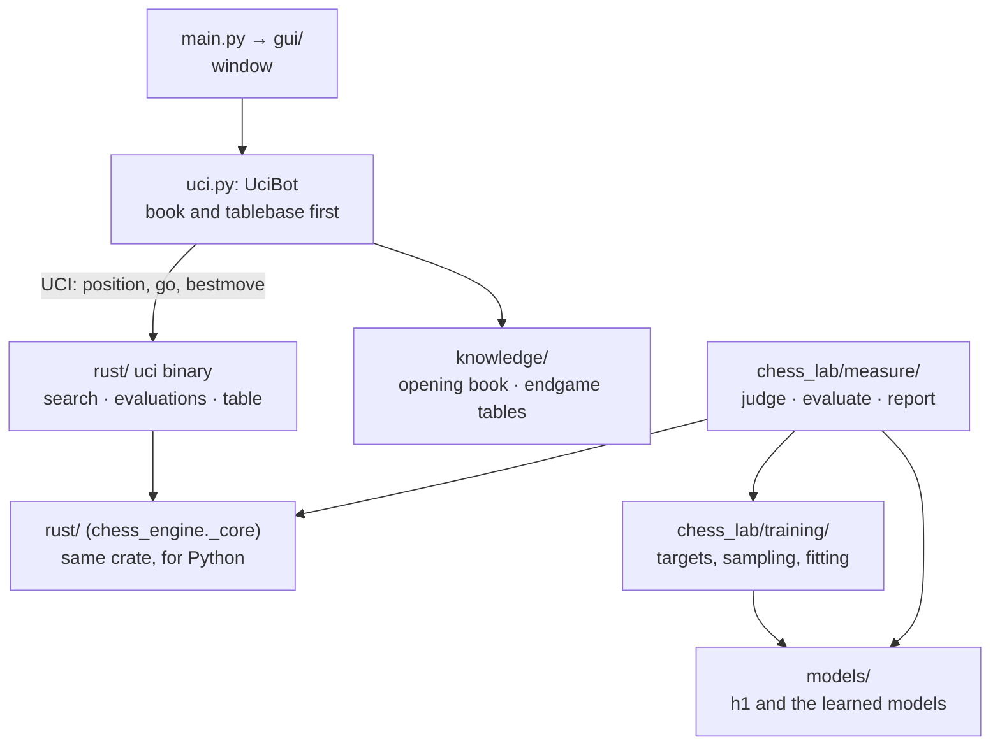
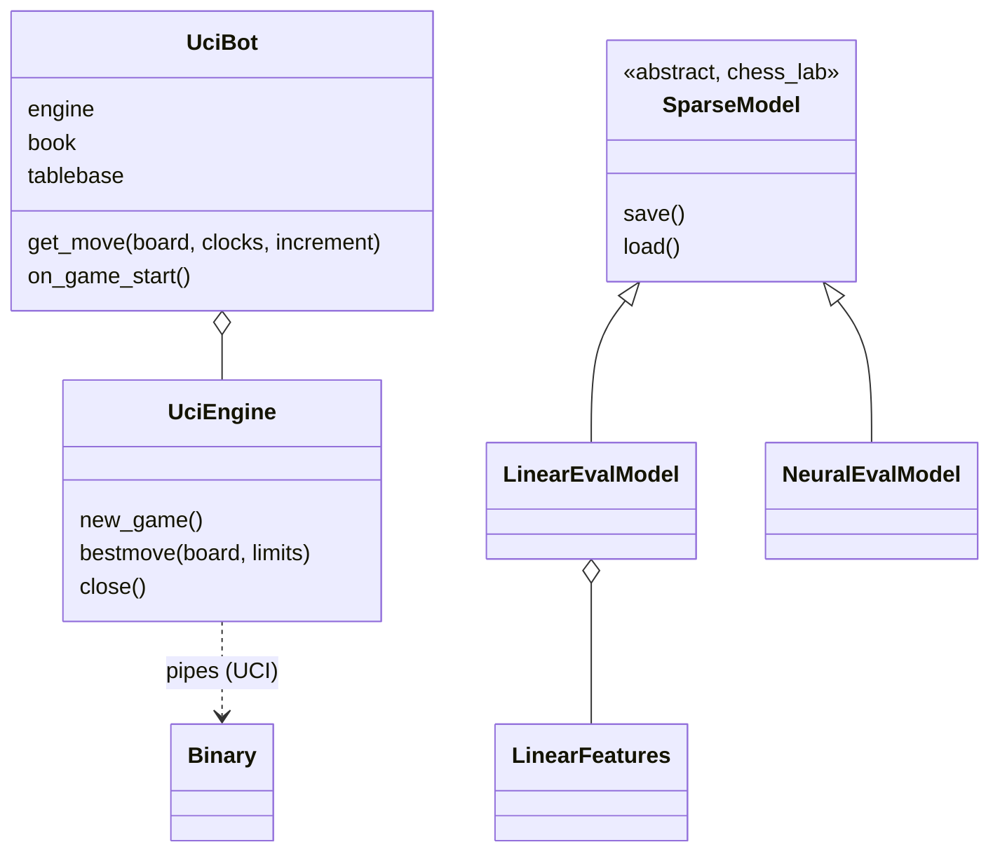
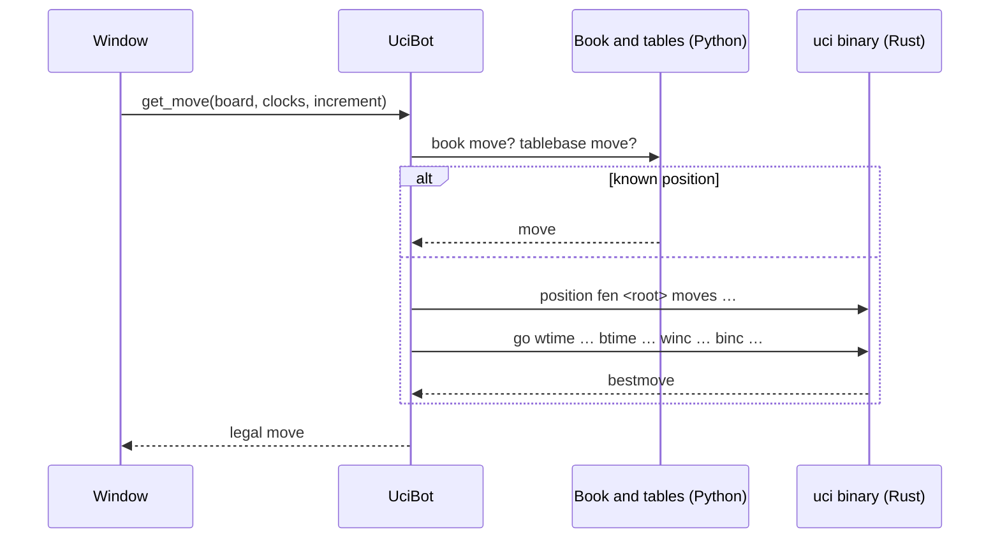

# Architecture

> **What it is:** The packages of the engine, what depends on what, and the path of one move through them.
>
> **Read it when:** You are about to change the code or add a bot or a model.
>
> **Next:** [Algorithms](ALGORITHMS.md)

The engine has two parts. The part that must be fast, the search, the evaluations it calls and the
opening book and endgame tables, is written in Rust (`rust/`). It is built as two products: the
extension module `chess_engine._core` (for the Python code and the tests) and the UCI binary
`rust/target/release/uci`, which the window plays through. Everything else is Python in two
packages: `src/chess_engine/` is the application (window, UCI client, models), and `src/chess_lab/` is the
laboratory that produces and measures it (training and measurements). The laboratory imports the application;
the application never imports the laboratory. The window talks to the UCI binary once per move.

Dependencies, as the imports stand:

- `rust/` imports nothing from Python except the weights it is given (`models/loader.py` builds the evaluators).
- `models/` imports nothing from the rest of the package: it only loads, saves and registers models.
- `chess_lab/models/` imports `models/` (the classes it trains) and holds everything that builds a model: feature extractors, the target representation, fitting and the Python evaluation. `chess_lab/training/` imports both. `models/` imports nothing from `chess_lab`.
- `chess_engine/uci.py` imports `knowledge/`; it talks to the UCI binary through pipes and imports nothing from the Rust core.
- `gui/` imports `uci.py`, `models/` and `knowledge/`; Qt only in its widgets. Nothing else imports it.
- `chess_lab/measure/` is the top layer: it imports `models/`, `chess_lab/training/` and the Rust core. Nothing else imports it.

## Packages

| Package (`src/chess_engine/` unless noted) | Responsibility |
|---|---|
| `rust/src/board.rs` | The rules for the search: a position with the keys needed for repetitions, the terminal test of `board.outcome(claim_draw=True)`, legal moves in the order python-chess generates them, a key for the transposition table |
| `rust/src/eval/` | The evaluations the search runs without Python: `h1.rs` (the heuristic), `features.rs` (sparse board features), `linear.rs` (the logistic models), `net.rs` (the sparse network `net4_pst`) |
| `rust/src/search/` | `node.rs`: alpha-beta and quiescence. `deepening.rs`: iterative deepening, aspiration windows and the helper threads. `options.rs`: `Options`, the `Techniques` switches and the defaults. `memory.rs`: `Memory` (what a game keeps), `Control` (clock and stop switches). `stats.rs`: the counters and the stop reason. `mod.rs` re-exports them. `tt.rs`: transposition table. `ordering.rs`: killer moves, history, MVV-LVA ordering. `shared.rs`: the lock-free table of several threads. `estimators.rs`: the rules that predict the next iteration |
| `rust/src/knowledge/` | `book.rs`: the opening book. `tablebase.rs`: the Syzygy endgame tables |
| `rust/src/py.rs` | The Python module: `Evaluator`, `Searcher`, `Book`, `Tablebase` |
| `uci.py` | `UciEngine` (one process of the UCI binary: `position fen … moves …`, `go`, `bestmove`), `UciBot` (the AI player of the window: the opening book and the tablebases first, then the engine; the clock or the fixed time become the `go` limits) |
| `models/` | `loader.py`: turns a saved model (`artifacts/<name>.npz`, or `<name>@<tag>`) or `h1` (`h1_weights.json`) into the Rust `Evaluator`, which computes the features and the score. The models are defined, trained and saved in the lab: `chess_lab/models/definitions.py` (`SparseModel`, `LinearEvalModel`, `NeuralEvalModel` and the table `MODELS`) and `cards.py` (model cards in `chess_lab/models/cards/`) |
| `chess_lab/models/` | What builds a model. `linear_features.py`: the sparse feature sets in Python (`FEATURE_SETS`). `representation.py`: target scale and point of view. `defaults.py`: the defaults shared by the training and the measurements (sample seed, share of mates kept). `linear_eval.py` and `neural_eval.py`: `new_model` and `fit_stream` for the linear models (Adam) and the network (Keras). `python_eval.py`: `PythonEvaluator`, the evaluation in Python used by the judge, the cost measure and the parity tests |
| `chess_lab/training/` | `lichess_raw.py`: the Lichess evaluation dump as raw Parquet shards, and the detection of its perspective. `sidecar.py`: split, quiet flag and seeded samplers over the shards. `dataset.py`: split and target scale. `effort.py`: training size per effort level. `train.py`: the training command |
| `chess_lab/measure/` | `judge.py` (accuracy and best-move agreement against Stockfish), `evaluate.py` (judge plus cost of one model), `report.py` (model cards into the models table of `RESULTS.md`) |
| `knowledge/` | `opening_book.py` and `endgame_tablebase.py`: the Python faces of the book and the tables, which delegate to the Rust core |
| `gui/` | The window (PySide6, optional): `game_model.py` (position, clocks, result; no Qt), `settings.py` (AI settings; no Qt), `board_widget.py`, `game_window.py`, `setup_dialog.py`, `settings_dialog.py`, `app.py`, `theme.py`, `pieces.py` and the piece images in `assets/` |

Data scripts live in `src/chess_lab/scripts/data/` (`build_raw_shards.py`, `build_sidecars.py`,
`build_opening_book.py`, `check_opening_book.py`, `check_split_leakage.py`), and `src/chess_lab/scripts/run_full_pipeline.sh`
runs the data, training and measurement flow. Games between engines are played by fastchess against the UCI binary, not by
Python code in this repository. See [DATA_AND_TRAINING.md](DATA_AND_TRAINING.md) for the data and
[MODELS.md](MODELS.md) for the models themselves.

## Main classes

`UciBot` decides the move source; `UciEngine` only speaks UCI. The binary has one evaluation, `linear_pst_terms`,
compiled in (`rust/models/`), and its search options (threads, techniques) are set with `setoption`.

The core identifies a position by `(zobrist hash, halfmove clock, fullmove number)`: it names the
same positions as the FEN without building the string, and it is what the transposition table is
indexed by. The repetition history is rebuilt on every call from the root FEN and the moves played
(`board.root()` and `board.move_stack`).

## One move

Under a clock the binary spends a share of the time left and the increment; with `depth N` it searches
to that depth; with `movetime` it spends that time. Without a clock or a fixed time the window sends
`movetime 3000`. The search is iterative deepening with a hard limit inside the tree: an interrupted
iteration is discarded unless it is the first one, so there is always a move. The algorithms themselves
are in [Algorithms](ALGORITHMS.md).

The binary takes its options by `setoption`: `Threads`, `Hash`, `Techniques` (a list of names, as in
`_core.TECHNIQUES`) and `Model`. `ucinewgame` clears the table between games. Known gap: the binary reads
the clock fields but ignores `winc`/`binc`, so the increment has no effect on the search until the
selective-search work of the plan fixes it.

## Building and testing## Building and testing

The Rust crate is built by `maturin`, which `pip install -e ".[dev]"` runs (it needs a Rust
toolchain, `rustup`). After a change in `rust/` run the same command again, or `maturin develop`,
and then the tests. `cargo test --manifest-path rust/Cargo.toml` runs the Rust tests;
`cargo clippy --all-targets -- -D warnings` and `cargo fmt --check` are checked by CI as well.

The rules of the Rust core are checked by perft and end-of-game tests (`rust/tests/rules.rs`), the book and the
tables by `rust/tests/knowledge.rs`, the techniques by `rust/tests/techniques.rs` and the features against the
Python extractors by `tests/core/test_feature_parity.py`.

## Extension points

| To add... | Implement | Guide |
|---|---|---|
| an evaluation model | a `LinearFeatures` (`chess_lab/models/linear_features.py`, plus its Rust version) and a model class in `chess_lab/models/definitions.py` (added to `MODELS`); train and measure it with the commands of [Data and training](DATA_AND_TRAINING.md) and [Results](RESULTS.md) | [Models](MODELS.md) |
| a search technique | a change in `rust/src/search/`, measured and documented like the others | [Algorithms](ALGORITHMS.md) |

### Running a model in Rust

The search runs in Rust, so a model plays at full speed only if its features are computed there too.
`models/loader.py` hands the saved weights of a model to the core by the
**name** of its feature set; the core knows `material5`, `linear_pst`, `linear_pst_terms`,
`king_bucket` and `pst_slotted`. A model with another feature set is rejected by the core. To give a feature set its Rust version:

1. add a variant to `FeatureSet` in `rust/src/eval/features.rs`, with its name in `FeatureSet::NAMES`,
   its size in `size` and its `active` function, which must give the same indices and values, in the
   same order, as the Python `active` (the training encodes with the Python one, so a difference
   means training on one thing and playing with another);
2. run `tests/core/test_feature_parity.py`, which compares the two on 300 positions for every registered
   feature family;
3. rebuild with `pip install -e .` and run `cargo test --manifest-path rust/Cargo.toml`.

The search is written for chess (it uses `shakmaty` for the rules); another game would need
its own core.
