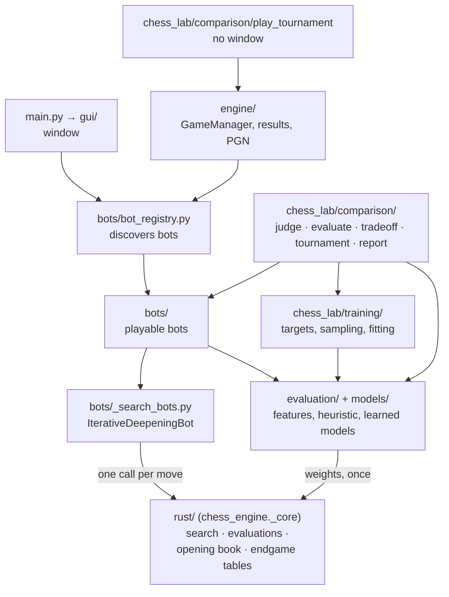
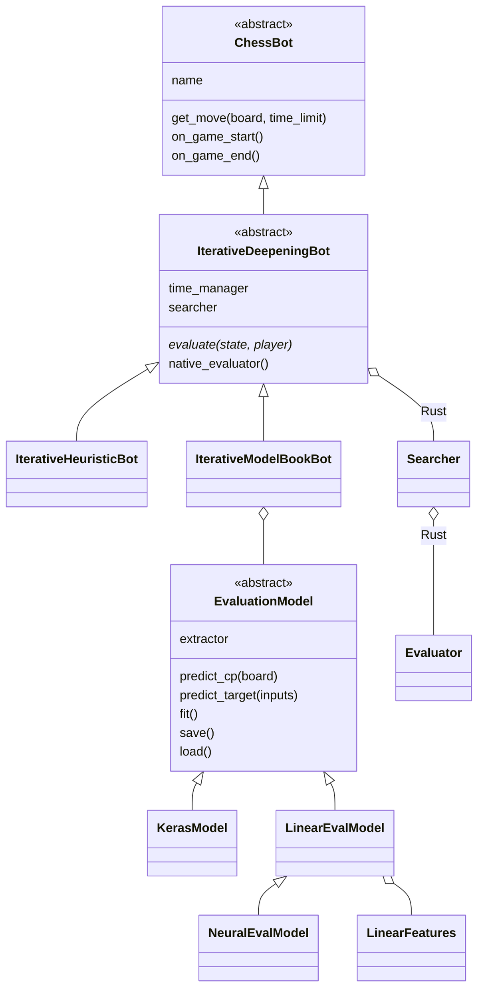
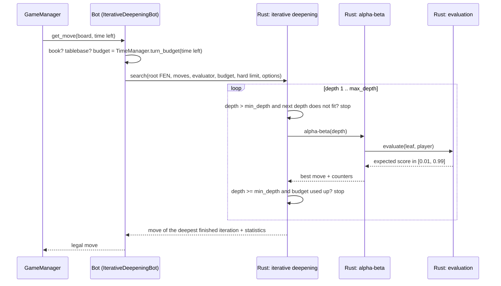

# Architecture

> **What it is:** The packages of the engine, what depends on what, and the path of one move through them.
>
> **Read it when:** You are about to change the code or add a bot or a model.
>
> **Next:** [Algorithms](ALGORITHMS.md)

The engine has two parts. The part that must be fast, the search, the evaluations it calls and the
opening book and endgame tables, is written in Rust (`rust/`, built as the extension module
`chess_engine._core`). Everything else is Python in two packages: `src/chess_engine/` is the application (game loop, bots,
models, window), and `src/chess_lab/` is the laboratory that produces and measures it (training,
comparison and the scripts). The laboratory imports the application; the application never imports the
laboratory. A bot hands the position and
an evaluation to the Rust core once per move and gets a move and the statistics back.



Dependencies, as the imports stand:

- `rust/` imports nothing from Python except the weights it is given (`models/native.py` builds the evaluators).
- `models/` imports `evaluation/` (`evaluator.py`, `native.py`, for `ChessGameState`). It holds `representation.py` and `spec.py` (target scale and shared defaults), which both the models and the training need.
- `chess_lab/training/` imports `models/` (the base class, the registry, the cards and the model classes it fits). `models/` imports nothing from `chess_lab`.
- `bots/` imports `search/`, `evaluation/`, `models/` and `knowledge/`.
- `engine/` imports `bots/` and `config/`; `config/` imports the data classes of `engine/`.
- `gui/` imports `bots/`, `models/`, `search/` and `knowledge/`; Qt only in its widgets. Nothing else imports it.
- `chess_lab/comparison/` is the top layer: it imports `bots/`, `search/`, `models/`, `chess_lab/training/`, `evaluation/`, `knowledge/` and `engine/`. Nothing else imports it.

## Packages

| Package (`src/chess_engine/` unless noted) | Responsibility |
|---|---|
| `rust/src/board.rs` | The rules for the search: a position with the keys needed for repetitions, the terminal test of `board.outcome(claim_draw=True)`, legal moves in the order python-chess generates them, a key for the transposition table |
| `rust/src/eval/` | The evaluations the search runs without Python: `h1.rs` (the heuristic), `linear.rs` (sparse features and the logistic models), `net.rs` (the sparse network `net4_pst`) |
| `rust/src/search/` | `mod.rs`: alpha-beta, quiescence, iterative deepening, the `Techniques` switches and the threads. `tt.rs`: transposition table, killer moves, history, MVV-LVA ordering. `shared.rs`: the lock-free table of several threads. `estimators.rs`: the rules that predict the next iteration |
| `rust/src/knowledge/` | `book.rs`: the opening book. `tablebase.rs`: the Syzygy endgame tables |
| `rust/src/py.rs` | The Python module: `Evaluator`, `Searcher`, `Book`, `Tablebase` |
| `search/` | `statistics.py`: `SearchStatistics`. `time_management.py`: per-move time budget |
| `bots/` | `chess_bot.py` (base class), `bot_registry.py` (finds the bots), `_search_bots.py` (`IterativeDeepeningBot`; options `techniques`, `threads`, `hash_mb`), `iterative_heuristic_bot.py`, `iterative_model_book_bot.py` |
| `evaluation/` | `features.py`: hand-crafted features (material, mobility, king safety...). `heuristics.py`: the heuristic `h1` and its fitted weights. `chess_game_state.py`: a thin wrapper of a board for the evaluation functions |
| `models/` | Learned position evaluators behind one interface, `EvaluationModel` (`base.py`), found by name in `registry.py` (which also lists `ACCURACY_RECORDS`, the models that are only measured). Linear family: `linear_features.py` (sparse feature sets) and `linear_eval.py` (`LinearEvalModel` and the registered `linear_*` models). Neural: `neural_eval.py` (`net4_pst`). Course models: `architectures.py` and `keras_model.py` (`mlp_features`, `cnn_resnet`) with the dense encodings of `dense_features.py`. `evaluator.py` adapts a model to a search; `native.py` hands a model's weights to the Rust core; `cards.py` reads and writes the model cards in `models/cards/`. `representation.py`: target scale and point of view. `spec.py`: defaults shared everywhere (sample seed, share of mates kept) |
| `chess_lab/training/` | `lichess.py` and `lichess_raw.py`: the Lichess evaluation dump as raw Parquet shards. `sidecar.py`: split, quiet flag and seeded samplers over the shards. `dataset.py` and `targets.py`: split and target scale. `effort.py`: training size per effort level. `train.py`: the training command |
| `chess_lab/comparison/` | `play_tournament.py` (entry point of the tournaments), `judge.py` (accuracy and best-move agreement against Stockfish), `evaluate.py` (judge plus cost of one model), `tradeoff.py` (depth against accuracy at a fixed time per move), `standings.py` (Elo, summaries and model cards of a tournament), `tournament.py` (round-robin at equal time, resumable records), `report.py` (model cards into the models table of `RESULTS.md`) |
| `knowledge/` | `opening_book.py` and `endgame_tablebase.py`: the Python faces of the book and the tables, which delegate to the Rust core |
| `gui/` | The window (PySide6, optional): `game_model.py` (position, clocks, result; no Qt), `settings.py` (AI settings → bot options; no Qt), `board_widget.py`, `game_window.py`, `setup_dialog.py`, `settings_dialog.py`, `app.py`, `theme.py`, `pieces.py` and the piece images in `assets/` |
| `engine/`, `config/` | Game loop with clocks, results and PGN export for the tournaments; tournament presets |

Tournaments run with `python -m chess_lab.comparison.play_tournament`. `src/chess_lab/scripts/data/` builds the data (`build_raw_shards.py`, `build_sidecars.py`,
`fit_h1_weights.py`, `build_opening_book.py`, `check_opening_book.py`, `check_split_leakage.py`),
`src/chess_lab/scripts/bench/` holds the experiments (`profile_depth_vs_accuracy.py`,
`measure_search_speed.py`, `compare_quiescence.py`, `compare_search_features.py`,
`compare_target_representations.py`) and `src/chess_lab/scripts/run_full_pipeline.sh`
runs the whole flow. See [DATA_AND_TRAINING.md](DATA_AND_TRAINING.md) for the data and
[MODELS.md](MODELS.md) for the models themselves.

## Main classes



A bot's whole job is to say which evaluation the search uses: `evaluate(state, player)` in
Python and, to run it inside the core, `native_evaluator()`. `models/native.py` builds the native
evaluator of a model from its weights (linear and sparse-network models), and of `h1`; any other
evaluation is called back from Python for every leaf, which works but is slow (the Keras
networks of the course). The base class provides the search, the time budget and the bookkeeping.

The core identifies a position by `(zobrist hash, halfmove clock, fullmove number)`: it names the
same positions as the FEN without building the string, and it is what the transposition table is
indexed by. The repetition history is rebuilt on every call from the root FEN and the moves played
(`board.root()` and `board.move_stack`).

## One move



The clock only decides how deep to go after the first `min_depth` iterations: depths 1 to
`min_depth` (default 3, `DEFAULT_MIN_DEPTH` in `rust/src/search/mod.rs`) are always completed,
whatever the time estimate says. Beyond that, the search stops when the time the next iteration
would take (estimated from the previous ones) does not fit in the budget. Only the hard limit
(`TimeManager.hard_limit`, checked inside the tree) interrupts an iteration, and an interrupted
iteration is discarded unless it is the first one. If the search returns no legal move, the bot
falls back to the best capture or the first legal move. The algorithms themselves are in
[Algorithms](ALGORITHMS.md).

`IterativeDeepeningBot` takes these options (`bots/_search_bots.py`):

| Option | Default | Meaning |
|---|---|---|
| `max_depth` | 3 | deepest iteration |
| `min_depth` | 3 | iterations always completed |
| `quiescence_plies` | 4 | plies of capture and promotion search at the horizon; 0 turns it off |
| `max_tt_entries` | 500,000 | size cap of the transposition table |
| `estimator` | `geometric_growth` | rule that predicts the next iteration |
| `time_manager` | `TimeManager()` | per-move time budgeting policy |
| `tablebase`, `opening_book` | the shipped ones | endgame tables and opening book; `None` switches them off |

The shipped subclasses take their own arguments (`IterativeHeuristicBot`: `eval_function`; `IterativeModelBookBot`:
`model` and `opening_book`) plus `max_depth`, `time_manager` and any other option of
`IterativeDeepeningBot`, which they pass on.

## Building and testing

The Rust crate is built by `maturin`, which `pip install -e ".[dev]"` runs (it needs a Rust
toolchain, `rustup`). After a change in `rust/` run the same command again, or `maturin develop`,
and then the tests. `cargo test --manifest-path rust/Cargo.toml` runs the Rust tests;
`cargo clippy --all-targets -- -D warnings` and `cargo fmt --check` are checked by CI as well.

The Rust core was checked against the Python engine it replaced through golden files
(`tests/golden/`): positions, terminal tests, features, evaluations, fixed-depth searches (value,
move and node counts), opening-book lookups and tablebase moves. The tests that read them are
`tests/core/test_core_golden.py` and `rust/tests/golden_*.rs`.

## Adding a bot

A bot is one file in `src/chess_engine/bots/`: subclass `IterativeDeepeningBot` (from
`bots/_search_bots.py`) and implement `evaluate(state, player)`, the expected score of `player` in
`state`, strictly between 0 and 1. `BotRegistry` imports every public module in `bots/` and registers
each `ChessBot` subclass under its class name; modules starting with `_` hold shared code and are
skipped. `get_bot(name, **options)` forwards constructor arguments, which is how the settings of the window
reach the bots; the new bot can be named in tournaments.

```python
# src/chess_engine/bots/material_bot.py
import chess

from chess_engine.bots._search_bots import IterativeDeepeningBot
from chess_engine.evaluation.features import extract_material_features


class MaterialBot(IterativeDeepeningBot):
    """Iterative-deepening alpha-beta that only counts material."""

    def __init__(self, max_depth: int = 2):
        super().__init__("MaterialBot", max_depth=max_depth)

    def evaluate(self, state, player):
        white_score = extract_material_features(state.get_board())["material_diff_normalized"]
        score = white_score if player == chess.WHITE else 1.0 - white_score
        return min(0.99, max(0.01, score))
```

This bot works as it stands, but the core calls `evaluate` back from Python for every leaf, which
is slow. To run an evaluation at full speed it must be written in Rust and returned by
`native_evaluator()` (see "Running a model in Rust" below).

Rules: the constructor must work without arguments; override `on_game_start` to reset per-game
state and `get_info()` to describe the bot. Use `ChessBot` directly only if you do not want a tree
search (just `get_move(board, time_limit)`). Test it like `tests/app/bots/test_bots.py`: legal moves from
several positions, mate in one (`tests.conftest.MATE_IN_ONE`) and the board left untouched.

## Extension points

| To add... | Implement | Guide |
|---|---|---|
| a bot | `evaluate()` in a subclass of `IterativeDeepeningBot` | the section above |
| an evaluation model | a `LinearFeatures` and a `LinearEvalModel` (`models/linear_features.py`, `models/linear_eval.py`), or any `EvaluationModel`; register it by name in `models/registry.py`; train and measure it with the commands of [Data and training](DATA_AND_TRAINING.md) and [Results](RESULTS.md) | [Models](MODELS.md) |
| a search technique | a change in `rust/src/search/`, measured and documented like the others | [Algorithms](ALGORITHMS.md) |

### Running a model in Rust

The search runs in Rust, so a model plays at full speed only if its features are computed there too.
`models/native.py` hands the weights of a `LinearEvalModel` or a `NeuralEvalModel` to the core by the
**name** of its feature set; the core knows `material5`, `linear_pst`, `linear_pst_terms`,
`king_bucket` and `pst_slotted`. A model with another feature set still plays: the core calls it back
from Python for every leaf (a warning says so), which is much slower and cannot use
several threads. To give a feature set its Rust version:

1. add a variant to `FeatureSet` in `rust/src/eval/linear.rs`, with its name in `FeatureSet::NAMES`,
   its size in `size` and its `active` function, which must give the same indices and values, in the
   same order, as the Python `active` (the training encodes with the Python one, so a difference
   means training on one thing and playing with another);
2. run `tests/core/test_feature_parity.py`, which compares the two on 300 positions for every registered
   feature family (and, for the shipped ones, `tests/core/test_core_golden.py`);
3. rebuild with `pip install -e .` and run `cargo test --manifest-path rust/Cargo.toml`.

The search is written for chess (it uses `shakmaty` for the rules); another game would need
its own core.
