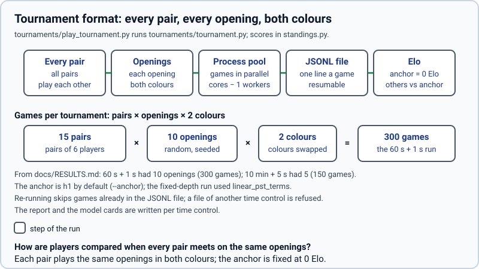
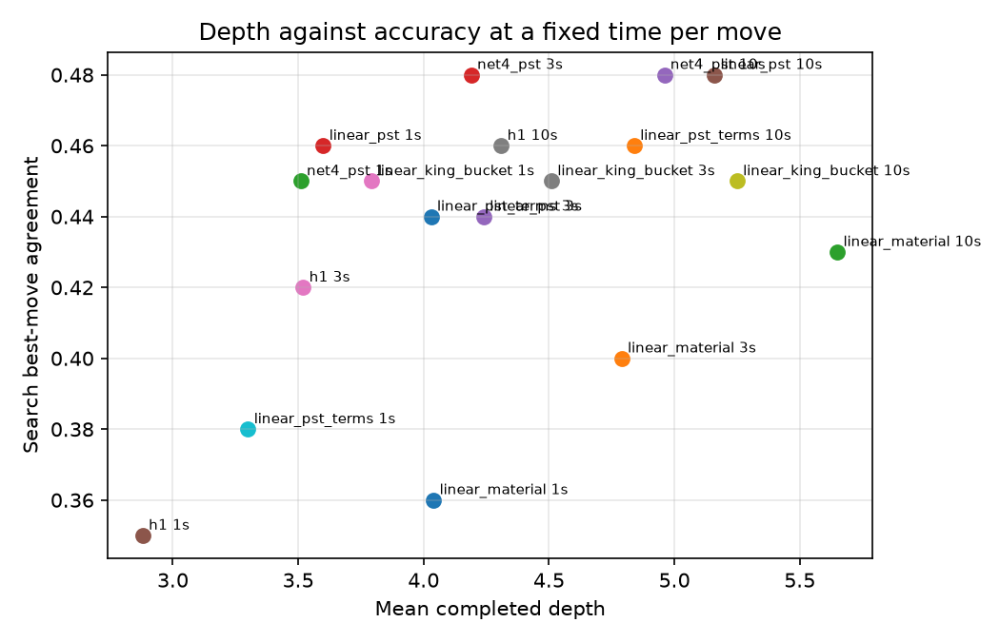

# Results

> **What it is:** What was measured, what was only estimated, which model plays best, and the command or file behind every number.
>
> **Read it when:** You want to compare models or techniques, check a claim of the other pages, or repeat a measurement.
>
> **Next:** [How a change is measured](MEASUREMENT.md)

All numbers are from this project, on a six-core CPU, with the five models trained at effort 30 (30
million positions, 10 % of the mate positions kept; see [Training data](DATA.md)). Commands are run from the
repository root. Two engines produced them: the Python engine, until 2026-10-25, and the Rust engine since
([The search in Rust](techniques/rust-core.md)); every section says which one. Scripts under `scripts/bench/` and
`play_tournament` were removed in `6162db8` and are in the git history.

## The short answer

- **The engine that plays is the Rust UCI binary** with six search techniques on by default (incremental
  accumulator, table move, history, PVS, aspiration windows, null move). Together they scored 76.5 % against the
  plain search in 100 games ("Search techniques in games" below); each one's own measurement is in the
  [catalogue](techniques/README.md). Late move reductions are off: they lose 8.6 Elo at a fixed node count (next section).
- **The model that plays is trained on quiet positions only** (`--representation '{"filter":"quiet"}'`, effort 10): it
  beat the model trained on every position by +284 ± 43 Elo in 362 games at 60 s + 1 s (`quiet_vs_actual` below).
  The tournaments in the next bullet were played with the earlier, all-positions version.
- **Best model: the Piece-square-and-terms logistic model (`linear_pst_terms`).** It has the best score in the
  three tournaments that were played (59.5 % at 60 s + 1 s, 66.0 % at 10 min + 5 s, 72.5 % at a fixed depth of 3)
  and is second in the static judge. Its intervals overlap those of the next models, so "best" means best point
  estimate, not a proven gap. Those tournaments were played by the Python engine.
- **Best judge of a position: the Four-layer piece-square network (`net4_pst`)**, with a Spearman correlation of
  0.700 against Stockfish, but it does not translate into more wins (50.0 % at 10 min + 5 s).
- **The order of the models does not depend on the time control**: `linear_pst_terms` is first in all three
  tournaments.

## Measured and estimated

| Claim | How it is known | Engine | Strength of the evidence |
|---|---|---|---|
| The measuring instrument has no bias | Three A/A matches of 400 to 500 games, fastchess ([Measurement](MEASUREMENT.md#the-aa-check)) | Rust | Measured; intervals ±24 to ±27 Elo |
| The default techniques make the engine stronger | 100 games at 4 s + 0.05 s against the plain search, 76.5 % | Rust core through Python | Measured, one match; per technique only node counts and short matches ([catalogue](techniques/README.md)) |
| Late move reductions make the engine weaker | SPRT of 10,244 games at 20,000 nodes per move: 48.76 %, −8.6 ± 6.1 Elo | Rust | Measured; H0 accepted (next section) |
| Several threads search faster | Time to depth 8 on 60 positions ([Lazy SMP](techniques/lazy-smp.md)) | Rust | Measured speed; effect in games not measured |
| `linear_pst_terms` is the best model | Three tournaments, 50 to 150 games per player | Python | Best point estimate; intervals overlap the next models |
| The model ranking holds on the Rust engine | Only the fixed-depth tournament was replayed (71.9 % against 72.5 %) | Rust core through Python | Estimated for the timed tournaments |
| Quiescence, endgame tables and the opening book help | Position suites ("Decisions that are settled") | Python | Measured on positions, not in games |

## Engine matches (Rust engine, fastchess)

Matches of the UCI binary against itself, one change at a time, as explained in
[How a change is measured](MEASUREMENT.md). Logs in `data/matches/<name>/match.log`.

| match | A against B | conditions | games | score | Elo (95 %) | LLR | verdict |
|---|---|---|---|---|---|---|---|
| `aa_s11` | default against default | 10 s + 0.1 s, SPRT [−5, 0] | 400 counted | 50.5 % | +3.5 ± 26.8 | +0.11 | no bias |
| `aa_s12` | default against default | 10 s + 0.1 s, SPRT [−5, 0] | 500 | 51.3 % | +9.0 ± 25.0 | +0.28 | no bias |
| `aa_s13` | default against default | 10 s + 0.1 s, SPRT [−5, 0] | 500 | 50.7 % | +4.9 ± 23.9 | +0.18 | no bias |
| `lmr_nodes` | default + `lmr` against default | 20,000 nodes per move, SPRT [−5, 0] | 10,244 | 48.76 % | −8.6 ± 6.1 | −2.94 | H0: regresses |
| `qs_evasions` | default + `qs_evasions` against default | 20,000 nodes per move, SPRT [−5, 0] | 3,428 | 46.94 % | −21.3 ± 10.6 | −2.96 | H0: regresses |
| `qs_tt` | default + `qs_tt` against default | 20,000 nodes per move, SPRT [−5, 0] | 10,000 | 50.10 % | +0.7 ± 3.9 | +1.55 | no verdict (round cap) |
| `quiet_vs_actual` | model trained on quiet positions against the previous model | 60 s + 1 s, SPRT [0, 5] | 362 | 83.70 % | +284 ± 43 | +2.96 | H1: stronger |
| `q_k65_vs_quiet` | quiet model with `k` 0.0065 against the quiet model | 60 s + 1 s, SPRT [0, 5] | 280 | 48.93 % | −7 ± 35 | −0.13 | no verdict (round cap) |
| `q_m05_vs_quiet` | quiet model with 0.5 % of the mates against the quiet model | 60 s + 1 s, SPRT [0, 5] | 280 | 43.75 % | −44 ± 36 | −0.59 | no verdict (round cap) |
| `q30_vs_quiet` | quiet model with 30 M positions against the quiet model | 60 s + 1 s, SPRT [0, 5] | 240 | 53.33 % | +23 ± 41 | +0.22 | no verdict (stopped by hand) |
| `reloj_nuevo` | new clock against the old clock, same model and techniques | 60 s + 1 s, SPRT [0, 5] | 720 | 40.83 % | −64 ± 24 | −2.06 | no verdict (stopped by hand); the new clock is worse |
| `see_vs_base` | default + `see` against default | 10 s + 0.1 s, 300 games (screening) | 300 | 56.83 % | +47.8 ± 34.3 | - | screening only |
| `see_sprt` | default + `see` against default | 60 s + 1 s, SPRT [0, 5] | 160 | 55.94 % | +41.5 ± 46.1 | +0.30 | no verdict (stopped by hand) |
| `see_sprt10` | default + `see` against default | 60 s + 1 s, SPRT [0, 10] | 282 | 57.27 % | +50.9 ± 38.6 | +1.13 | no verdict (stopped by hand at 303 games; Elo as of the last report, 282 games) |
| `passed_vs_base` | `linear_pst_passed` against the shipped model | 10 s + 0.1 s, 300 games (screening) | 300 | 54.17 % | +29.0 ± 35.2 | - | screening only |
| `king_vs_base` | `linear_pst_king` against the shipped model | 10 s + 0.1 s, 300 games (screening) | 300 | 50.00 % | 0.0 ± 35.3 | - | screening only |
| `e30_vs_base` | quiet model with 30 M positions (`linear_pst_terms@e30`) against the shipped model | 10 s + 0.1 s, 300 games (screening) | 300 | 55.67 % | +39.6 ± 33.8 | - | screening only |

## How the models were measured

| Judge | What it measures | Command |
|---|---|---|
| Static | Spearman correlation and error of the model against Stockfish on 200,000 test positions (seed 42), scored by the Rust core as the engine plays it (clipped to 0.01–0.99); µs per eval is the median of one core evaluation from a FEN over 1,000 positions | `python -m chess_lab.measure.evaluate --model linear_pst_terms` |
| Profile | Depth reached in 1, 3 and 10 s and agreement of the searched move with Stockfish | `scripts/bench/profile_depth_vs_accuracy.py` (removed in `6162db8`) |
| Tournament | Round robin at equal time per move, paired openings, Elo against an anchor | `play_tournament`; today, fastchess ([Measurement](MEASUREMENT.md)) |

The tournaments report the score (wins plus half the draws) with a 95 % interval; no game in any of them ended by
forfeit, time or illegal move.

## Model tournaments (Python engine, historical)

<picture>
  <source media="(prefers-color-scheme: dark)" srcset="img/tournament-format-dark.svg">
  
</picture>

These tournaments were played by the Python engine before 2026-10-25, with `play_tournament`, and cannot be played again as they were: the Rust engine reaches 2 to 3 plies more in the same time. They still
rank the evaluations; a re-run with fastchess is not planned yet. They measured the evaluation alone: quiescence on, opening book and
endgame tables off.

Anchor `h1` (the hand-written heuristic), 10 openings (20 games per pair, 300 games), 60 s + 1 s:

| Player | Score % |
|---|---|
| `linear_pst_terms` | 59.5 |
| `net4_pst` | 57.0 |
| `h1` | 54.0 |
| `linear_king_bucket` | 50.5 |
| `linear_pst` | 45.0 |
| `linear_material` | 34.0 |

The reference time control, 10 min + 5 s, 5 openings (10 games per pair, 150 games):

| Player | W-D-L | Score % | 95 % interval % |
|---|---|---|---|
| `linear_pst_terms` | 30-6-14 | 66.0 | 53.8 – 78.2 |
| `linear_pst` | 27-3-20 | 57.0 | 43.7 – 70.3 |
| `h1` | 24-7-19 | 55.0 | 42.2 – 67.8 |
| `linear_king_bucket` | 24-3-23 | 51.0 | 37.6 – 64.4 |
| `net4_pst` | 22-6-22 | 50.0 | 37.0 – 63.0 |
| `linear_material` | 8-5-37 | 21.0 | 10.6 – 31.4 |

Fixed depth of 3 for everybody (no player can reach more depth than another), anchor
`linear_pst_terms`, 10 openings (200 games):

| Player | Score % |
|---|---|
| `linear_pst_terms` | 72.5 |
| `linear_pst` | 58.1 |
| `net4_pst` | 47.5 |
| `linear_king_bucket` | 44.4 |
| `linear_material` | 27.5 |

Commands, as they were run:

```text
play_tournament --players linear_material,linear_pst,linear_king_bucket,linear_pst_terms,net4_pst,h1 \
    --anchor h1 --base 60 --increment 1 --openings 10 --out data/tournament/short.jsonl
play_tournament --players linear_material,linear_pst,linear_king_bucket,linear_pst_terms,net4_pst,h1 \
    --anchor h1 --base 600 --increment 5 --openings 5 --out data/tournament/reference.jsonl
play_tournament --players linear_material,linear_pst,linear_king_bucket,linear_pst_terms,net4_pst \
    --anchor linear_pst_terms --max-depth 3 --base 600 --increment 0 --openings 10 --out data/tournament/depth3.jsonl
```

Reading the 10 min + 5 s table honestly: with 50 games per player the intervals are about ±13
points, so only the last place (`linear_material`) is separated from the rest; the order of the
middle four could change with more games. The fixed-depth table is the cleanest comparison of the
evaluations themselves, since speed plays no part.

## Does the time control matter?

No: `linear_pst_terms` is first in all three tournaments and the middle models swap places within their intervals.
At a fixed depth of 3 the network falls to 47.5 %: its quality as a judge (0.700) does not become playing strength
at this search depth.



*Generated by `scripts/bench/profile_depth_vs_accuracy.py` (removed in `6162db8`).*

## Search techniques in games

The tournaments above used the plain search of the Python engine; the Rust engine reaches 2 to 3 plies more in
the same time ([The search in Rust](techniques/rust-core.md)). On it, the six default techniques
([search techniques](techniques/README.md)) scored 76.5 % against the plain search with the same model in 100
games at 4 s + 0.05 s, reaching 5.54 plies against 4.68 (`scripts/bench/compare_engine_versions.py --candidate
incremental,tt_move,history,pvs,aspiration,null_move --openings 50 --base 4 --increment 0.05`, removed in `6162db8`).

## Decisions that are settled

| Question | Answer | Where it comes from |
|---|---|---|
| Keep every mate position in training? | No: 10 % of them. `linear_pst_terms` trained that way scored 71.0 % against 29.0 % for the all-mates version (100 games, effort 15, 60 s + 1 s, anchor `linear_pst_terms`). Those two models are not shipped any more; the all-mates one is recreated with `--mate-keep 1.0 --tag mates100`. | `DEFAULT_MATE_KEEP = 0.10`; `python -m chess_lab.training.train --model linear_pst_terms --effort 15 --mate-keep 1.0 --tag mates100`, then a tournament between that model and the default one (`play_tournament`) |
| Train on quiet positions only? | Yes: +284 ± 43 Elo against the all-positions model (362 games, SPRT [0, 5] accepted). Three variants of the quiet model (`k` 0.0065, 0.5 % of the mates, 30 M positions) did not differ from it beyond the error (−7 ± 35, −44 ± 36, +23 ± 41 Elo); they are not shipped. | `data/matches/quiet_vs_actual/match.log`, `q_k65_vs_quiet`, `q_m05_vs_quiet`, `q30_vs_quiet`; [Models](MODELS.md#piece-square-and-terms-logistic-model-linear_pst_terms) |
| Does more training effort help? | Not for the Material logistic model: effort 90 gives Spearman 0.474, the same as effort 30; the validation loss stays flat (0.6722 to 0.6719). | `python -m chess_lab.training.train --model linear_material --effort 90` |
| Is quiescence worth its cost? | Yes: at depth 3 it adds +0.047 (`h1`) and +0.096 (`linear_pst_terms`) to the share of positions where the move is Stockfish's (standard error 0.015), at 2.5 to 3.6 times the nodes. | `scripts/bench/compare_quiescence.py --players h1,linear_pst_terms` (removed in `6162db8`); [Quiescence](techniques/quiescence.md) |
| Why did games stop at depth 2? | The original rule that predicts the next iteration (last duration squared over the previous one) over-estimated it. It was replaced by `geometric_growth`, with a floor of depth 3. | `scripts/bench/compare_time_estimators.py` (removed in `6162db8`); [Iterative deepening](techniques/iterative-deepening.md) |
| Do the endgame tables help? | Yes: from 60 won endgames of 3 to 5 pieces the search with the tables converts 52 and without them 8. | `scripts/bench/compare_endgame_tablebase.py --positions 60 --seconds 0.5` (removed in `6162db8`); [Endgame tablebases](techniques/endgame-tablebases.md) |
| Is the opening book good? | 98.7 % of 2,438 sampled moves are within 50 centipawns of Stockfish's best line, none illegal. | `python src/chess_lab/scripts/data/check_opening_book.py data/opening_book.json --fraction 0.02 --engine /usr/games/stockfish --depth 16` |

## Limits and leakage

- **Positions, not games.** The data has no game identifiers, so the split is by a hash of the position.
  `python src/chess_lab/scripts/data/check_split_leakage.py` found no duplicate position among the 124,923,027
  rows; 1.1 % of the test positions have their colour-swapped image in the data and 72.0 % have a
  position one move away (60.2 % in train).
- **The neighbours do not flatter the models.** Judged separately on test positions with and
  without a neighbour in train, the Spearman correlation is not higher with it
  (`linear_pst_terms` 0.665 against 0.623, `net4_pst` 0.714 against 0.679). Every model scores higher on those
  positions, also the ones too small to memorise, so the difference comes from easier positions.
- **Statistical power.** The tournaments have 50 games per player at 10 min + 5 s and 100 to 150 per
  player in the others; read them with the intervals.
- **One machine, one run.** The figures depend on the CPU (the 1 s depth in particular).

## Model table

Generated by `python -m chess_lab.measure.report` from the model cards; do not edit by hand. It holds what can
be measured again today (accuracy and cost); the depth, search agreement and tournament figures of the Python
engine are in the sections above (the model cards carried them until 2026-11-01).

<!-- BEGIN GENERATED TABLES -->
| Model | Params | Representation | Effort | Spearman | MAE | Best move, all / non-quiet | µs per eval |
|---|---:|---|---:|---:|---:|---:|---:|
| `h1` | 6 | — | — | 0.561 | 0.149 | 19.6% / 49.8% | 2.9 |
| `linear_king_bucket` | 10,369 | winprob-k0.00368-stm-all | 30 | 0.613 | 0.141 | 19.4% / 52.0% | 2.0 |
| `linear_material` | 6 | winprob-k0.00368-stm-all | 30 | 0.474 | 0.157 | 19.1% / 54.9% | 1.9 |
| `linear_pst` | 769 | winprob-k0.00368-stm-all | 30 | 0.626 | 0.135 | 19.8% / 53.5% | 2.3 |
| `linear_pst_king` | 809 | winprob-k0.00368-stm-quiet | 10 | 0.643 | 0.129 | 20.7% / 55.9% | 3.3 |
| `linear_pst_passed` | 805 | winprob-k0.00368-stm-quiet | 10 | 0.641 | 0.130 | 20.6% / 55.9% | 3.3 |
| `linear_pst_terms` | 791 | winprob-k0.00368-stm-quiet | 10 | 0.638 | 0.131 | 20.4% / 55.9% | 2.9 |
| `linear_pst_terms@e30` | 791 | winprob-k0.00368-stm-quiet | 30 | 0.646 | 0.128 | 20.8% / 56.7% | 2.9 |
| `net4_pst` | 206,177 | winprob-k0.00368-stm-all | 30 | 0.700 | 0.120 | 20.5% / 51.1% | 5.8 |
<!-- END GENERATED TABLES -->

## Reproduce

The pipeline rebuilds the sidecars, trains the models, evaluates them and regenerates the model table; it plays no
games (games are played with fastchess, [Measurement](MEASUREMENT.md)).

```bash
DRY_RUN=1 bash src/chess_lab/scripts/run_full_pipeline.sh   # prints every command
nohup setsid bash src/chess_lab/scripts/run_full_pipeline.sh > data/pipeline/pipeline.log 2>&1 &
```
