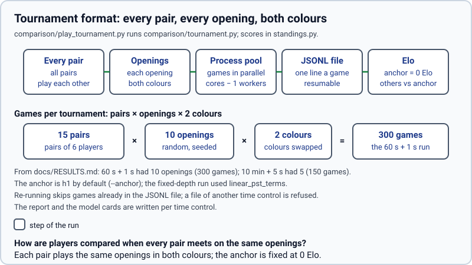
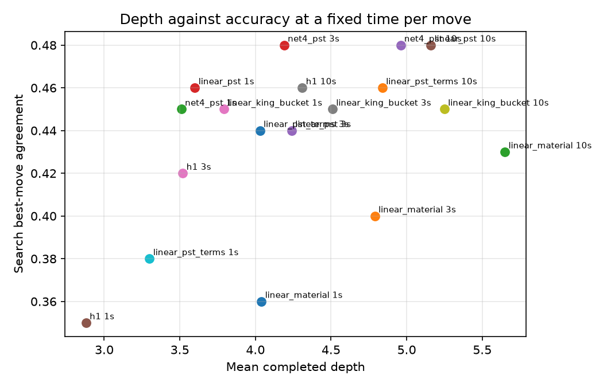

# Results

> **What it is:** What was measured, which model plays best, why the answer depends on the time control, and the command behind every number.
>
> **Read it when:** You want to compare models, check a claim of the other pages, or repeat a measurement.
>
> **Next:** [Index of the pages](README.md)

All numbers are from this project, on a six-core CPU, with the five models trained at effort 30 (30
million positions, 10 % of the mate positions kept; see [Data and training](DATA_AND_TRAINING.md)).
Commands are run from the repository root.

## The short answer

- **Best player: the Piece-square-and-terms logistic model (`linear_pst_terms`).** It has the best
  score in the three tournaments that were played (59.5 % at 60 s + 1 s, 66.0 % at 10 min + 5 s,
  72.5 % at a fixed depth of 3) and is second in the static judge. Its intervals overlap those of
  the next models, so "best" means best point estimate, not a proven gap.
- **Worst player, with certainty: the Material logistic model (`linear_material`).** It has the
  lowest static accuracy and the lowest score in every tournament; at 10 min + 5 s it wins 8 of 50
  games.
- **Best judge of a position: the Four-layer piece-square network (`net4_pst`)**, with a Spearman
  correlation of 0.700 against Stockfish, but it does not translate into more wins (50.0 % at
  10 min + 5 s).
- **The order is stable across time controls**: `linear_material` is last in all three, and
  `linear_pst_terms` first in all three. What changes is how far apart they are; see "Does the time
  control matter?". An earlier finding that `linear_material` won at 60 s + 1 s came from training
  every model with all the mate positions and is not reproduced with 10 % of them.

## How it is measured

| Judge | What it measures | Command |
|---|---|---|
| Static | Spearman correlation and error of the model against Stockfish on 200,000 test positions (seed 42) | `python -m chess_lab.measure.evaluate --model linear_pst_terms` |
| Profile | Depth reached in 1, 3 and 10 s and agreement of the searched move with Stockfish | `python (removed) scripts/bench/profile_depth_vs_accuracy.py` |
| Tournament | Round robin at equal time per move, paired openings (each opening is played with both colours), Elo against an anchor | `play_tournament (removed; see CHANGELOG)` |

The tournaments report the score (wins plus half the draws) with a 95 % interval; no game in
any of them ended by forfeit, time or illegal move. The whole flow is `bash src/chess_lab/scripts/run_full_pipeline.sh`.

## Tournaments



Anchor `h1` (the hand-written heuristic), 10 openings (20 games per pair, 300 games), 60 s + 1 s:

| Player | Score % |
|---|---|
| `linear_pst_terms` | 59.5 |
| `net4_pst` | 57.0 |
| `h1` | 54.0 |
| `linear_king_bucket` | 50.5 |
| `linear_pst` | 45.0 |
| `linear_material` | 34.0 |

The reference time control, 10 min + 5 s, 5 openings (10 games per pair, 150 games):

| Player | W-D-L | Score % | 95 % interval % |
|---|---|---|---|
| `linear_pst_terms` | 30-6-14 | 66.0 | 53.8 – 78.2 |
| `linear_pst` | 27-3-20 | 57.0 | 43.7 – 70.3 |
| `h1` | 24-7-19 | 55.0 | 42.2 – 67.8 |
| `linear_king_bucket` | 24-3-23 | 51.0 | 37.6 – 64.4 |
| `net4_pst` | 22-6-22 | 50.0 | 37.0 – 63.0 |
| `linear_material` | 8-5-37 | 21.0 | 10.6 – 31.4 |

Fixed depth of 3 for everybody (no player can reach more depth than another), anchor
`linear_pst_terms`, 10 openings (200 games):

| Player | Score % |
|---|---|
| `linear_pst_terms` | 72.5 |
| `linear_pst` | 58.1 |
| `net4_pst` | 47.5 |
| `linear_king_bucket` | 44.4 |
| `linear_material` | 27.5 |

```bash
play_tournament (removed; see CHANGELOG) --players linear_material,linear_pst,linear_king_bucket,linear_pst_terms,net4_pst,h1 \
    --anchor h1 --base 60 --increment 1 --openings 10 --out data/tournament/short.jsonl
play_tournament (removed; see CHANGELOG) --players linear_material,linear_pst,linear_king_bucket,linear_pst_terms,net4_pst,h1 \
    --anchor h1 --base 600 --increment 5 --openings 5 --out data/tournament/reference.jsonl
play_tournament (removed; see CHANGELOG) --players linear_material,linear_pst,linear_king_bucket,linear_pst_terms,net4_pst \
    --anchor linear_pst_terms --max-depth 3 --base 600 --increment 0 --openings 10 --out data/tournament/depth3.jsonl
```

Reading the 10 min + 5 s table honestly: with 50 games per player the intervals are about ±13
points, so only the last place (`linear_material`) is separated from the rest; the order of the
middle four could change with more games. The fixed-depth table is the cleanest comparison of the
evaluations themselves, since speed plays no part.

## Engine speed

The search, the evaluations and the knowledge moved from Python to Rust on 2026-10-25 (see
[Rust and threads](algorithms/rust-and-threads.md)). **The tournaments of this page were played with the Python
engine**, which searched 3 to 5 plies deep in the times they use; the Rust core plays the same
moves from the same positions but reaches 2 to 3 plies more, so a new tournament at the same time
control is not comparable with them and the ranking could change. The core was checked against
the Python engine node for node, and the fixed-depth tournament gives the same standings (the
`linear_pst_terms` score 71.9 % against 72.5 %); the tournaments at 60 s + 1 s and 10 min + 5 s have
not been played again.

Depth reached in 10 seconds per move, mean over 200 test positions (`python
(removed) scripts/bench/measure_search_speed.py --positions 200 --seconds 1,3,10 --depths 4`, five processes of one thread):

| Player | Python | Rust | Time to depth 4 (Python → Rust) |
|---|---|---|---|
| `h1` | 4.12 | 6.93 | 7.995 s → 0.226 s (35 times faster) |
| `linear_material` | 5.37 | 7.68 | 1.335 s → 0.076 s (18 times) |
| `linear_pst` | 4.94 | 7.18 | 2.279 s → 0.110 s (21 times) |
| `linear_pst_terms` | 4.62 | 7.13 | 3.429 s → 0.139 s (25 times) |
| `linear_king_bucket` | 5.04 | 7.51 | 1.990 s → 0.120 s (17 times) |
| `net4_pst` | 4.85 | 6.82 | 2.266 s → 0.286 s (8 times) |

The table above is the reference search (no selective techniques). The bots add six techniques
([selective techniques](algorithms/selective-techniques.md)); in 100 games at 4 s + 0.05 s they scored 76.5 % against the
reference with the same model (`python (removed) scripts/bench/compare_engine_versions.py --candidate
incremental,tt_move,history,pvs,aspiration,null_move --openings 50 --base 4 --increment 0.05`), and reached 5.54
plies against 4.68. With the techniques on, four threads reach depth 8 1.6 times faster and gain 0.4 plies in 3 s
([Rust and threads](algorithms/rust-and-threads.md#several-threads-lazy-smp)). The model tournaments of this page were played without them.

## Does the time control matter?

Less than it first seemed. With the five models trained the same way, the order of the extremes does
not move: `linear_pst_terms` has 59.5 %, 66.0 % and 72.5 % and `linear_material` 34.0 %, 21.0 % and
27.5 % in the three tournaments. The gap between the best and the worst widens with time, from
25 points at 60 s + 1 s to 45 points at 10 min + 5 s. The models in the middle (`linear_pst`,
`linear_king_bucket`, `net4_pst`, `h1`) swap places from one table to another, but their intervals
overlap (±13 to ±14 points at 10 min + 5 s), so those swaps are within noise.

Speed still matters, only not enough to reverse the order. The model table below gives the cost of
one evaluation and the depth reached in a second: `linear_material` evaluates in 19.6 µs and
reaches depth 4.0 in 1 s, `linear_pst_terms` takes 113 µs and reaches 3.3, and `net4_pst` takes
46 µs and reaches 3.5. At a fixed depth of 3 (no speed advantage) `net4_pst` falls to 47.5 % and
`linear_pst` stays second, so the network's quality as a judge (0.700) is not turned into play
strength by a search this shallow. For a game at 10 min + 5 s use `linear_pst_terms`.



*Generated by `python (removed) scripts/bench/profile_depth_vs_accuracy.py`.*

## Decisions that are settled

| Question | Answer | Where it comes from |
|---|---|---|
| Keep every mate position in training? | No: 10 % of them. `linear_pst_terms` trained that way scored 71.0 % against 29.0 % for the all-mates version (100 games, effort 15, 60 s + 1 s, anchor `linear_pst_terms`). Those two models are not shipped any more; the all-mates one is recreated with `--mate-keep 1.0 --tag mates100`. | `DEFAULT_MATE_KEEP = 0.10`; `python -m chess_lab.training.train --model linear_pst_terms --effort 15 --mate-keep 1.0 --tag mates100`, then `play_tournament (removed; see CHANGELOG)` between that model and the default one |
| Does more training effort help? | Not for the Material logistic model: effort 90 gives Spearman 0.474, the same as effort 30; the validation loss stays flat (0.6722 to 0.6719). | `python -m chess_lab.training.train --model linear_material --effort 90` |
| Is quiescence worth its cost? | Yes: at depth 3 it adds +0.047 (`h1`) and +0.096 (`linear_pst_terms`) to the share of positions where the move is Stockfish's (standard error 0.015), at 2.5 to 3.6 times the nodes. | `python (removed) scripts/bench/compare_quiescence.py --players h1,linear_pst_terms`; [Search basics](algorithms/search-basics.md#quiescence-search) |
| Why did games stop at depth 2? | The original rule that predicts the next iteration (last duration squared over the previous one) over-estimated it. It was replaced by `geometric_growth`, with a floor of depth 3. | `python (removed) scripts/bench/compare_time_estimators.py`; [Search basics](algorithms/search-basics.md#iterative-deepening-with-a-clock) |
| Do the endgame tables help? | Yes: from 60 won endgames of 3 to 5 pieces the search with the tables converts 52 and without them 8. | `python (removed) scripts/bench/compare_endgame_tablebase.py --positions 60 --seconds 0.5`; [Search basics](algorithms/search-basics.md#endgame-tablebases) |
| Is the opening book good? | 98.7 % of 2,438 sampled moves are within 50 centipawns of Stockfish's best line, none illegal. | `python src/chess_lab/scripts/data/check_opening_book.py data/opening_book.json --fraction 0.02 --engine /usr/games/stockfish --depth 16` |

The tournaments measure the evaluation alone: the endgame tables and the opening book are off in
them, and the time estimator is pinned to the original rule (`ratio_squared`, with the floor of depth 3)
so that a stopped tournament can be resumed with identical conditions. Quiescence is on, as in the
bots by default. Each game record also carries the version of the Rust core that played it (`core`,
`chess_engine._core.version()`); a file is never resumed with another version, and records without the
field count as `python`, the engine before 2.0 (`tests/lab/tournaments/test_tournament.py::test_a_file_played_by_another_core_is_refused`).
The published tournaments below were played by that Python engine.

## Limits and leakage

- **Positions, not games.** The data has no game identifiers, so the split is by a hash of the position.
  `python src/chess_lab/scripts/data/check_split_leakage.py` found no duplicate position among the 124,923,027
  rows; 1.1 % of the test positions have their colour-swapped image in the data and 72.0 % have a
  position one move away (60.2 % in train).
- **The neighbours do not flatter the models.** Judged separately on test positions with and
  without a neighbour in train, the Spearman correlation is not higher with it
  (`linear_pst_terms` 0.665 against 0.623, `net4_pst` 0.714 against 0.679, `linear_material` 0.493
  against 0.446). Every model scores higher on those positions, including the 6-parameter one that
  cannot memorise anything, so the difference comes from easier positions and not from memorisation.
- **Statistical power.** The tournaments have 50 games per player at 10 min + 5 s and 100 to 150 per
  player in the others; read them with the intervals.
- **One machine, one run.** The figures depend on the CPU (the 1 s depth in particular).

## Model table

Generated by `python -m chess_lab.measure.report` from the model cards; do not edit by hand.

<!-- BEGIN GENERATED TABLES -->
| Model | Params | Representation | Effort | Spearman | MAE | Best move, all / non-quiet | µs per eval | Depth 1 s | Depth 3 s | Depth 10 s | Search agreement, 10 s | 10 min + 5 s, score % | 10 min + 5 s, Elo vs anchor | 1 min + 1 s, score % | 1 min + 1 s, Elo vs anchor | Depth 3, score % | Depth 3, Elo vs anchor |
|---|---:|---|---:|---:|---:|---:|---:|---:|---:|---:|---:|---:|---:|---:|---:|---:|---:|
| `h1` | 6 | — | — | 0.561 | 0.149 | 19.6% / 49.8% | 190.1 | — | — | — | — | 55.0% | +0 ± 92 | 54.0% | +0 ± 60 | — | — |
| `linear_king_bucket` | 10,369 | winprob-k0.00368-stm-all | 30 | 0.613 | 0.141 | 19.4% / 52.0% | 24.9 | 3.8 | 4.5 | 5.2 | 45.0% | 51.0% | -25 ± 96 | 50.5% | -21 ± 66 | 44.4% | -173 ± 68 |
| `linear_material` | 6 | winprob-k0.00368-stm-all | 30 | 0.474 | 0.157 | 19.1% / 54.9% | 19.6 | 4.0 | 4.8 | 5.7 | 43.0% | 21.0% | -227 ± 117 | 34.0% | -121 ± 66 | 27.5% | -279 ± 76 |
| `linear_pst` | 769 | winprob-k0.00368-stm-all | 30 | 0.626 | 0.135 | 19.8% / 53.5% | 44.4 | 3.6 | 4.2 | 5.2 | 48.0% | 57.0% | +12 ± 97 | 45.0% | -53 ± 62 | 58.1% | -91 ± 63 |
| `linear_pst_terms` | 791 | winprob-k0.00368-stm-all | 30 | 0.648 | 0.132 | 20.0% / 54.0% | 113.2 | 3.3 | 4.0 | 4.8 | 46.0% | 66.0% | +70 ± 98 | 59.5% | +33 ± 63 | 72.5% | +0 ± 72 |
| `net4_pst` | 206,177 | winprob-k0.00368-stm-all | 30 | 0.700 | 0.120 | 20.5% / 51.1% | 46.1 | 3.5 | 4.2 | 5.0 | 48.0% | 50.0% | -31 ± 92 | 57.0% | +18 ± 64 | 47.5% | -154 ± 68 |
<!-- END GENERATED TABLES -->

## Reproduce

```bash
DRY_RUN=1 bash src/chess_lab/scripts/run_full_pipeline.sh   # prints every command
nohup setsid bash src/chess_lab/scripts/run_full_pipeline.sh > data/pipeline/pipeline.log 2>&1 &
```
