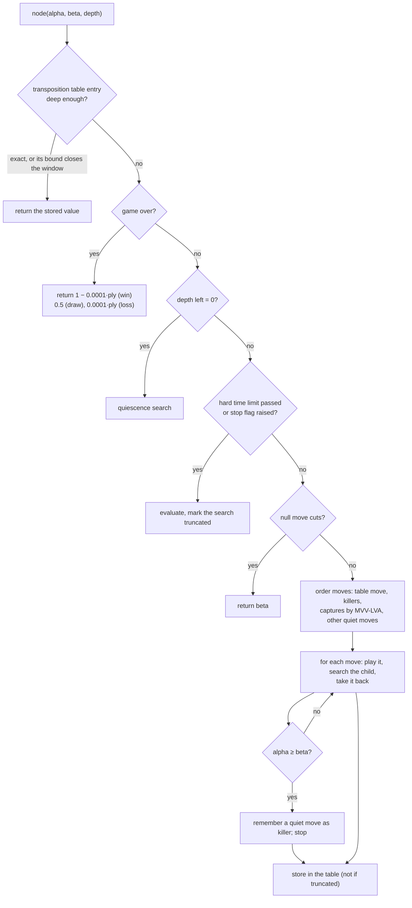

# How the engine chooses a move

> **What it is:** The main algorithm of the engine, alpha-beta search, explained with an example; the techniques added on it have one page each in the [catalogue](techniques/README.md).
>
> **Read it when:** You want to know how the engine thinks before reading about any technique.
>
> **Next:** [Search techniques](techniques/README.md)

A chess engine tries moves, imagines the replies, and picks the move leading to the best position it can force.
With about 30 moves per position the lines explode (30⁶ ≈ 730 million positions at six plies), so everything in
the search is about looking at fewer or better positions within the clock. Code: `rust/src/search/` and
`rust/src/board.rs`; the evaluations are in [MODELS.md](MODELS.md).

## The path of one move

The window first asks the [opening book](techniques/opening-book.md) while the game follows it, then the
[endgame tablebases](techniques/endgame-tablebases.md) (five pieces or fewer), and only otherwise the UCI binary,
which searches. The binary alone (in fastchess matches) always searches.

<picture>
  <source media="(prefers-color-scheme: dark)" srcset="img/path-of-a-move-dark.svg">
  
</picture>

## Values

Every value is the expected score for the player the search runs for: `1` win, `0.5` draw, `0` loss. Evaluations
(the networks) are clipped to `0.01 .. 0.99`, so an estimate never outranks a real result;
finished games use exact values. A terminal value is nudged by `0.0001` per ply from the root
(`DEPTH_PREFERENCE_EPSILON` in `rust/src/search/options.rs`, `terminal_utility` in `rust/src/search/node.rs`): a
mate in 2 is worth `0.9998` and a mate in 9 `0.9991`, so the engine plays the quicker win and, when losing, the slower
loss. That nudge is not measured; it has been there since the first commit (2026-10-16).

## Minimax

The engine's side (MAX) picks the child with the highest value, the opponent (MIN) the lowest, and the values of
the leaves bubble up to the root. The search stops at a fixed depth and asks the evaluation for a number there,
because a game is too deep to search to the end. [Iterative deepening](techniques/iterative-deepening.md) repeats
the search one ply deeper each time until the clock runs out.

## Alpha-beta

While it searches, the engine keeps a window `(alpha, beta)`: `alpha` is the best value MAX is already sure to get
through another line, `beta` the best MIN is sure to get. A node whose value falls outside the window cannot change
the decision, so its remaining children are skipped: a cut-off. The result is exactly the minimax result, with
fewer nodes.

**Worked example.** The root (MAX) has two moves, each answered by a MIN node with two replies (abstract values).

1. Left MIN node: its leaves are `3` and `5`; MIN takes `3`. The root now has `alpha = 3`: it can get at least 3.
2. Right MIN node: its first leaf is `2`, so MIN can hold the root to at most `2`.
3. `2 ≤ alpha = 3`: whatever the second leaf is, the root prefers the left move. The second leaf is never searched.

The root's value is `3`, the same as minimax, with 3 leaves searched instead of 4. With good move ordering (best
move first) alpha-beta searches about the square root of the minimax tree, which is why the
[ordering techniques](techniques/README.md) matter as much as the pruning ones.

<picture>
  <source media="(prefers-color-scheme: dark)" srcset="img/alpha-beta-cut-dark.svg">
  
</picture>

## One node

`Search::node` in `rust/src/search/node.rs` searches one node, for MAX and MIN alike; `alpha_beta`
(`rust/src/search/deepening.rs`) runs it for one depth and returns the value, the best move and the counters.
Every technique of the catalogue is a step of this function or of the loop around it:

The switched techniques (null move, table move, static exchange evaluation in quiescence, incremental accumulator) only act when on; see the
[catalogue](techniques/README.md) for which are on by default and what each one gained.

See also [RESULTS.md](RESULTS.md) and [ARCHITECTURE.md](ARCHITECTURE.md).
