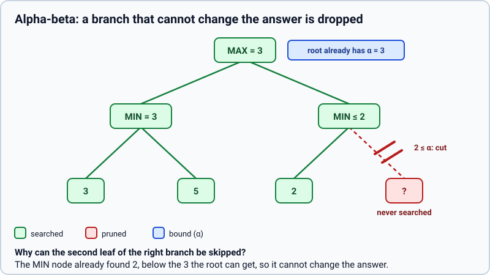
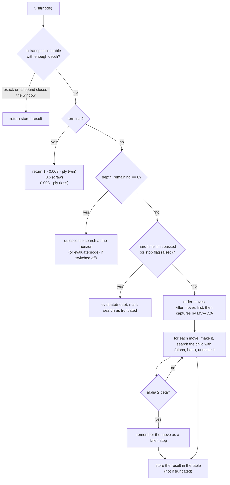
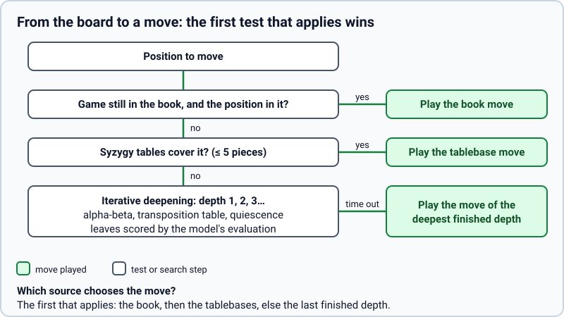

# Search algorithms

> **What it is:** How the engine chooses a move: one main algorithm (alpha-beta search) and the techniques added on it, one page each in the [catalogue](techniques/README.md).
>
> **Read it when:** You want to know why the engine thinks the way it does, what each technique costs or saves, or where it lives in the code.
>
> **Next:** [Search techniques](techniques/README.md)

A chess engine tries moves, imagines the replies, and picks the move leading to the best position it
can force. With about 30 moves per position the lines explode, so everything below is about looking at
fewer or better positions within the clock. After the main algorithm, each technique gets a section
with five parts (problem, what it does, how it is implemented, measured effect, status). Code: `rust/src/search/`, `rust/src/board.rs`, `(removed) chess_engine/bots/`; evaluations: [MODELS.md](MODELS.md).

The search was first written in Python and moved to Rust ([the search in Rust](techniques/rust-core.md)). The node counts, the pruning
counts and the moves quoted in these pages were measured with the Python engine; the Rust core
reproduced them exactly when it replaced the Python engine, so they hold
for both. Only the time per node changed, and that page gives the speed.

## The main algorithm: alpha-beta search

**Minimax.** The engine's side (MAX) picks the child with the highest value, the opponent (MIN) the
lowest; leaf scores bubble up to the root.

**Alpha-beta pruning.** While exploring, the search keeps a window `(alpha, beta)`: `alpha` is the
best value MAX is already sure to get elsewhere, `beta` the best value MIN is already sure to
concede. When `alpha >= beta` the rest of a node's children cannot change the decision, so they are
skipped (a cut-off). The result is exactly the minimax result with fewer nodes.

**Heuristic evaluation and a depth cut-off.** Games are too deep to search to the end, so the search
stops at a fixed depth and asks an evaluation function for a number. This is `Search::node` in
`rust/src/search/node.rs` (one function for MAX and MIN nodes; `alpha_beta` runs it for a depth and
returns the value, the best move and the counters). Every modification below was added to it.

**Values.** Every value is the expected score for the player the search runs for: `1` win, `0.5` draw,
`0` loss. Evaluations (heuristics and learned models) are clipped to `0.01 .. 0.99`, so an estimate never
outranks a real result; terminal positions use exact `1`, `0.5`, `0`.

How the search visits one node (`Search::node`):

The measured tables below come from `python (removed) scripts/bench/compare_search_features.py`: a fixed sample
of test positions searched with each technique switched off, one at a time, with `linear_material`
as evaluation. Its report files are local (not versioned), so the numbers are copied here.

## Preference for faster wins

**Problem.** A forced mate in 2 and a forced mate in 9 are both worth `1`, so the engine can see a
win and keep postponing it. The same happens in reverse for losses.

**What it does.** A terminal value is nudged by `0.003` per ply from the root: a quicker win is worth
slightly more than a slower one, a slower loss more than a quicker one. Draws are untouched.

**How it is implemented.** `DEPTH_PREFERENCE_EPSILON = 0.003` and `Search::terminal_utility` in
`rust/src/search/node.rs`: `1 - ply * epsilon` for a win, `ply * epsilon` for a loss, with `ply`
computed from `depth_remaining`. The quiescence search uses it too.

**Measured effect.** Not measured in this repository.

**Status.** Kept; since the first commit (2026-10-16, imported from the coursework version).

## The path of one move

The whole decision of a move, around that search: the opening book answers first while the game follows
it, then the endgame tables (five pieces or fewer), and only otherwise the search above runs.

## The techniques

Every technique added to this search, with its status and measured effect, is in the [catalogue of search techniques](techniques/README.md).

See also [RESULTS.md](RESULTS.md) and [ARCHITECTURE.md](ARCHITECTURE.md).
