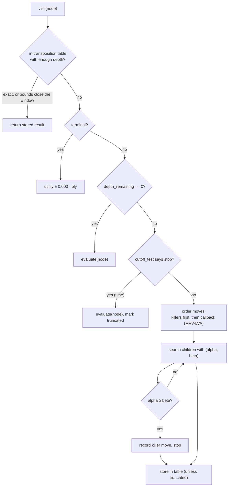
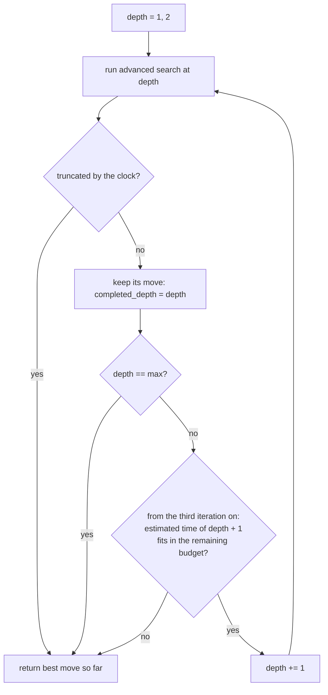
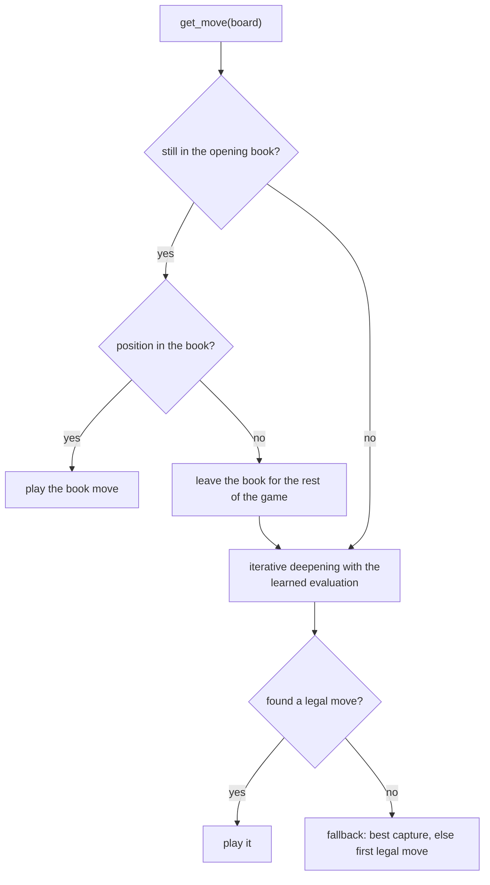

# Search algorithms

> **Qué es:** Los algoritmos de búsqueda (minimax, alfa-beta, profundización iterativa) y sus convenciones.
>
> **Cuándo leerla:** Para entender cómo decide una jugada el motor.
>
> **Siguiente paso:** [Adding an evaluation model](ADDING_A_MODEL.md)

All algorithms live in `src/chess_engine/search/game_algorithms.py` and work on any `GameProblem`.

| Function | What it adds |
|---|---|
| `minimax_search` | exhaustive minimax to terminal states |
| `alphabeta_search` | alpha-beta pruning, same result as minimax with fewer nodes |
| `heuristic_alphabeta_search` | an evaluation function and a cut-off test, so it can stop before the end of the game |
| `advanced_heuristic_alphabeta_search` | transposition table, killer moves, move ordering, preference for faster wins |
| `heuristic_alphabeta_iterative_deepening_search` | repeats the advanced search at growing depth within a time budget |

The three heuristic searches return `(best_move, SearchStatistics)`; the statistics hold
`nodes_visited`, `pruning_count`, `max_depth_reached` and `truncated`.

*Alpha-beta pruning: branches that cannot change the decision are cut. Image by Jez9999, CC BY-SA 3.0,
via Wikimedia Commons.*

## Conventions

* **Values** are the expected score for the player the search runs for: `1` win, `0.5` draw, `0` loss.
  Evaluation functions return values strictly between 0 and 1 (`0.01`–`0.99`) so that a heuristic never
  outranks a real result.
* **Cut-off test** `cutoff_test(state, depth, elapsed)`: in `heuristic_alphabeta_search` `depth` counts
  plies *from the root*; in the advanced search it is `depth_remaining`, counting *down* to 0.
  Returning True at `depth_remaining > 0` (typically because time ran out) marks the search as
  *truncated*.
* **Terminal values** are adjusted by `0.003` per ply (`DEPTH_PREFERENCE_EPSILON`): a quicker win is
  worth more than a slower one, a slower loss more than a quicker one.

## Advanced alpha-beta

* **Transposition table** (`dict` of `TTEntry`): stores value, best move, depth and a flag
  (`EXACT`, `LOWERBOUND`, `UPPERBOUND`) computed against the window the node was entered with. It is
  capped (500k entries by default, oldest dropped first) and never written after a time cut-off.
* **Killer moves**: up to three moves per depth that recently caused a cut-off are searched first.
* **Move ordering**: `order_moves_callback(board, moves)`; the bots use MVV-LVA (captures first,
  most valuable victim and least valuable attacker first; en passant counts as a pawn capture).
* **Make / unmake**: the advanced search walks the tree on one state with `apply_move` and
  `undo_move` instead of copying the position at every node. `ChessGameState` keeps its own undo
  stack (the position history and the cached outcome), so an undo restores them exactly.
* **Fast terminal detection**: `is_over()` caches the outcome of the state. The threefold repetition
  is read from the transposition keys of the positions since the last irreversible move (kept in
  the state and extended in constant time per move), not by replaying the game as python-chess does;
  the rules are the same as `board.outcome(claim_draw=True)`.

## Quiescencia

At the horizon a node is not scored directly. The side to move may keep the static evaluation
(stand-pat) or follow a noisy move (`chess_noisy_moves`: captures and promotions) for up to
`quiescence_plies` more plies, with alpha-beta and without transposition table. Terminal states and
time cut-offs behave as before, and the nodes it visits count in `nodes_visited`. It avoids scoring
a position in the middle of an exchange.

* **Default:** the search bots (`IterativeDeepeningBot` and its subclasses) use 4 plies.
* **Switch:** `quiescence_plies=0` turns it off (the horizon is evaluated directly, as before).
* **Measured gain** (paired, 2,000 test positions, best-move agreement with Stockfish): at depth 3,
  quiescence 4 adds +0.06 for `h1`, `linear_pst` and `linear_pst_terms` (paired SE 0.01). Depth 2
  with quiescence 4 beats depth 3 without it (+0.037, SE 0.013) in about half the time.
* **Cost** (`linear_pst_terms`, depth 3): 1,566 to 3,639 nodes per move and 0.19 s to 0.49 s per
  move, about 2.3x nodes and 2.6x time. Quiescence 8 adds little over 4 (+0.073 against +0.067).

Data, commands and logs: [RESULTS.md](RESULTS.md), section "Quiescencia a profundidad fija".

## Iterative deepening and time

The first two iterations always run. From the third on, the estimate multiplies the duration of
the last iteration by the growth between the last two (1.5 when they are too short to measure), and
the iteration is skipped when the estimate exceeds the remaining time by more than 15%. An
interrupted iteration is discarded unless it is the first one (some move is always needed).
`completed_depth` in the statistics is the depth of the last finished iteration, the move the bot
returns. `elapsed` is measured from the start of the move, not of each iteration.

`TimeManager` turns the clock into a budget: 15% of the remaining time, between 1.5 s and 40 s and never
more than half the clock; the hard limit is `1.5 × budget − 0.3 s`.

## How `IterativeModelBookBot` picks a move

The book is keyed by the position without move counters, so transpositions hit it. Everything the
bot learned (transposition table, killer moves, statistics) is cleared in `on_game_start`, because
its values are from the point of view of the colour it played.
