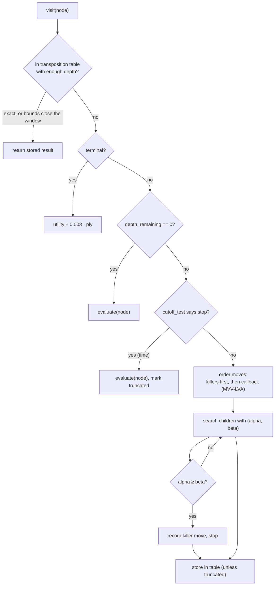
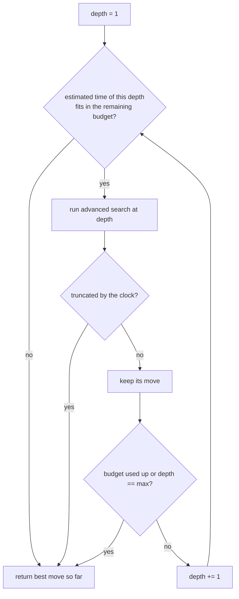
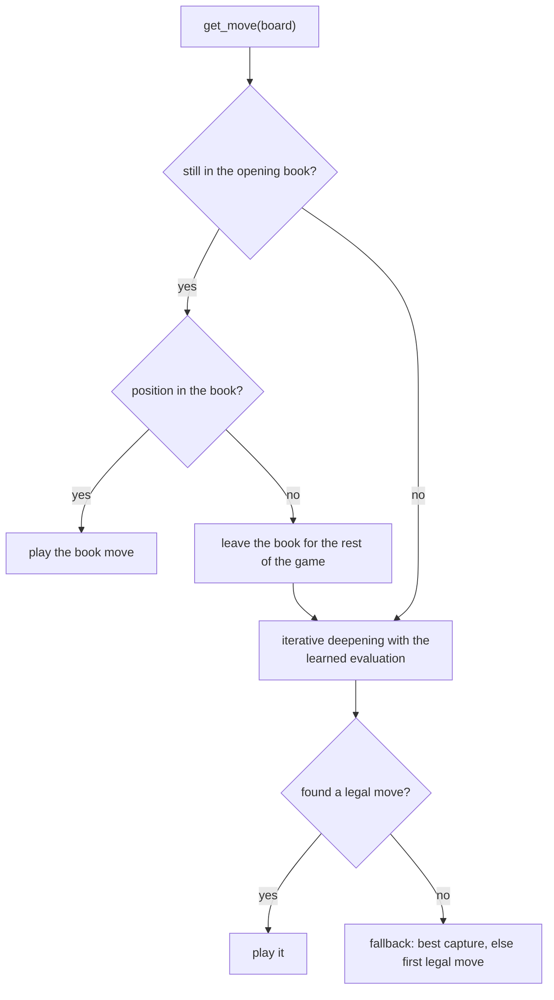

# Search algorithms

All algorithms live in `src/chess_engine/search/game_algorithms.py` and work on any `GameProblem`.

| Function | What it adds |
|---|---|
| `minimax_search` | exhaustive minimax to terminal states |
| `alphabeta_search` | alpha-beta pruning, same result as minimax with fewer nodes |
| `heuristic_alphabeta_search` | an evaluation function and a cut-off test, so it can stop before the end of the game |
| `advanced_heuristic_alphabeta_search` | transposition table, killer moves, move ordering, preference for faster wins |
| `heuristic_alphabeta_iterative_deepening_search` | repeats the advanced search at growing depth within a time budget |

The three heuristic searches return `(best_move, SearchStatistics)`; the statistics hold
`nodes_visited`, `pruning_count`, `max_depth_reached` and `truncated`.

*Alpha-beta pruning: branches that cannot change the decision are cut. Image by Jez9999, CC BY-SA 3.0,
via Wikimedia Commons.*

## Conventions

* **Values** are the expected score for the player the search runs for: `1` win, `0.5` draw, `0` loss.
  Evaluation functions return values strictly between 0 and 1 (`0.01`–`0.99`) so that a heuristic never
  outranks a real result.
* **Cut-off test** `cutoff_test(state, depth, elapsed)`: in `heuristic_alphabeta_search` `depth` counts
  plies *from the root*; in the advanced search it is `depth_remaining`, counting *down* to 0.
  Returning True at `depth_remaining > 0` (typically because time ran out) marks the search as
  *truncated*.
* **Terminal values** are adjusted by `0.003` per ply (`DEPTH_PREFERENCE_EPSILON`): a quicker win is
  worth more than a slower one, a slower loss more than a quicker one.

## Advanced alpha-beta

* **Transposition table** (`dict` of `TTEntry`): stores value, best move, depth and a flag
  (`EXACT`, `LOWERBOUND`, `UPPERBOUND`) computed against the window the node was entered with. It is
  capped (500k entries by default, oldest dropped first) and never written after a time cut-off.
* **Killer moves**: up to three moves per depth that recently caused a cut-off are searched first.
* **Move ordering**: `order_moves_callback(board, moves)`; the bots use MVV-LVA (captures first,
  most valuable victim and least valuable attacker first; en passant counts as a pawn capture).

## Iterative deepening and time

The estimate multiplies the duration of the last iteration by the ratio of the last two. An
interrupted iteration is discarded unless it is the first one (some move is always needed).
`elapsed` is measured from the start of the move, not of each iteration.

`TimeManager` turns the clock into a budget: 15% of the remaining time, between 1.5 s and 40 s and never
more than half the clock; the hard limit is `1.5 × budget − 0.3 s`.

## How `IterativeModelBookBot` picks a move

The book is keyed by the position without move counters, so transpositions hit it. Everything the
bot learned (transposition table, killer moves, statistics) is cleared in `on_game_start`, because
its values are from the point of view of the colour it played.
