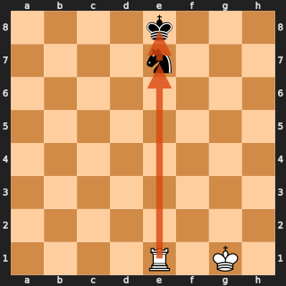
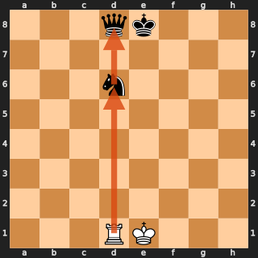
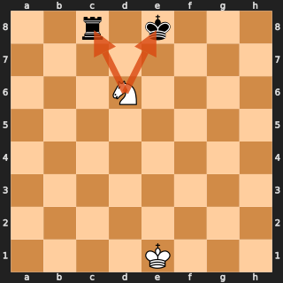
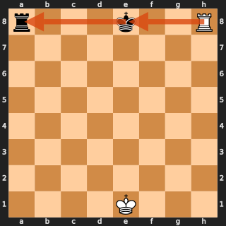

# Tactical patterns

`PrologPatternDetector` (`knowledge/pattern_detector.py`) asks a Prolog knowledge base,
`knowledge/chess_patterns.pl`, which legal moves *create* a tactical pattern. No bot uses it at the
moment.

> **Cost.** Loading a position into Prolog takes about 2 ms. Used as move ordering in every node of an
> alpha-beta search (the former `TacticalAlphaBetaBot`), a depth-3 move took several seconds against
> about one second without it, and quiet middlegame positions could even visit *more* nodes. That bot
> was removed; the detector is kept for a cheaper use (near the root only, or cached).

The detector loads the position once as facts (`piece/4`,
`to_move/1`, `can_castle/2`, `en_passant/2`, `move/4`), queries each predicate once for all moves
and returns a score per move and pattern. Coordinates are 1-based `(row, column)`.

| Pattern | Predicate | Idea |
|---|---|---|
| Absolute pin | `move_creates_absolute_pin/5` | the pinned piece cannot move: it shields the king |
| Relative pin | `move_creates_relative_pin/5` | moving the pinned piece loses something more valuable |
| Fork | `move_creates_fork/5` | one piece attacks two or more valuable enemy pieces |
| Skewer | `move_creates_skewer/5` | a valuable piece must move and exposes a weaker one behind it |
| Capture | `move_creates_capture/5` | most valuable victim, least valuable attacker |
| Promotion | `move_creates_promotion/4` | pawn reaches the last rank |

`score` is computed in Prolog from the piece values, so patterns involving a king or a queen rank
above those involving minor pieces.

| | |
|---|---|
|  |  |
| **Absolute pin**: the rook pins the knight to the king. | **Relative pin**: the knight is pinned to the queen behind it. |
|  |  |
| **Fork**: the knight attacks the king and the rook. | **Skewer**: the rook checks the king, which must leave the rank, exposing the rook behind it. |

The diagrams are generated with `python scripts/render_pattern_boards.py`.

## Requirements

SWI-Prolog (`apt install swi-prolog`) and `pip install -e ".[prolog]"`. Without them the detector
cannot be created and the Prolog tests are skipped.
