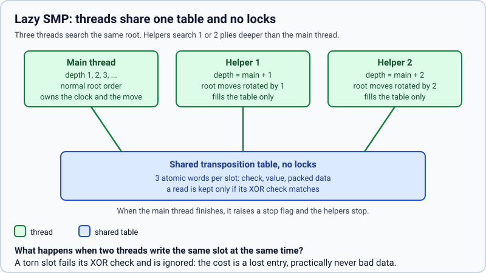

# The search in Rust and several threads

> **What it is:** How the search moved to Rust with identical results, how much faster it is, and how it uses several threads.
>
> **Read it when:** You want the speed numbers or to use several threads.
>
> **Next:** [Selective techniques](selective-techniques.md)

## The search in Rust

**Problem.** In Python the search visited 3,000 to 12,000 nodes per second, so in the 3 to 10
seconds a move gets it reached depth 4 or 5, far from the depths where a chess engine plays well.
The time went into the interpreter, the board of python-chess and the evaluations, not into the
algorithm.

**What it does.** The same search, in Rust: the rules of the game, the evaluations the search calls
(`h1`, the four logistic models and the sparse network), the alpha-beta with all the techniques
above, the opening book and the endgame tables. Python keeps the game loop, the bots' interface, the
training and the comparison tools, and calls the core once per move with the position, the
evaluation and the time limits.

**How it is implemented.** The crate in `rust/` is built as the Python module `chess_engine._core`
(PyO3 and `maturin`) on top of `shakmaty` for the rules. Nothing changed in the algorithm: the Rust
core reproduces the Python engine node for node. `tests/golden/` holds what the Python engine
produced (2,000 positions with their histories, the features and values of every evaluation,
fixed-depth searches of `h1` and the five models with value, move, nodes and prunings, book
lookups and tablebase moves) and `rust/tests/golden_*.rs` and `tests/core/test_core_golden.py` compare
the core with it. The legal moves are listed in the order python-chess generates them
(`generation_order`), so that moves of equal value are chosen as before. Replaying the 21,203 moves
of the 200 recorded games of the depth-3 tournament, the core plays 21,192 of them (99.95 %) with
the same number of nodes; the 11 others differ in the last decimal of a value.

**Measured effect.** Measured with `python src/chess_lab/scripts/bench/measure_search_speed.py --positions 200 --seconds 1,3,10 --depths 4`
(200 test positions, seed 42, a fresh table per position, five processes of one thread each, books
and tables off), once with the Python engine (commit `148b86d`) and once with the core. Time to search
every position to depth 4, in seconds per move:

| player | Python | Rust | times faster |
|---|---|---|---|
| Heuristic (`h1`) | 7.995 | 0.226 | 35.4 |
| Position-terms logistic model (`linear_pst_terms`) | 3.429 | 0.139 | 24.7 |
| Piece-square logistic model (`linear_pst`) | 2.279 | 0.110 | 20.6 |
| Material logistic model (`linear_material`) | 1.335 | 0.076 | 17.6 |
| King-bucket logistic model (`linear_king_bucket`) | 1.990 | 0.120 | 16.6 |
| Four-layer piece-square network (`net4_pst`) | 2.266 | 0.286 | 7.9 |

Mean depth completed in a time budget per move (the clock decides; the estimator stops an iteration
that will not fit, so a move uses 50 to 80 % of the budget):

| player | 1 s: Python → Rust | 3 s: Python → Rust | 10 s: Python → Rust |
|---|---|---|---|
| `h1` | 2.58 → 5.29 | 3.25 → 6.04 | 4.12 → 6.93 |
| `linear_material` | 3.78 → 6.04 | 4.49 → 6.82 | 5.37 → 7.68 |
| `linear_pst` | 3.35 → 5.60 | 4.05 → 6.34 | 4.94 → 7.18 |
| `linear_pst_terms` | 3.19 → 5.43 | 3.85 → 6.26 | 4.62 → 7.13 |
| `linear_king_bucket` | 3.50 → 5.63 | 4.23 → 6.36 | 5.04 → 7.51 |
| `net4_pst` | 3.35 → 4.80 | 4.04 → 5.61 | 4.85 → 6.82 |

In 10 seconds the core searches 2.0 to 2.8 plies deeper. A 200-game round robin at a fixed depth of 3
took 56 s (it took hours in Python). The network gains least because it still adds the 768 inputs
to its first layer at every leaf; an accumulator updated move by move, as NNUE does, would remove
that and has not been written.

**Status.** Kept; since 2026-10-25.

## Several threads (Lazy SMP)

**Problem.** A computer has several cores and the search used one.

**What it does.** With `threads = N` the search runs on N threads. They all search the same position
and share one transposition table, without locks; the main thread runs the iterative deepening as
usual and the others, from other depths and with the moves of the root in a different order, fill the
table with what they find. When the main thread finishes it raises a flag and the others stop. The
move is the main thread's. Dividing the root moves among the threads was not chosen: the first move
takes most of the work (the others are cut off by its value), so the threads would wait for each
other and, ignoring what the others find, they would prune less.

**How it is implemented.** `iterative_deepening` and `helper` in `rust/src/search/mod.rs`; the
table is `SharedTable` in `rust/src/search/shared.rs`, with three atomic words per slot checked by
XOR (a slot torn by two writers is ignored). `threads` and `hash_mb` are options of
`IterativeDeepeningBot` and the thread setting of the window. The tournaments use one thread, so
that games are reproducible and the clock is fair among processes. With more than one thread the
search is not deterministic and the evaluation must run in the core.

**Measured effect.** Measured with `python src/chess_lab/scripts/bench/measure_search_speed.py --positions 60 --seconds 3 --depths 8
--players linear_pst_terms --threads 1,2,4,6 --workers 1 --techniques incremental,tt_move,history,pvs,aspiration,null_move`
(the Position-terms logistic model, 60 test positions, the default techniques of [selective techniques](selective-techniques.md) on, nothing
else running on the six-core machine). The nodes per second count the nodes of all threads:

| threads | nodes/s (3 s) | mean depth in 3 s | seconds to depth 8 |
|---|---|---|---|
| 1 | 483,810 | 9.08 | 1.930 |
| 2 | 925,702 | 9.28 | 1.522 |
| 4 | 1,605,067 | 9.50 | 1.180 |
| 6 | 2,099,554 | 9.43 | 1.211 |

With the techniques on, the searches are deeper and share more, so the threads pay off more than with the
reference search (there, six threads gave only 15 % less time to depth 6 and +0.23 plies in 10 s): four
threads reach depth 8 1.6 times faster and gain 0.4 plies in 3 s. Six threads are no better than four
on this machine (six cores, with the main thread of the measurement and the operating system on them).
A first version in which the helpers started at depths 1 to 3 was slower; making them search one or two plies
deeper than the main thread is, as here, improved it. Longer searches and further variants were not measured.

**Status.** Kept as an option, off by default (tournaments need one thread); since 2026-10-25.
