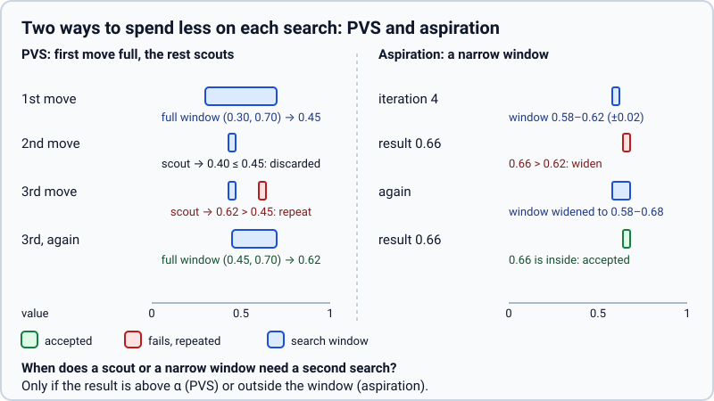
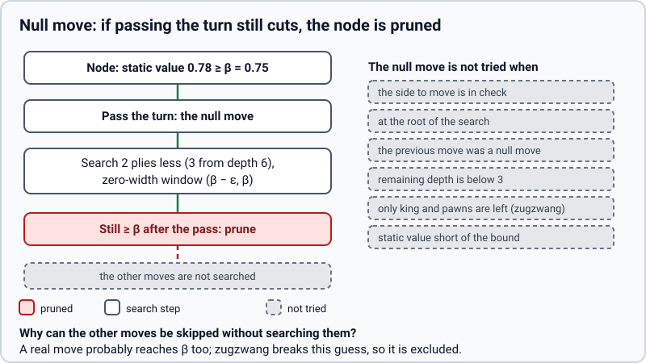

# Selective search techniques

> **What it is:** Six techniques that prune or reorder the tree behind switches (`incremental`, `tt_move`, `history`, `pvs`, `aspiration`, `null_move`), and how they were judged.
>
> **Read it when:** You want to know what each one does, how it is implemented and what it gained.
>
> **Next:** [Techniques not adopted](not-adopted.md)

## Search techniques: the switches and how they were judged

The search of the classic techniques ([search basics](search-basics.md)) and the Rust core ([Rust and threads](rust-and-threads.md)) is the *reference*: every technique below is off in it, and `tests/golden/` pins
its values, moves and node counts. Each technique is a field of `Techniques` (`rust/src/search/mod.rs`), a
name in `_core.TECHNIQUES`, the option `techniques` of `IterativeDeepeningBot` and `--techniques` of `main.py`
(`list`, `all` or `none`). The bots use `DEFAULT_TECHNIQUES` (`src/chess_engine/bots/_search_bots.py`): all but
`lmr`. `make_player` (tournaments and measurements) uses none unless the player is written `model+tech1,tech2`,
so results of different engines are never mixed.

**How they were judged.** Two measurements, both repeatable.

1. Nodes and time at depth 6 over 100 positions, and how often the move equals the reference's:
   `python scripts/bench/compare_search_features.py` (variants `with <technique>` and `with all of them`),
   Position-terms model:

| variant | nodes per move | s per move | same move as reference |
|---|---|---|---|
| reference | 672,800 | 1.86 | - |
| `tt_move` | 256,693 | 0.71 | 98 % |
| `history` | 391,130 | 1.16 | 100 % |
| `pvs` | 487,244 | 1.33 | 100 % |
| `aspiration` | 440,213 | 1.20 | 100 % |
| `null_move` | 446,129 | 1.25 | 99 % |
| `lmr` (first, aggressive) | 86,830 | 0.23 | 70 % |
| `lmr` (mild) | 146,356 | 0.395 | 82 % |

2. Games against the reference at equal time (4 s + 0.05 s per move, 100 games, colours swapped, same model):
   `python scripts/bench/compare_engine_versions.py --model linear_pst_terms --candidate tt_move,history --openings 50 --base 4 --increment 0.05`.

| candidate | score | Elo | mean depth (reference 4.68) |
|---|---|---|---|
| `tt_move,history` | 63.0 % | +92 | 5.20 |
| `+ pvs, aspiration` | 64.5 % | +104 | 5.20 |
| `+ null_move` | 76.5 % (95 % interval 69.0-84.0) | +205 | 5.54 |
| all, aggressive `lmr` | 63.5 % | +96 | 6.26 |
| mild `lmr` against the set without it | 49.0 % | -7 | 6.08 against 5.55 |

A technique is on if it does not lose to the reference and gains depth or time. Fewer nodes alone is not
enough: `lmr` searched deeper and played worse. The intervals of 100 games are wide (about +-8 points), so
the table shows what was decided, not small differences.

## Incremental network accumulator

**Problem.** `net4_pst` (768 -> 256 -> 32 -> 32 -> 1) spent most of its time in the first layer, summing the
rows of every piece again at each leaf.

**What it does.** Keeps the first-layer sum updated move by move: a move adds and removes only the rows of the
pieces that change. The features are relative to the side to move, so two accumulators are kept (White and
Black as the reference) and the one of the player to move is read.

**How it is implemented.** `NetState` in `rust/src/eval/net.rs` behind the `EvalState` trait (`apply`,
`apply_null`, `undo`, `evaluate`), with a stack of snapshots so `undo` is a pop. The search holds the state
beside `GameState`. Switch: `incremental`. Test: `incremental_equals_full` (same values as the full evaluation up
to rounding) and `tests/test_core_golden.py::test_the_incremental_network_gives_the_same_search`.

**Measured effect.** About 15 % more nodes per second for `net4_pst`
(`python scripts/bench/measure_search_speed.py --techniques incremental`). Rounding can break a tie, so node counts
agree within 1 %, not exactly.

**Status.** On by default; since 2026-10-25.

## Table move first (`tt_move`)

**Problem.** A node whose table entry is too shallow to cut still knows the best move found there; the reference
ignores it and orders by MVV-LVA and killers.

**What it does.** Tries the stored best move before every other move.

**How it is implemented.** `move_to_front` in `rust/src/search/tt.rs`, called in `Search::node`. The value does
not change (same tree, other order), only how soon a cut-off comes.

**Measured effect.** Nodes at depth 6 fall from 672,800 to 256,693 (2.6 times); same move as the reference in 98 %
(ties resolve differently). In games, with `history`: +92 Elo.

**Status.** On by default.

## History heuristic (`history`)

**Problem.** Among quiet moves nothing says which to try first; killers only remember two or three per depth.

**What it does.** Counts, for each (colour, move), how often it produced a cut-off, weighted by depth, and orders
quiet moves by that count.

**How it is implemented.** `History` in `rust/src/search/tt.rs`, indexed by `move_id`; `reward` is called at a
cut-off by a quiet move. Part of `order`.

**Measured effect.** Nodes 672,800 -> 391,130; same move as the reference 100 %.

**Status.** On by default.

## Principal variation search (`pvs`)

**Problem.** After the first move, the rest are only checked to see that none is better; a full window wastes work.

**What it does.** Searches the first move with the full window and the others with a zero-width window around alpha;
only a move that beats alpha is searched again with the full window.

**How it is implemented.** `child_value` in `rust/src/search/mod.rs`; the scout window uses
`SCOUT_EPSILON = 1e-9` because values are continuous probabilities.

**Measured effect.** Nodes 672,800 -> 487,244; same move 100 %.

**Status.** On by default.

## Aspiration windows (`aspiration`)

**Problem.** Each iteration starts from the whole `[0.01, 0.99]` window although the previous iteration's value
is almost always close.

**What it does.** From depth 4, searches with a window of +-0.02 around the last value; if the result falls
outside, widens it by 4 times and searches again.

**How it is implemented.** `iteration` in `rust/src/search/mod.rs`. A repeat cut short by the clock keeps the
last complete result, and nothing reduced is stored as complete in the table.

**Measured effect.** Nodes 672,800 -> 440,213; same move 100 %. With `pvs`: +104 Elo (with `tt_move`, `history`).

**Status.** On by default.

## Null move (`null_move`)

**Problem.** Many nodes are so good for the side to move that even passing the turn would cut.

**What it does.** Passes the turn and searches 2 plies less (3 from depth 6) with a zero-width window; if even
that cuts, the node is cut. Not in check, not at the root, not twice in a row, only if the mover has pieces
besides king and pawns (zugzwang), and only if the static value already reaches beta.

**How it is implemented.** `apply_null` in `rust/src/board.rs` and the branch at the start of `Search::node`.
Test: a pawn ending (Lasker position) where the null move would be wrong, in `rust/tests/techniques.rs`.

**Measured effect.** Nodes 672,800 -> 446,129; same move 99 %. The biggest gain in games: the set with it
scored 76.5 % (+205 Elo) against the reference.

**Status.** On by default.
