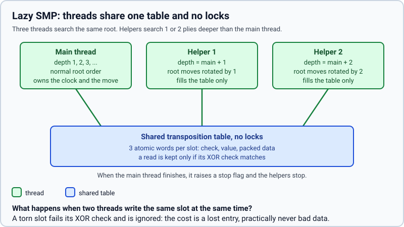

# Several threads (Lazy SMP)

> **What it is:** Running the search on several threads that share one lock-free transposition table.
>
> **Read it when:** You want to use several threads or know what they gain.
>
> **Next:** [Incremental network accumulator](incremental.md)

**Problem.** A computer has several cores and the search used one.

**What it does.** With `threads = N` the search runs on N threads. They all search the same position
and share one transposition table, without locks; the main thread runs the iterative deepening as
usual and the others, from other depths and with the moves of the root in a different order, fill the
table with what they find. When the main thread finishes it raises a flag and the others stop. The
move is the main thread's. Dividing the root moves among the threads was not chosen: the first move
takes most of the work (the others are cut off by its value), so the threads would wait for each
other and, ignoring what the others find, they would prune less.

**How it is implemented.** `iterative_deepening` and `helper` in `rust/src/search/deepening.rs`; the
table is `SharedTable` in `rust/src/search/shared.rs`, with three atomic words per slot checked by
XOR (a slot torn by two writers is ignored). `threads` and `hash_mb` are options of
`SearchBot` and the thread setting of the window. The tournaments use one thread, so
that games are reproducible and the clock is fair among processes. With more than one thread the
search is not deterministic and the evaluation must run in the core.

**Measured effect.** Measured with `python (removed) scripts/bench/measure_search_speed.py --positions 60 --seconds 3 --depths 8
--players linear_pst_terms --threads 1,2,4,6 --workers 1 --techniques incremental,tt_move,history,pvs,aspiration,null_move`
(the Position-terms logistic model, 60 test positions, the default techniques of [selective techniques](README.md) on, nothing
else running on the six-core machine). The nodes per second count the nodes of all threads:

| threads | nodes/s (3 s) | mean depth in 3 s | seconds to depth 8 |
|---|---|---|---|
| 1 | 483,810 | 9.08 | 1.930 |
| 2 | 925,702 | 9.28 | 1.522 |
| 4 | 1,605,067 | 9.50 | 1.180 |
| 6 | 2,099,554 | 9.43 | 1.211 |

With the techniques on, the searches are deeper and share more, so the threads pay off more than with the
reference search (there, six threads gave only 15 % less time to depth 6 and +0.23 plies in 10 s): four
threads reach depth 8 1.6 times faster and gain 0.4 plies in 3 s. Six threads are no better than four
on this machine (six cores, with the main thread of the measurement and the operating system on them).
A first version in which the helpers started at depths 1 to 3 was slower; making them search one or two plies
deeper than the main thread is, as here, improved it. Longer searches and further variants were not measured.

**Status.** Kept as an option, off by default (tournaments need one thread); since 2026-10-25.
