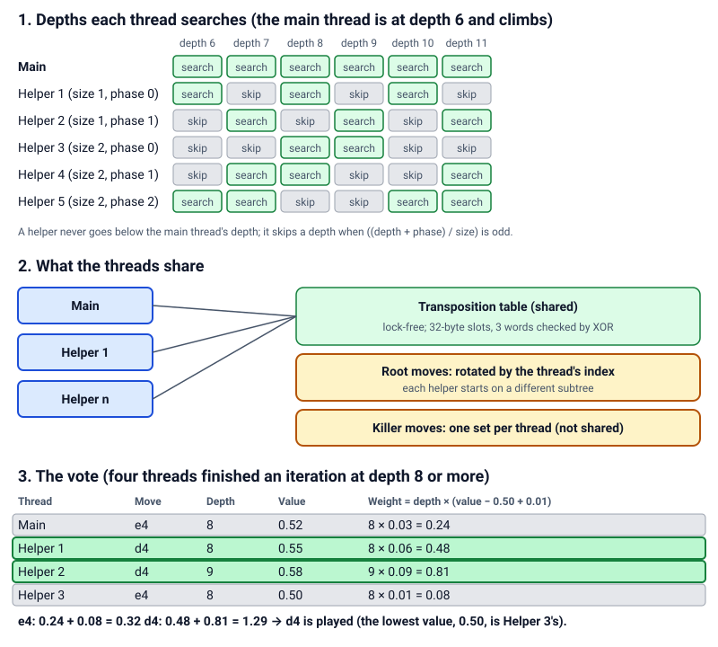

# Several threads (Lazy SMP)

> **What it is:** Running the search on several threads that share one lock-free transposition table.
>
> **Read it when:** You want to use several threads or know what they gain.
>
> **Next:** [Incremental network accumulator](incremental.md)

## Problem

A computer has several cores and the search used one.

## Idea

Let every thread search the same root and share one transposition table. The helpers do not need to coordinate:
what one finds is in the table when another reaches the same position. Dividing the root moves among the threads
was not chosen: the first move takes most of the work (the others are cut off by its value), so the threads would
wait for each other and, blind to each other's results, prune less.

## How it works

- The main thread runs [iterative deepening](iterative-deepening.md) as usual, with the clock, and its move is the
  one played.
- Each helper repeatedly searches one or two plies deeper than the main thread's current depth (helpers with an even
  index one ply, odd two), so the table already holds what the main thread will need next.
- The table is shared without locks; a slot written by two threads at once is detected and ignored.
- When the main thread finishes it raises a stop flag and the helpers abandon their search.

**Worked example.** Four threads; the main thread is on depth 6. Helpers 1 and 3 search depth 8, helper 2 depth 7.
When helper 2 stores an exact value for a position at depth 5 from the root, the main thread, reaching that position
with one ply left, finds an entry deep enough and returns without searching it. The four threads share the 1.18 s it
takes to reach depth 8, against 1.93 s for one thread (table below).

<picture>
  <source media="(prefers-color-scheme: dark)" srcset="../img/threads-shared-table-dark.svg">
  
</picture>

## Implementation

`iterative_deepening` and `helper` in `rust/src/search/deepening.rs`; `SharedTable` in `rust/src/search/shared.rs`,
three atomic words per slot checked by XOR. `Memory::with_threads` (`rust/src/search/memory.rs`) builds the shared
table only with more than one thread. UCI options `Threads` and `Hash` (megabytes of the shared table; with one
thread `Hash` has no effect); in the window, Settings → Advanced. With more than one thread the search is not
deterministic.

## Measured effect

`scripts/bench/measure_search_speed.py --positions 60 --seconds 3 --depths 8 --players linear_pst_terms --threads 1,2,4,6 --workers 1 --techniques incremental,tt_move,history,pvs,aspiration,null_move`
(removed in `6162db8`; in the git history), Rust core, 60 test positions, six-core machine otherwise idle; nodes per
second count all threads:

| threads | nodes/s (3 s) | mean depth in 3 s | seconds to depth 8 |
|---|---|---|---|
| 1 | 483,810 | 9.08 | 1.930 |
| 2 | 925,702 | 9.28 | 1.522 |
| 4 | 1,605,067 | 9.50 | 1.180 |
| 6 | 2,099,554 | 9.43 | 1.211 |

Four threads reach depth 8 1.6 times faster and gain 0.4 plies in 3 s; six are no better than four on six cores.
Without the techniques, six threads gave only 15 % less time to depth 6. A first version with helpers at depths 1
to 3 was slower than helpers ahead of the main thread. Its effect in games is not measured.

## Status

Adopted as an option, off by default (one thread keeps matches reproducible and the clock fair); since 2026-10-25.
