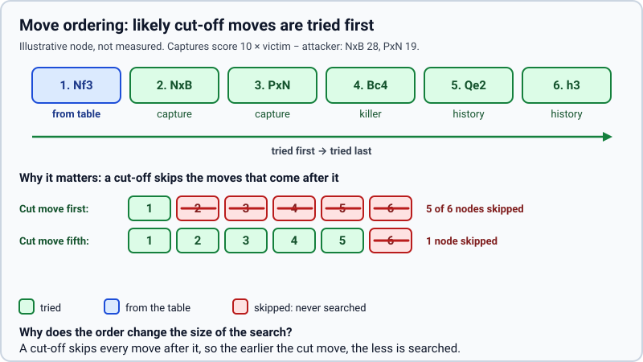

# Move ordering by MVV-LVA

> **What it is:** Trying captures first, the most valuable victim taken by the least valuable attacker first.
>
> **Read it when:** You want to know the order in which the search tries moves.
>
> **Next:** [Quiescence search](quiescence.md)

**Problem.** The order in which moves are tried decides how much alpha-beta can skip, and the move list of a
position comes in generation order, which says nothing about how good a move is.

**What it does.** Captures go first, best Most Valuable Victim / Least Valuable Attacker first (a pawn
taking a queen before a queen taking a pawn; en passant counts as a pawn capture). Quiet moves keep
their order, so killers stay in front of them. The full order a node uses is: the move stored in the
transposition table (`tt_move`, if that technique is on), the captures by MVV-LVA, the killers, and the
rest of the quiet moves by their history score (`history`, if on).

**How it is implemented.** `mvv_lva_score` and `order` in `rust/src/search/ordering.rs` (score
`10 × victim − attacker`; a stable sort, so equal captures keep the order of generation (the one python-chess used)
them in, `generation_order` in `rust/src/board.rs`). `fallback_move` in
`(removed) chess_engine/bots/search_bot.py` picks the best capture when a search returns nothing.

**Measured effect.** Depth 4, 60 positions: without ordering 64,003 nodes per move instead of 15,988
(ordering saves 75.0 % of the nodes) and 5.408 s instead of 1.365 s (74.8 % less time); 11.7 % of the
moves differ (`same as baseline` 0.883) and Stockfish agreement drops from 0.317 to 0.283. By far the
most effective technique measured. With table, killers, ordering and quiescence all off: 47,445 nodes
(fewer than without ordering alone, because switching quiescence off removes many nodes itself).

**Status.** Kept; since the first commit (2026-10-16).
