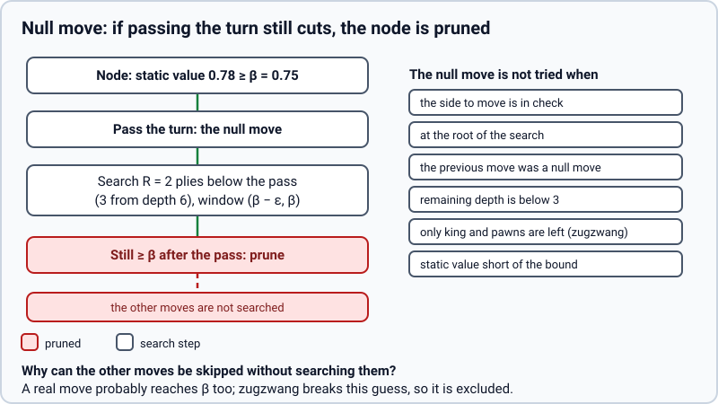

# Null move (`null_move`)

> **What it is:** Pruning a node when even passing the turn leaves the side to move good enough.
>
> **Read it when:** You want to know the technique that gained most in games, and when it is not tried.
>
> **Next:** [Late move reductions](lmr.md)

## Problem

Many nodes are so good for the side to move that any reasonable move reaches beta. The search still has to find
and search one such move at full depth to prove the cut.

## Idea

Passing the turn is almost always worse than the best move. So if the side to move passes and the opponent, with
a free move and a shallower search, still cannot bring the value below beta, a real move would not either: prune
the node.

## How it works

Before the moves, if the conditions hold, the turn is passed and the position is searched `R` plies shallower
than a normal child (`R = 2`, `3` from 6 plies left) with a zero-width window at beta. If that value reaches beta,
the node returns beta. Conditions: not in check, not at the root, not right after another null move, at least 3
plies left, the side to move has pieces other than king and pawns (in pawn endings passing would be best:
zugzwang), and the static value already reaches beta.

**Worked example** (illustrative values, as in the diagram). A node with 5 plies left, beta `0.75`, static value `0.78`. The turn is passed and the
opponent's position searched with 5 − 1 − 2 = 2 plies and window `(0.75 − ε, 0.75)`. It returns `0.77`: still at
or above beta, so the node returns `0.75` without searching its moves, a 2-ply search instead of at least one
4-ply one.

<picture>
  <source media="(prefers-color-scheme: dark)" srcset="../img/null-move-dark.svg">
  
</picture>

## Implementation

`apply_null` in `rust/src/board.rs`; the branch at the start of `Search::node` in `rust/src/search/node.rs`
(`NULL_MOVE_FROM_DEPTH = 3`). Test: a pawn ending (Lasker position) where a null move would be wrong, in
`rust/tests/techniques.rs`. Switch: `null_move`.

## Measured effect

Rust core, `linear_pst_terms`, 100 positions at depth 6 (`scripts/bench/compare_search_features.py`, removed in
`6162db8`; in the git history): nodes per move 672,800 → 446,129, time 1.86 s → 1.25 s, same move in 99 %. In
games the largest gain: the set with it scored 76.5 % (95 % interval 69.0–84.0, +205 Elo) against the reference,
against 64.5 % without it ([catalogue](README.md#how-the-switches-were-judged)).

## Status

Adopted, on by default; since 2026-10-25 (`f5e368a`).
