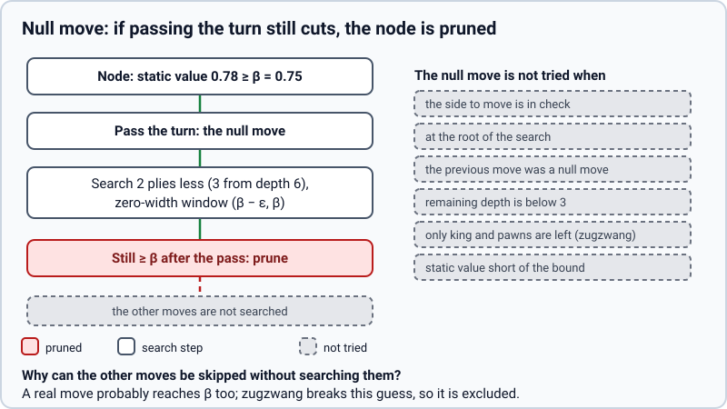

# Null move (`null_move`)

> **What it is:** Passing the turn to test whether a node is so good it can be cut without searching its moves.
>
> **Read it when:** You want to know the technique that gained most in games.
>
> **Next:** [Late move reductions](lmr.md)

**Problem.** Many nodes are so good for the side to move that even passing the turn would cut.

**What it does.** Passes the turn and searches R = 2 plies below the pass (R = 3 from depth 6) with a zero-width window; if even
that cuts, the node is cut. Not in check, not at the root, not twice in a row, only if the mover has pieces
besides king and pawns (zugzwang), and only if the static value already reaches beta.

**How it is implemented.** `apply_null` in `rust/src/board.rs` and the branch at the start of `Search::node`.
Test: a pawn ending (Lasker position) where the null move would be wrong, in `rust/tests/techniques.rs`.

**Measured effect.** Nodes 672,800 -> 446,129; same move 99 %. The biggest gain in games: the set with it
scored 76.5 % (+205 Elo) against the reference.

**Status.** On by default.
