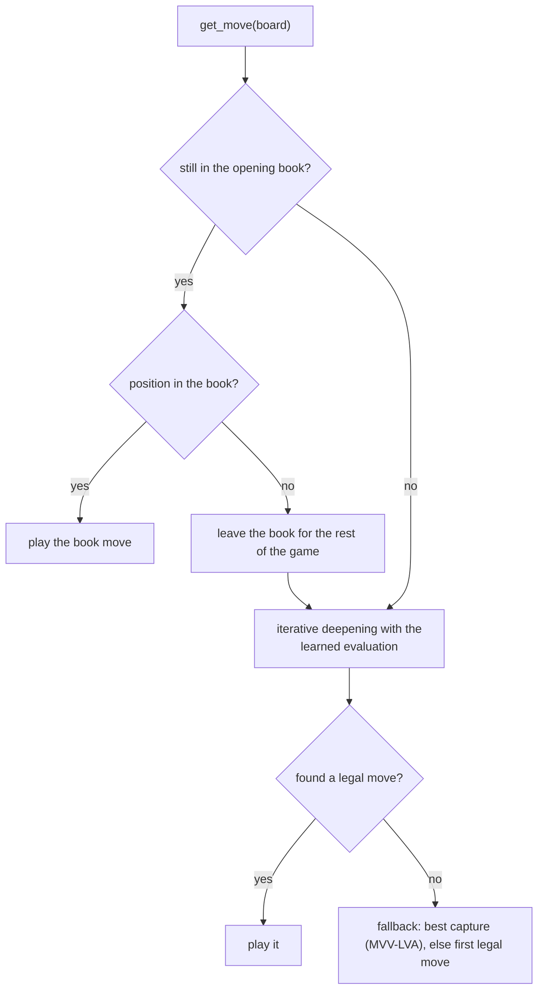

# Opening book

> **What it is:** The book of opening moves checked against Stockfish that the window plays before the engine searches.
>
> **Read it when:** You want to know where the book comes from, how it was checked, or how it is consulted.
>
> **Next:** [Endgame tablebases](endgame-tablebases.md)

**The opening book.** The bot (`SearchBot`; on by default, `--no-opening-book` switches it off) plays
book moves while the game follows the book, then searches. The book
(`OpeningBook` in `rust/src/knowledge/book.rs`, with `src/chess_engine/knowledge/opening_book.py` as its
Python face) is keyed by the first four FEN fields, so
transpositions hit the same entry. Once the game leaves the book it is never consulted again;
`on_game_start` re-enables it and clears the table, killers and statistics.

**The opening book**, `data/opening_book.json` (versioned, 9.0 MB, 121,868 positions), is the only
opening book of the project. `python src/chess_lab/scripts/data/build_opening_book.py` builds it from the raw
shards: from the starting position it plays every legal move, looks up the Stockfish evaluation of
the position that results (those with fewer than 26 pieces, or evaluated to a depth under 18, are not
indexed), keeps for the side to move the best move and the others within 30 centipawns (at most
four), and follows them for 24 half-moves. Lines that already favour one side by more than 150
centipawns are not followed, and each level keeps at most 8,000 positions, the most balanced ones.
Every move in the book therefore leads to a position that Stockfish evaluated, and is the best one
among the evaluated alternatives. The script indexes 39.6 million positions (about half an hour with other jobs running) and
the book keys are the first four FEN fields, so transpositions hit.

The book is not played against anything; it is checked against an engine instead.
`python src/chess_lab/scripts/data/check_opening_book.py data/opening_book.json --fraction 0.02 --engine /usr/games/stockfish --depth 16`
draws 2 % of its entries at random (seed 42) and asks Stockfish 16 how much each move loses against
the best line. On the 2,438 entries drawn from the 121,899-position build, none was illegal, 98.7 %
were within 50 centipawns of the best line and the mean loss was 5.0 centipawns; the 31 entries
that failed were removed (`--prune`), which leaves the 121,868 positions of the shipped book. The
script can also ask the public Lichess cloud evaluation (without `--engine`), which limits the
request rate; on 12 entries both judges agreed on the one failing move.
