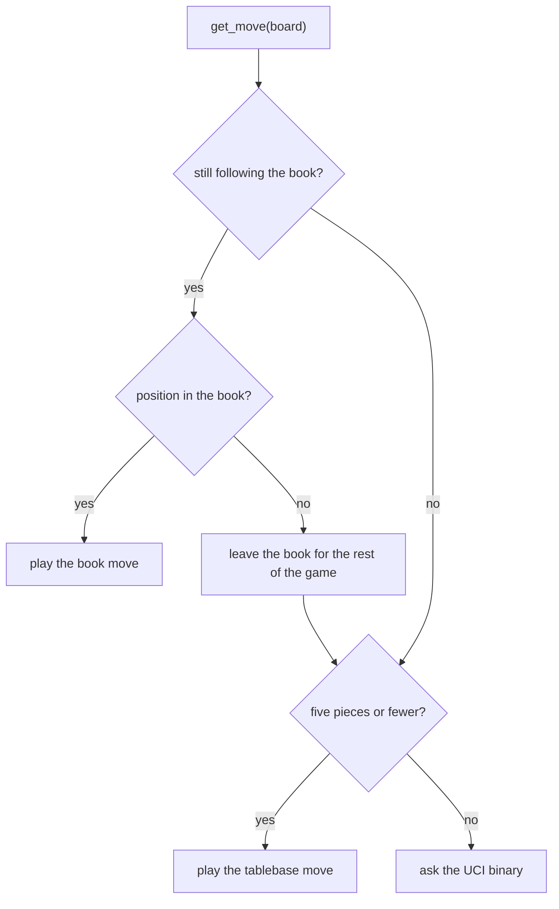

# Opening book

> **What it is:** The book of opening moves checked against Stockfish that the window plays before the engine searches.
>
> **Read it when:** You want to know where the book comes from, how it was checked, or how it is consulted.
>
> **Next:** [Endgame tablebases](endgame-tablebases.md)

## Problem

In the opening a search of a few seconds finds playable but shallow moves, and every engine of the project would
spend its clock rediscovering the same well-known positions. Stockfish has already evaluated those positions,
deeply, in the Lichess database.

## Idea

Build, once, a table from position to move out of the Stockfish evaluations, keep only moves that Stockfish
itself confirms, and play from it while the game follows it.

## How it works

**Building** (`build_opening_book.py`): from the starting position, play every legal move and look up Stockfish's
evaluation of the result in the raw shards (positions with fewer than 26 pieces or evaluated below depth 18 are
not indexed). For the side to move keep the best move and up to three others within 30 centipawns, and follow them
for 24 half-moves. Lines already more than 150 centipawns in favour of one side are not followed, and each level
keeps at most 8,000 positions, the most balanced.

**Playing**: the key is the first four FEN fields, so transpositions hit the same entry. While the game is in the
book, the book move is played; at the first position not in the book the game leaves it for good, and the engine
searches every later move.

**Worked example.** After 1. e4 the book has an entry for the position (key `rnbqkbnr/pppppppp/8/8/4P3/8/PPPP1PPP/RNBQKBNR b KQkq -`) and plays its move without searching. If the
opponent then plays a move whose resulting position has no entry, the window switches to the engine and does not
look at the book again until a new game, even if a later position is in it.



## Implementation

`OpeningBook` in `rust/src/knowledge/book.rs`, consulted by `rust/src/bin/uci.rs` on each `go`, before the
tablebases and the search, while the game follows the book (the first missing position ends it; `ucinewgame` starts
it again). The binary uses the book only when the UCI option `Book` names the JSON file, so the matches and
tournaments play without it. Switch: the window's Settings → Opening book (`AISettings.opening_book`), which sets that option. Data: `data/knowledge/opening_book/opening_book.json` (versioned,
9.0 MB, 121,868 positions), the only opening book of the project.

```bash
python src/chess_lab/scripts/data/build_opening_book.py
python src/chess_lab/scripts/data/check_opening_book.py data/knowledge/opening_book/opening_book.json --fraction 0.02 --engine /usr/games/stockfish --depth 16
```

The build indexes 39.6 million positions (about half an hour). The book is not used in engine matches: fastchess
plays from its own [opening suite](../OPENINGS.md).

## Measured effect

The book was checked against an engine, not played against anything. The check command above draws 2 % of the
entries (seed 42) and asks Stockfish 16 how much each move loses against the best line. On 2,438 entries of the
121,899-position build: none illegal, 98.7 % within 50 centipawns of the best line, mean loss 5.0 centipawns. The 31
entries that failed were removed (`--prune`), leaving the 121,868 positions shipped. Its effect on results is not
measured.

## Status

Adopted in the window; a book was part of the coursework base (2026-10-16), replaced by the one built from the Lichess shards on 2026-10-21 (`19c859e`). The UCI binary has no book. The book
(`data/knowledge/opening_book/opening_book.json`) is permanent data, kept when the training data is deleted.
