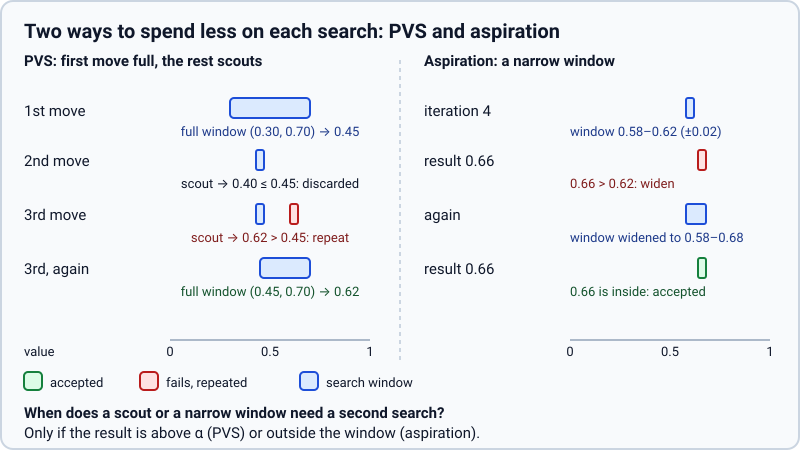

# Principal variation search (`pvs`)

> **What it is:** Searching every move after the first with a zero-width window, to prove it is not better.
>
> **Read it when:** You want to know why most moves cost less than the first.
>
> **Next:** [Aspiration windows](aspiration.md)

## Problem

With good ordering the first move of a node is usually the best. The others are searched only to confirm that
none beats it, yet the reference searches each with the full `(alpha, beta)` window, as if it might.

## Idea

Asking "is this move better than alpha?" is cheaper than asking "what is its value?". A search with a window of no
width around alpha answers yes or no and cuts much sooner. Only a move that answers yes is searched again with
the full window to get its value.

## How it works

The first move is searched with `(alpha, beta)`. Each later move is searched with `(alpha, alpha + ε)`. If the
result is at most alpha, the move is refuted and its value is enough. If it is above alpha (and below beta), the
move is searched again with `(alpha, beta)`.

**Worked example** (illustrative values). A node with window `(0.40, 0.60)`. The first move gives `0.52`, so alpha becomes `0.52`. The
second is searched with `(0.52, 0.52 + ε)` and returns `0.48`: refuted, no repeat. The third returns `0.55` from the
narrow search: it beats alpha, so it is searched again with `(0.52, 0.60)` and gives `0.55`, the new best. Two of
three moves were narrow searches; one needed a repeat.

<picture>
  <source media="(prefers-color-scheme: dark)" srcset="../img/pvs-aspiration-dark.svg">
  
</picture>

## Implementation

`child_value` in `rust/src/search/node.rs`. Values are continuous probabilities, so the width is
`SCOUT_EPSILON = 1e-9`. Only from 2 plies left, and only when the window is not already of zero width. A repeat
cut short by the clock keeps the narrow value. Switch: `pvs`.

## Measured effect

Rust core, `linear_pst_terms`, 100 positions at depth 6 (`scripts/bench/compare_search_features.py`, removed in
`6162db8`; in the git history): nodes per move 672,800 → 487,244, time 1.86 s → 1.33 s, same move in 100 %. In
games, with `aspiration` (and `tt_move`, `history`): 64.5 %, +104 Elo
([catalogue](README.md#how-the-switches-were-judged)).

## Status

Adopted, on by default; since 2026-10-25.
