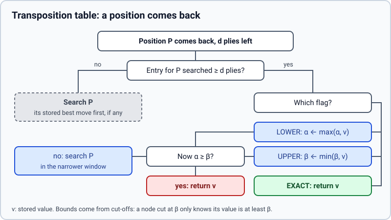

# Transposition table

> **What it is:** A memory of positions already searched, so the search does not analyse the same position twice.
>
> **Read it when:** You want to know why a deeper iteration costs less than it should, or what the option `Hash` does.
>
> **Next:** [Killer moves](killer-moves.md)

## Problem

The same position is reached through different move orders: 1. e4 e5 2. Nf3 and 1. Nf3 e5 2. e4 lead
to the same board. Iterative deepening makes it worse: the search to depth 6 visits again every
position the search to depth 5 already analysed. A plain alpha-beta search treats each arrival as a
new position and pays for the whole subtree again.

## Idea

Keep a table keyed by the position. After searching a node, write down its value, its best move and
how deep it was searched. When the position comes back, read the entry before searching: if it was
searched at least as deep, its value can be reused, either at once or to narrow the window.

## How it works

A value found inside an `(alpha, beta)` window is not always exact. If a move reaches `beta`, the
node is cut and the value is only a **lower bound** (the real value is at least that); if no move
beats `alpha`, it is only an **upper bound**. So every entry carries a flag computed against the
window the node was entered with:

| value found | flag | meaning |
|---|---|---|
| `≤ alpha` | `UPPERBOUND` | the real value is at most this |
| `≥ beta` | `LOWERBOUND` | the real value is at least this |
| between | `EXACT` | this is the value |

When a position comes back with `depth_remaining` no greater than the stored depth:

- `EXACT`: return the stored value without searching.
- `LOWERBOUND`: raise `alpha` to the stored value.
- `UPPERBOUND`: lower `beta` to the stored value.
- If the window is now closed (`alpha ≥ beta`), return the stored value.

A shallower entry is not used for its value, but its best move is still the best guess for ordering
([table move first](tt-move.md)).

**Worked example.** Values are expected scores for the side the search plays for (`1` win, `0` loss).

1. The node P is entered at depth 4 with the window `(0.40, 0.60)`. Its second move returns `0.65`,
   which reaches `beta = 0.60`: cut. The table stores `P → 0.65, LOWERBOUND, depth 4`.
2. Later, P is reached through another move order, at depth 3, with the window `(0.30, 0.50)`. The
   entry is deep enough (4 ≥ 3). The lower bound raises `alpha` to `max(0.30, 0.65) = 0.65`, which
   is above `beta = 0.50`: the window is closed and P returns `0.65` at once. Its subtree, about
   `30³ ≈ 27,000` nodes without pruning, is not searched.
3. P is reached a third time, at depth 4, with the window `(0.60, 0.80)`. The lower bound raises
   `alpha` to `0.65`; the window `(0.65, 0.80)` is still open, so P is searched, but with a narrower
   window that cuts sooner.
4. At depth 5 the entry (depth 4) is too shallow for its value; only its best move is tried first.

<picture>
  <source media="(prefers-color-scheme: dark)" srcset="../img/transposition-table-dark.svg">
  
</picture>

## Implementation

`Table` and `Entry` in `rust/src/search/tt.rs`; probed at the start of `Search::node` and written at
its end (`rust/src/search/node.rs`). The key is `GameState::key()` (`rust/src/board.rs`): a hash of
the position (placement, side to move, castling rights, en passant square) without the move counters, so a position reached by two move orders shares its entry. The table is capped at 2,000,000 entries
(`DEFAULT_MAX_TT_ENTRIES`), oldest dropped first. The UCI option `Hash` (megabytes) sizes only the
shared table of several threads; with one thread it has no effect.
Three guards make the shared key safe:

- **Mates by distance from the node.** A mate is stored as `value ± ply·eps` (`for_table`) and read back
  for the ply of the new visit (`at_ply`), so a mate found at ply 7 and read at ply 6 keeps its true
  distance. Evaluations are clipped to `0.01 .. 0.99` and a mate with `eps = 0.0001` per ply stays outside
  that range, so what lies outside is a mate.
- **Fifty-move clock.** If `halfmoves + depth_remaining ≥ 100` the value could depend on the clock: the entry
  neither cuts nor is stored, and still gives its move. (Test: `an_entry_that_the_fifty_move_clock_could_change_is_not_stored`.)
- **Repetition.** With a repeated position in the history (`GameState::has_repeated`) the table is not
  asked, so the draw by repetition is found by the terminal check. A value computed under a repetition
  inside its subtree can still be reused from another path; that is the usual limit of a table keyed by position.

Nothing is stored after the clock truncates a search, because a truncated value is neither exact nor
a bound. The table lives for the whole game (the iterations of a move and the moves that follow);
values are from the point of view of the colour played, so it is cleared on a new game. Quiescence
does not use it. With several threads the table is the lock-free `SharedTable`
([Lazy SMP](lazy-smp.md)). Test: `rust/src/search/tt.rs` (flags against the window).

## Measured effect

The Elo effect is not measured with the Rust engine; the nodes are. Dropping the move counters from the key lowered the nodes of `uci ttd 9 rust/bench/middlegame.epd` (20 positions, one thread) from 122,806,437 to 117,358,262 (-4.4 %, table hits 3.9 % to 4.8 % of probes); a table of 2,000,000 entries instead of 500,000 (`TTD_ENTRIES=2000000`, the same command) lowered them to 113,050,947 (-3.7 %), table hits to 5.2 % of probes, and no search overwrote another position; 8,000,000 gave the same nodes (peak memory 173 MB in both). Figures taken with the earlier Python engine have no reproducible source today and are not quoted. The table is warm from the previous moves in a game, which a per-position measurement does not cover.

## Status

Adopted; part of the reference search since the first commit (2026-10-16). Size cap and no store after
truncation since `1ee37d6`. Capacity 500,000 to 2,000,000 entries and key without move counters, mates relative to the node and the fifty-move and repetition guards since 2026-11-10.
